# Plan, Calculate, and Optimize: Top-Down and Bottom-Up Sales Planning with Plan in Microsoft Fabric

## Introduction

In this lab, you build a complete planning environment in Microsoft Fabric from scratch. You import the Acme Beverages semantic model, create a Fabric SQL database, set up a Plan (preview) app, and configure semantic model and SQL database connections. You then create a planning sheet, explore the Plan interface, set a top-down 2026 Sales Target, build a bottom-up 2026 Sales Plan, and use the Optimizer to find the mix of revenue growth and cost reduction that meets a gross profit target. An optional final part shows how to configure a two-level approval workflow.

Modern financial planning depends on bringing finance and sales together around one governed source of data. Planning directly on top of a Power BI semantic model, with changes stored in a Fabric SQL database, removes disconnected spreadsheets and manual reconciliation. Teams can collaborate with comments, status tracking, and approvals. Built-in tools such as proportional distribution, cell locking, Bulk Edit, and the Optimizer help planners model scenarios quickly and arrive at targets they can defend.

## Scenario

You are a financial planning analyst at Acme Beverages, a global beverage company that sells beer, hard seltzer, and other drinks across North America, APAC, EU, and Latin America. Leadership has asked Finance and Sales to prepare the 2026 plan. Finance will set a top-down revenue target, weighting growth toward the second half of the year. Sales will build a bottom-up plan from 2025 actuals, including an agreed uplift for Summit Lager in North America and a summer promotion for Beer and Hard Seltzer in the EU and Latin America. The CFO has also set a $12.5B gross profit goal, so you must work out how much revenue growth and cost reduction are needed to reach it. Finally, you will route plan changes through Regional Manager and Finance Director approval before the plan is finalized.

## Objectives

By the end of this lab, you will be able to:

- Set up a planning environment by importing the Acme Beverages semantic model, creating a Fabric SQL database, and building a Plan app with semantic model and SQL database connections
- Navigate the Plan interface, including the ribbons, header, Explorer pane, sidebar panels, and footer
- Create a top-down 2026 Target distributed by prior-year weights and apply an H2 skew by locking quarters
- Build a bottom-up 2026 Sales Plan using cell-level adjustments, trend distribution, and Bulk Edit uplifts
- Add inline comments, a Comments column, and a Status column to support row-level collaboration
- Calculate gross profit with a formula column and run the Optimizer to achieve a $12.5B gross profit target

## Prerequisites

- Access to a Microsoft Fabric workspace that meets the requirements in the prerequisites document, with permission to create SQL databases and Plan (preview) items
- The Acme_Beverages.pbix file downloaded from the lab Resources
- Basic familiarity with Power BI semantic models, dimensions, and measures
- Access to Microsoft Teams and a second user account (optional, for the approval workflow and @mention steps)

**Estimated duration:** 60 minutes

---

## Exercise 1: Plan, Calculate, Optimize

In this exercise, you build a complete planning environment for Acme Beverages, set a top-down 2026 Sales Target, build a bottom-up 2026 Sales Plan, run the Optimizer to reach a gross profit target, and optionally configure an approval workflow.

> **Note:** When you name the .pbix file and the Fabric SQL database, add your name as a suffix, for example **Acme_Beverages_JohnS** or **Acme_Beverages_JS**. A unique identifier is added automatically to connection names. This keeps your items separate in shared workspaces, prevents naming conflicts and makes your items easier to find and troubleshoot.

### Task 1: Create your training workspace

In this task, you sign in to Microsoft Fabric and create a workspace on a Fabric capacity. This workspace holds the semantic model, SQL database and Plan app that you use in the rest of the lab.

1. Open a browser and navigate to the following URL:

   ```text
   https://app.fabric.microsoft.com/
   ```

2. Sign in with your credentials.

   The Fabric **Home** page opens and shows **Welcome to Fabric**.

   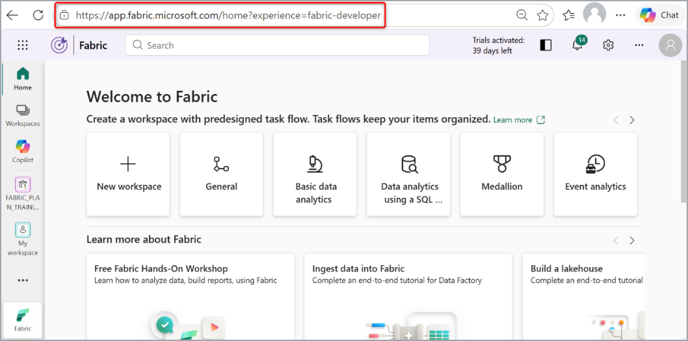

3. On the **Home** page, under **Welcome to Fabric**, select **New workspace**.

   The **Create a workspace** pane opens.

   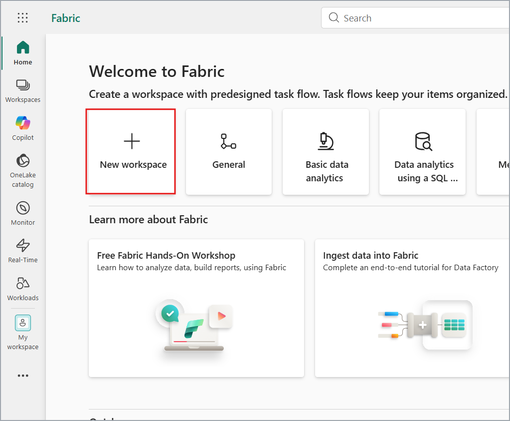

4. In the **Name** field, enter the following:

   ```text
   Fabricplan-Day176895
   ```

   The message **This name is available** appears under the field.

5. Select **Advanced** to expand the advanced settings.

   The **Contact list** field shows your user as **(Owner)**.

   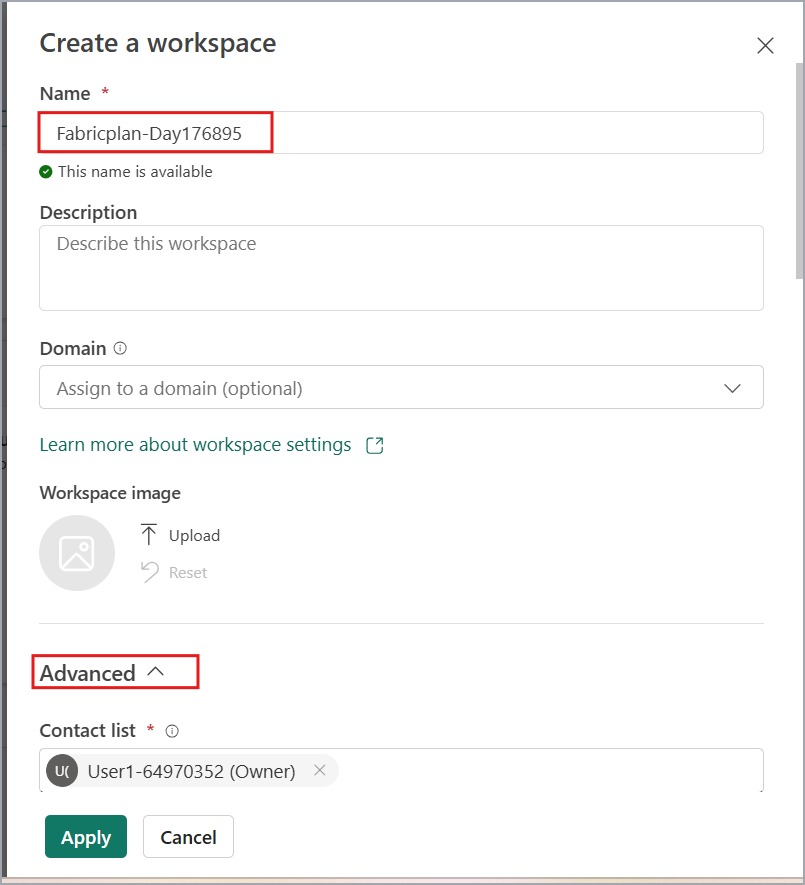

6. Scroll down and under the workspace type options, select **Fabric**.

7. In the **Details** list, select **fabriccapacity64970352 - West US 2**.

8. Under **Semantic model storage format**, confirm that **Small semantic model storage format** is selected.

9. Select **Apply**.

   The workspace is created and opens.

   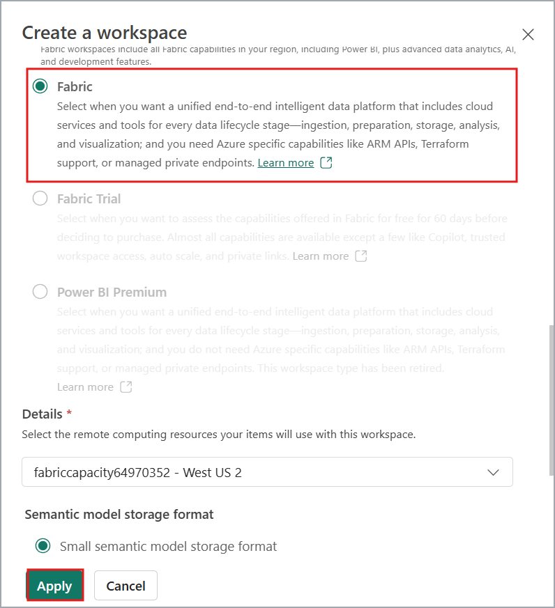

### Task 2: Create a folder for the lab

In this task, you create a folder in the workspace to hold the items for this lab. The folder keeps your Plan items together and separate from other content in the workspace.

1. In the left navigation pane, select the **Fabricplan-Day176895** workspace.

   The workspace opens and shows **Choose from predesigned task flows or add a task to build one**.

   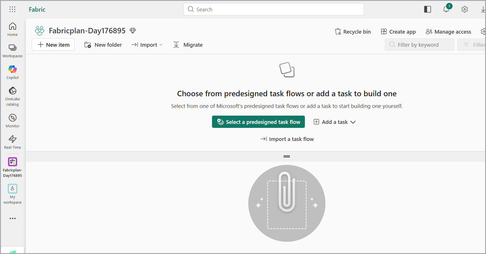

2. On the workspace toolbar, select **New folder**.

   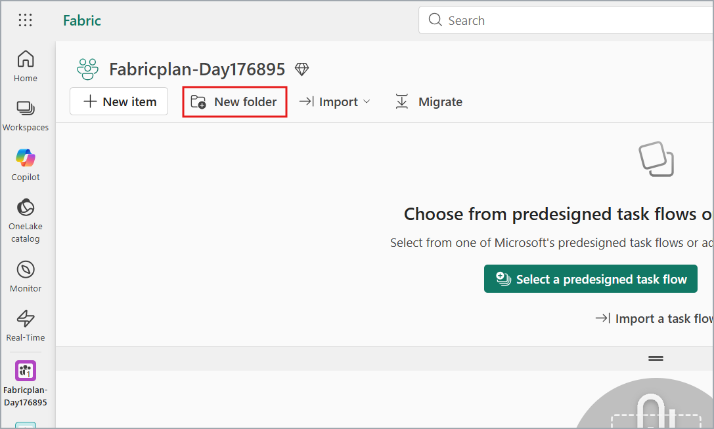

   The **New folder** dialog opens.

3. In the **New folder** dialog, enter the following folder name:

   ```text
   Day1-Plan
   ```

   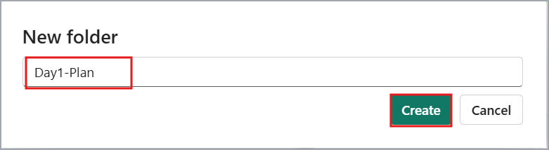

4. Select **Create**.

   The **Day1-Plan** folder appears in the workspace item list with the **Type** set to **Folder**.

   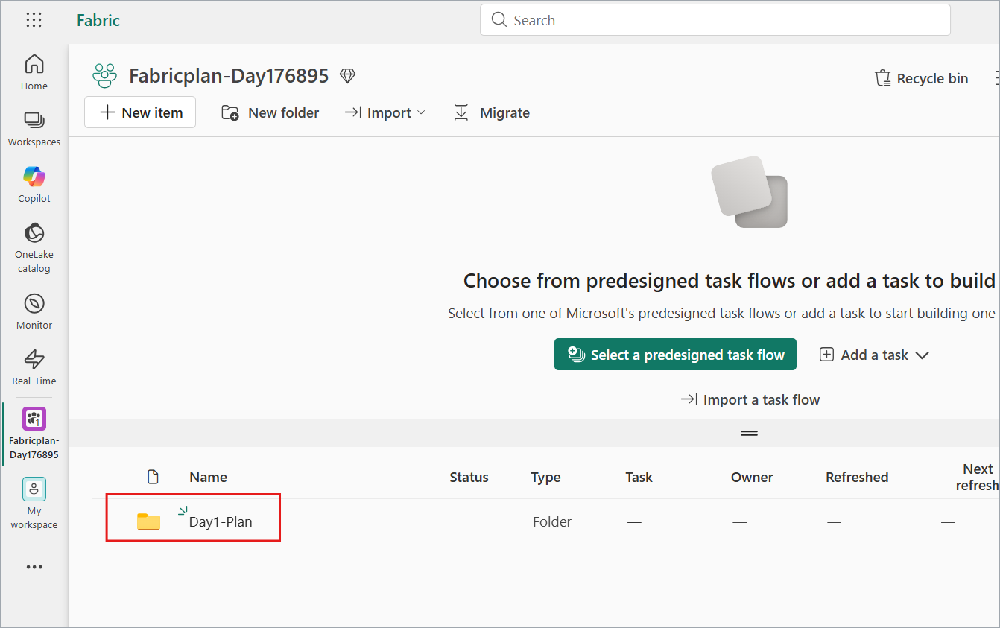

### Task 3: Import the PBIX file

In this task, you import the **ACME Beverages** Power BI file into the **Day1-Plan** folder. The file contains the semantic model and report that the planning exercises use.

1. In the **Fabricplan-Day176895** workspace, select the **Day1-Plan** folder.

   The folder opens and the breadcrumb shows **Fabricplan-Day176895** > **Day1-Plan**.

2. On the workspace toolbar, select **Import** > **Report, Paginated Report or Workbook** > **From this computer**.

   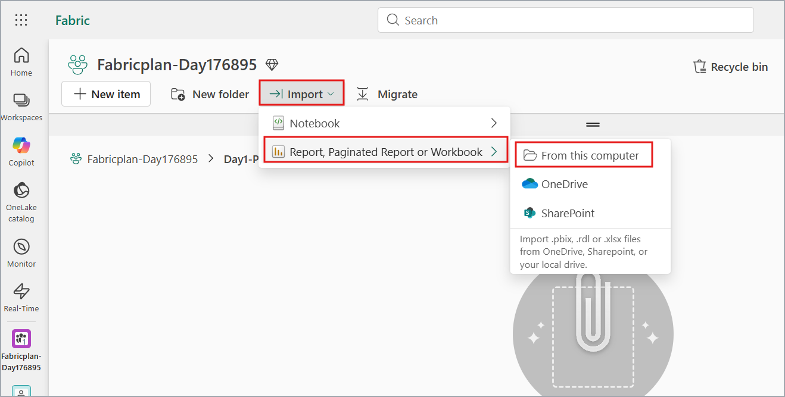

   The **Open** dialog opens.

3. In the **Open** dialog, browse to the folder where you saved the file you downloaded from **Resources**, for example **Local Disk (C:)** > **Labfiles**.

4. Select the **ACME Beverages** file.

   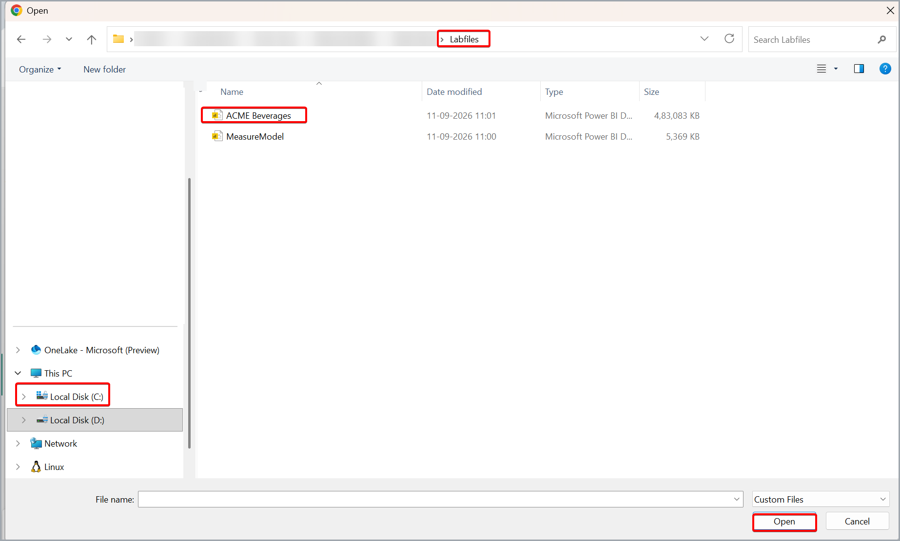

   > **Note:** If you saved the file to another location, such as a OneDrive folder, browse to that folder and select the **ACME Beverages** file there.

   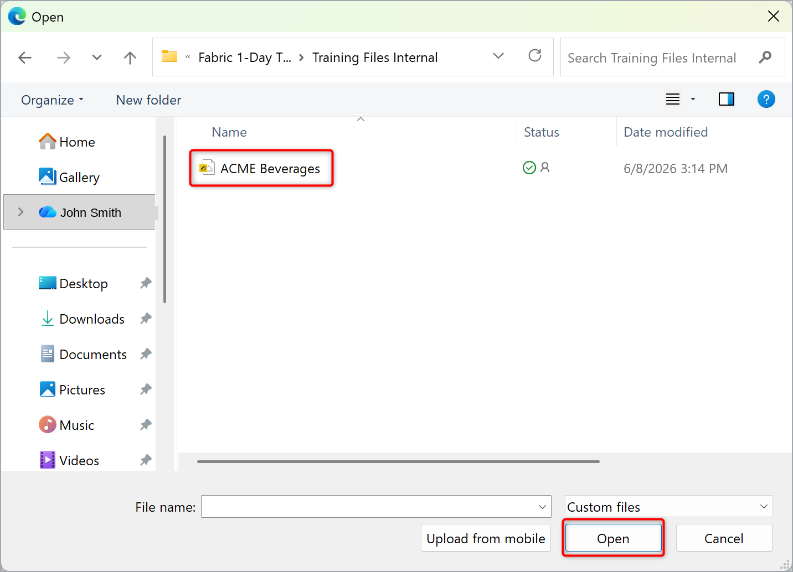

5. Select **Open**.

   The upload starts and the **Uploading ACME Beverages.pbix** notification appears in the upper-right corner of the workspace.

   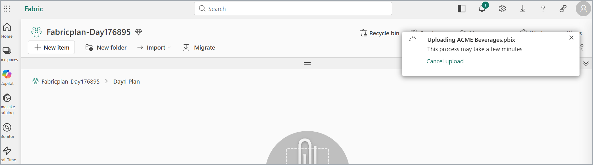

   > **Note:** The file is large, so the upload can take a few minutes. Don't select **Cancel upload** while it is in progress.

6. Verify that the **ACME Beverages** report and the **ACME Beverages** semantic model appear in the **Day1-Plan** folder.

   The **Type** column shows **Report** for one item and **Semantic model** for the other.

   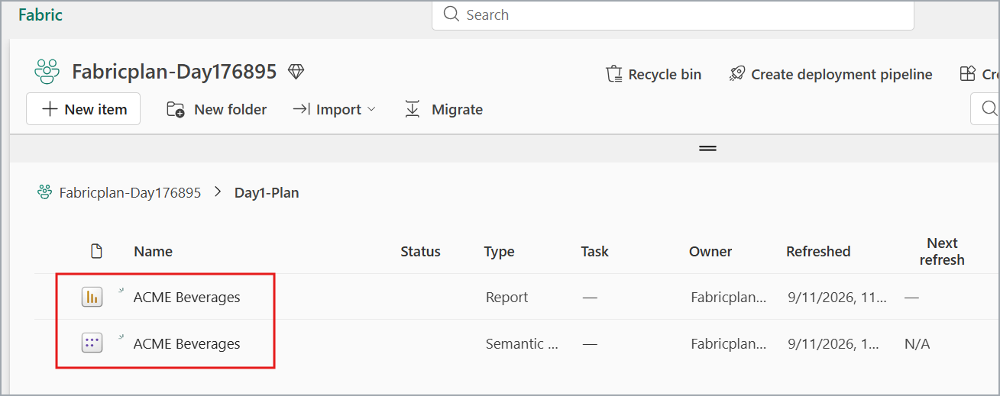

   > **Note:** A warning such as **Refresh failed due to missing data source credentials**, or a message that the data source connection cannot be validated, can appear. You can ignore it. The imported .pbix file already contains the data, so you can still map rows, columns, and values to your planning sheet.

### Task 4: Create a SQL database

In this task, you create a SQL database in the workspace. The database stores the planning data that you work with in the later exercises.

1. In the **Fabricplan-Day176895** workspace, select **+ New item**.

   The **New item** panel opens.

2. In the search box of the **New item** panel, enter the following:

   ```text
   sql
   ```

3. Select **SQL database**.

   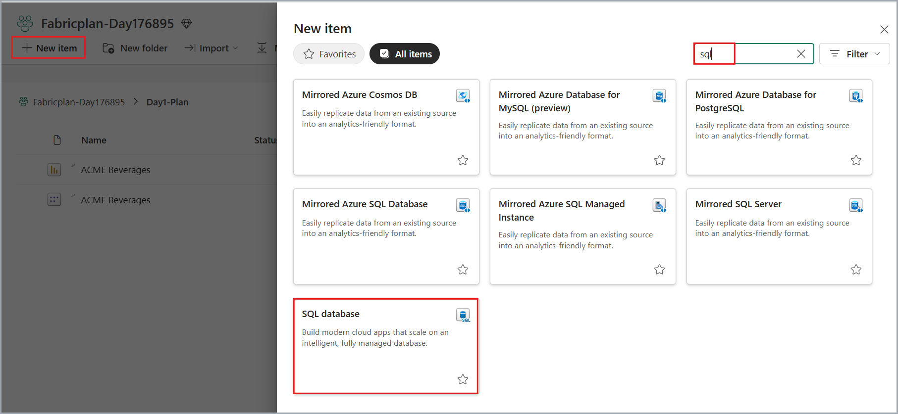

   The **New SQL database** dialog opens.

4. In the **Name** field, enter the following and add your name as a suffix, for example **Acme_Beverages6857**:

   ```text
   Acme_Beverages
   ```

   > **Note:** The suffix keeps the database name unique. Use this name wherever the lab refers to your SQL database.

5. Select **Create**.

   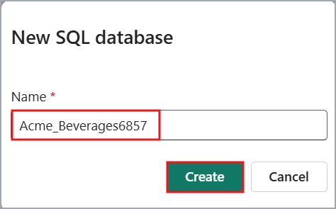

   The database is created and opens. The **Explorer** pane shows your database, and the **Build your database** page appears.

   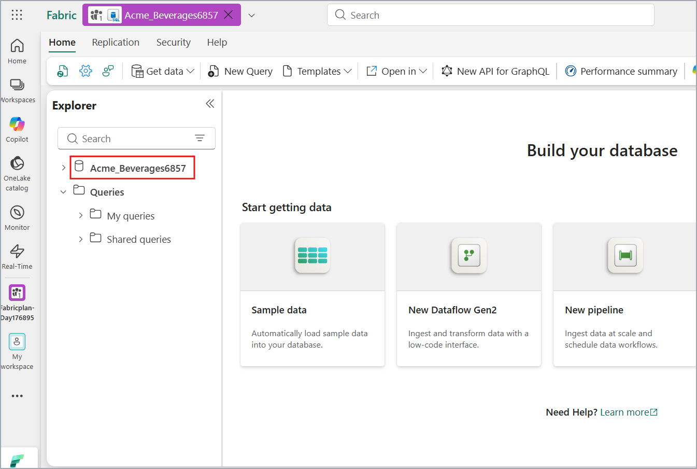

6. In the left navigation pane, select the **Fabricplan-Day176895** workspace icon.

   The workspace pane opens. Under **Fabricplan-Day176895** > **Day1-Plan**, the **Acme_Beverages6857** SQL database appears, with its **Acme_Beverages6857** SQL analytics endpoint nested under it.

   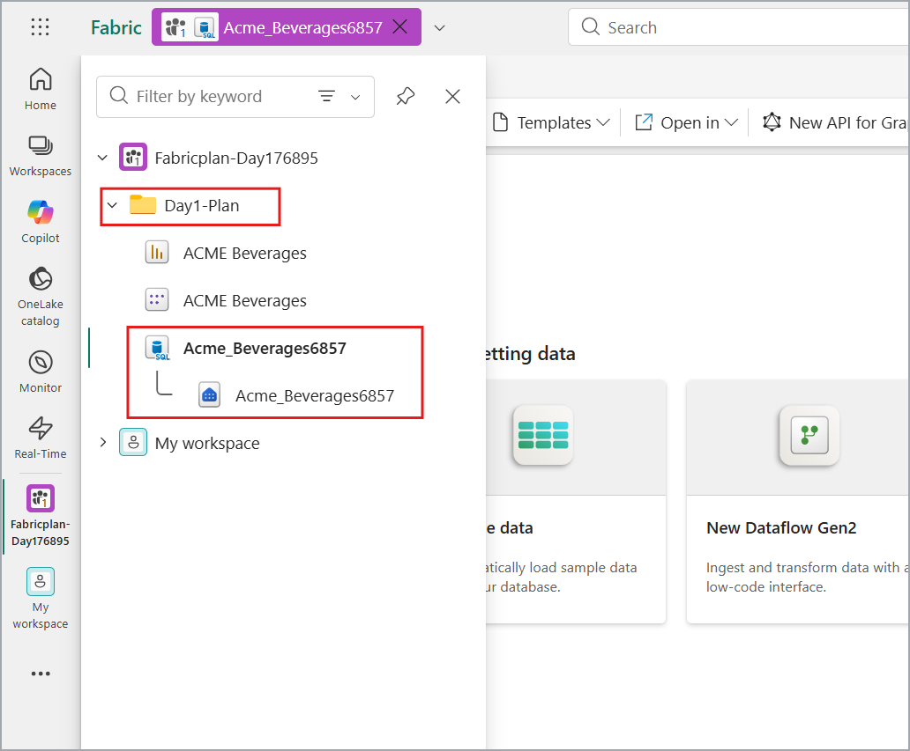

7. In the workspace pane, select **Fabricplan-Day176895**.

   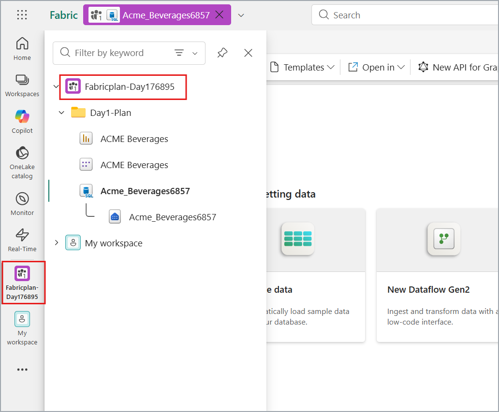

   The **Fabricplan-Day176895** workspace opens.

8. In the workspace item list, select the **Day1-Plan** folder.

   The breadcrumb shows **Fabricplan-Day176895** > **Day1-Plan**. The folder lists the **ACME Beverages** report, the **ACME Beverages** semantic model, the **Acme_Beverages6857** SQL database, and the **Acme_Beverages6857** SQL analytics endpoint.

   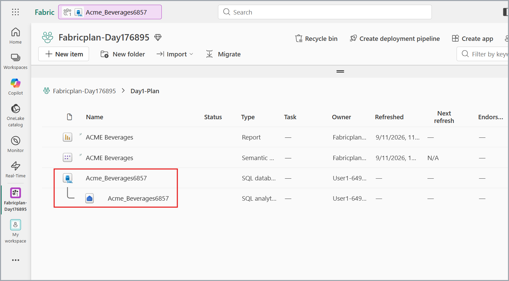

### Task 5: Create a new Plan app

In this task, you create a Plan app in the **Day1-Plan** folder. The Plan app is where you build the planning, PowerTable and intelligence sheets for the Acme Beverages 2026 plan.

1. In the **Day1-Plan** folder, select **+ New item**.

   The **New item** pane opens.

2. In the **New item** pane, in the search box, enter the following:

   ```text
   plan
   ```

3. Select the **Plan** tile.

   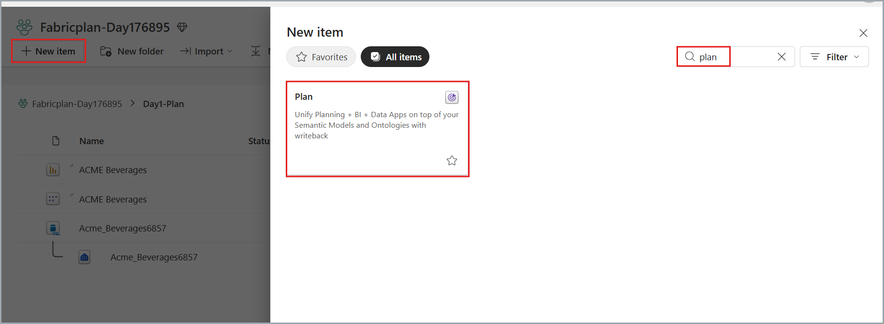

   The **New Plan** dialog opens.

4. In the **Name** field, enter the following:

   ```text
   Acme_Beverages_Plan
   ```

   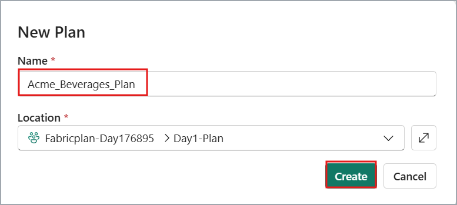

5. Confirm that **Location** shows **Fabricplan-Day176895** > **Day1-Plan**.

6. Select **Create**.

   The **Acme_Beverages_Plan** app opens to the **How Would You Like To Get Started?** screen. The **Get data** section lists **Semantic Model** and **Excel / CSV**. The **Create new sheet** section lists **Planning**, **PowerTable** and **Intelligence**.

   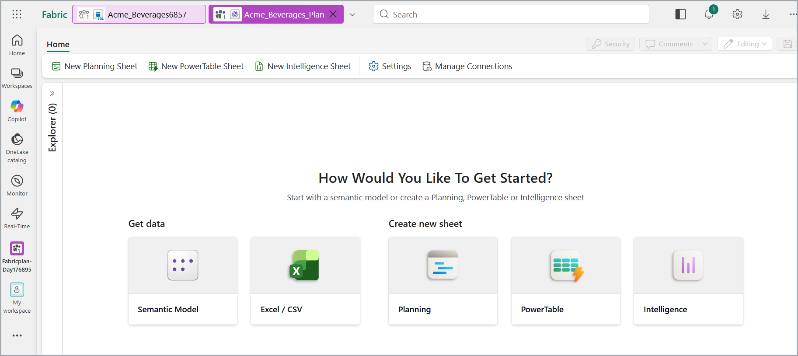

### Task 6: Connect to the semantic model

In this task, you create a shared cloud connection and use it to connect the Plan app to a semantic model. Planning and BI sheets need this connection to read and use semantic model data.

1. On the **How Would You Like To Get Started?** screen, under **Get data**, select **Semantic Model**.

   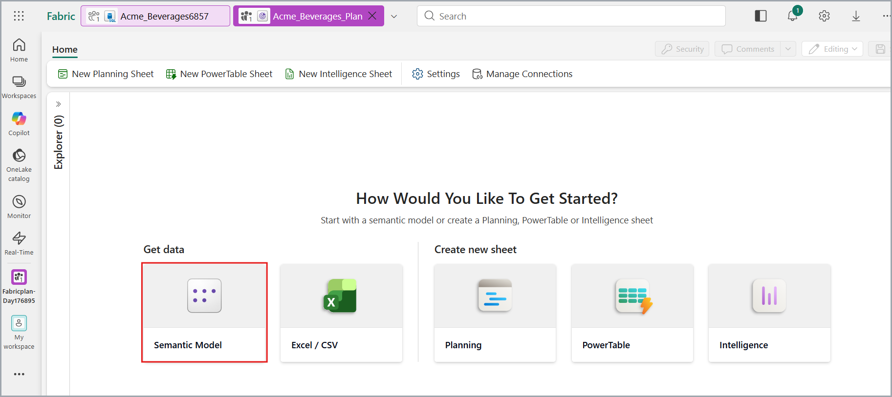

   The **Select Semantic Model Connection** dialog opens.

2. In the **Select Semantic Model Connection** dialog, next to **Select a Connection**, select **+ Create Connection**.

   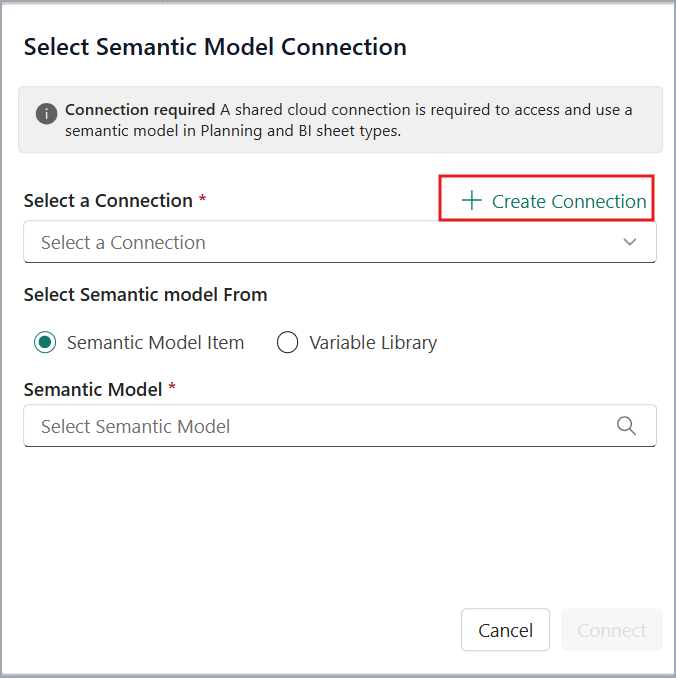

   The **Create New Connection** dialog opens.

3. Under **Connection credentials**, confirm that **Connection** shows **Create new connection**.

4. In the **Connection name** field, enter the following:

   ```text
   Acme_Beverages
   ```

5. Confirm that **Authentication kind** shows **Organizational account**.

6. Under **You are not signed in. Please sign in.**, select **Sign in**.

   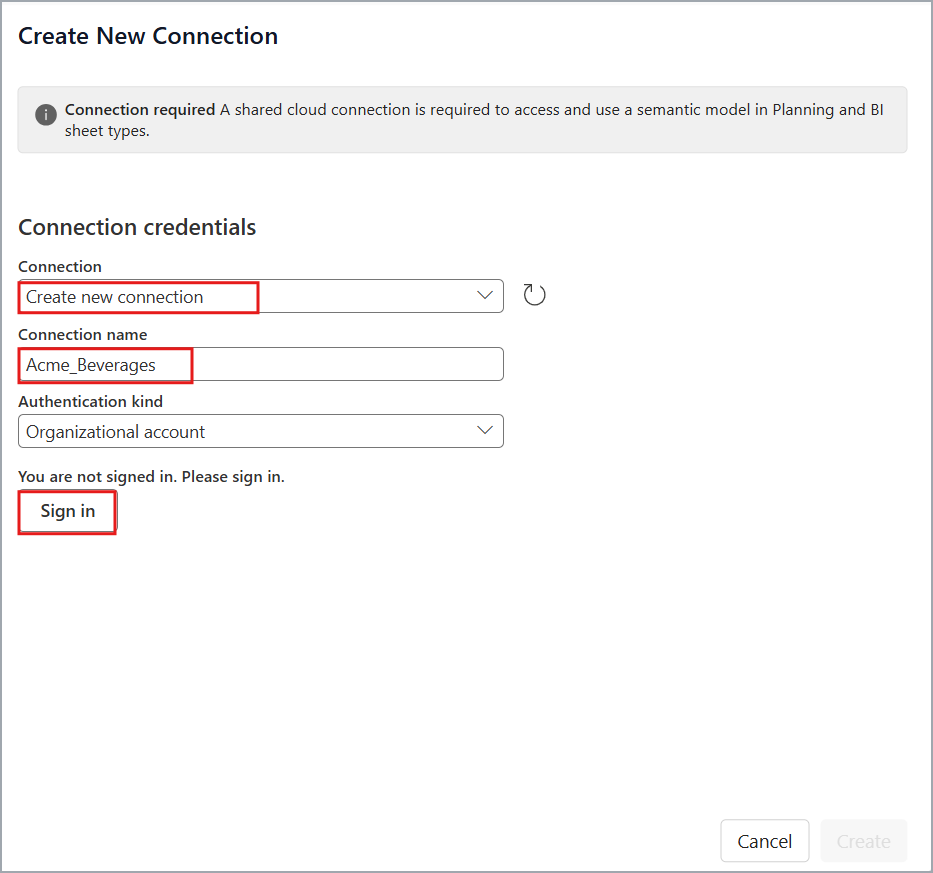

   The Microsoft **Pick an account** window opens.

7. In the **Pick an account** window, select your lab user account.

   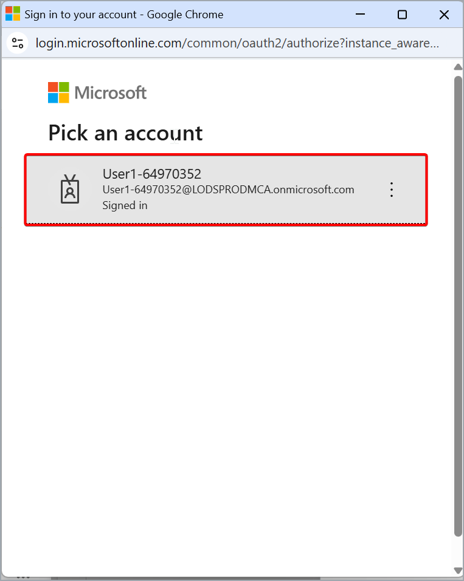

   The sign-in window closes, and you are signed in to the connection.

8. In the **Create New Connection** dialog, select **Create**.

   The connection is created and the **Create New Connection** dialog closes.

9. Verify that the connection you created appears in the **Connection** list of the **Create New Connection** dialog as **Acme_Beverages User1-64970352**.

   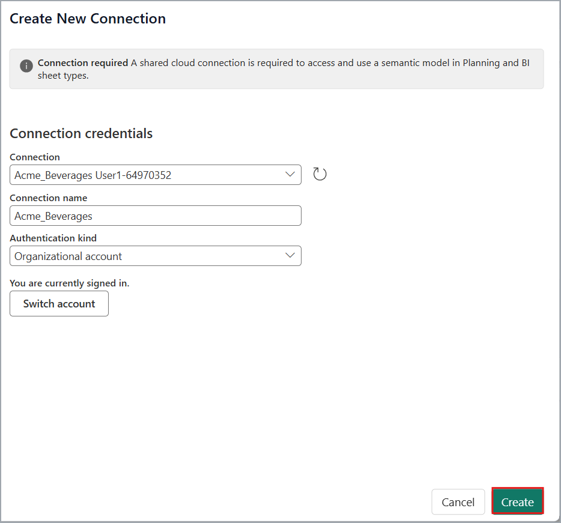

   > **Note:** The number after **User1-** matches your lab user account, so your connection name can show a different number.

10. In the **Select Semantic Model Connection** dialog, confirm that **Select a Connection** shows **Acme_Beverages User1-64970352**.

11. Under **Select Semantic model From**, confirm that **Semantic Model Item** is selected.

12. Select the **Semantic Model** field.

   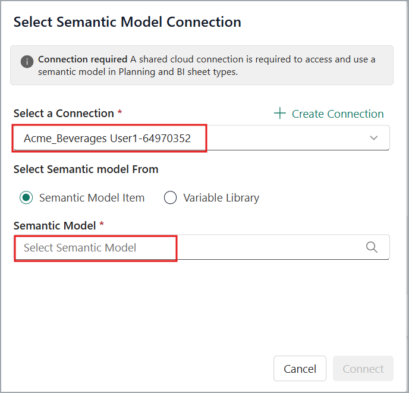

   The **OneLake catalog** opens on the **Choose a semantic model** page.

13. In the semantic model list, select **ACME Beverages**.

14. Select **Add**.

   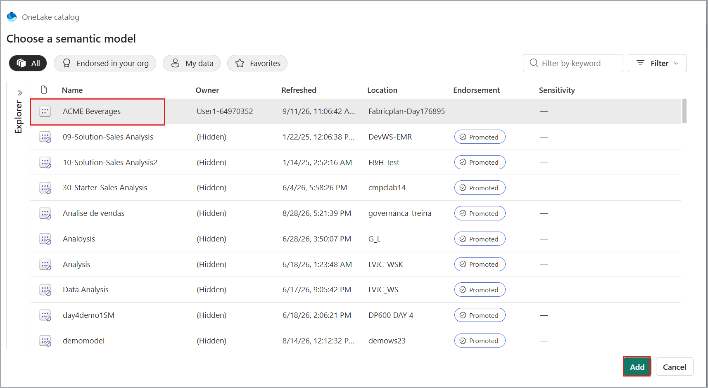

   The **OneLake catalog** closes, and the **Semantic Model** field shows **ACME Beverages**.

15. In the **Select Semantic Model Connection** dialog, confirm that **Select a Connection** shows **Acme_Beverages User1-64970352** and **Semantic Model** shows **ACME Beverages**.

16. Select **Connect**.

   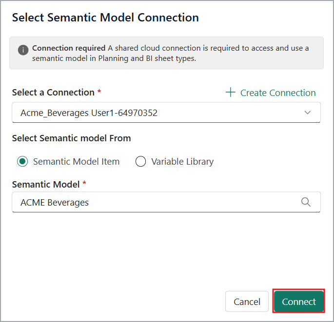

   The Plan app connects to the **ACME Beverages** semantic model.

17. In the right pane, select the **Data** icon.

18. On the **Data** pane, expand **Semantic Model** and verify that the following tables appear: **Measure Table**, **Dim Countries**, **Dim Customers**, **Dim Date**, **Dim Regions**, **Dim skus**, **Fact Plan Forecast**, **Fact Transactions**, and **P&L Data**.

   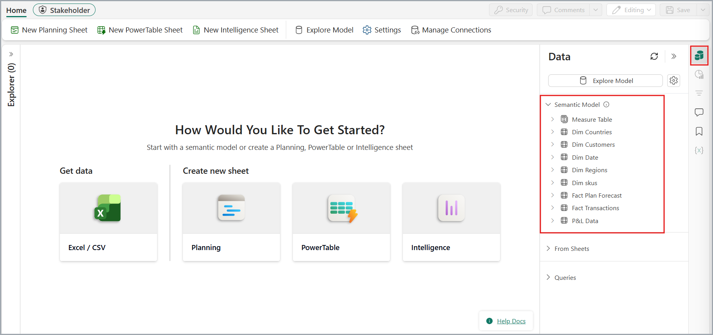

   The dimension, measure, date, and fact tables from the **ACME Beverages** semantic model are available for planning.

### Task 7: Create a new Planning sheet

In this task, you create a Planning sheet in the Plan app. You use this sheet to build the 2026 sales plan from the **ACME Beverages** semantic model data.

1. On the launch screen, in the **Home** ribbon, select **New Planning Sheet**.

   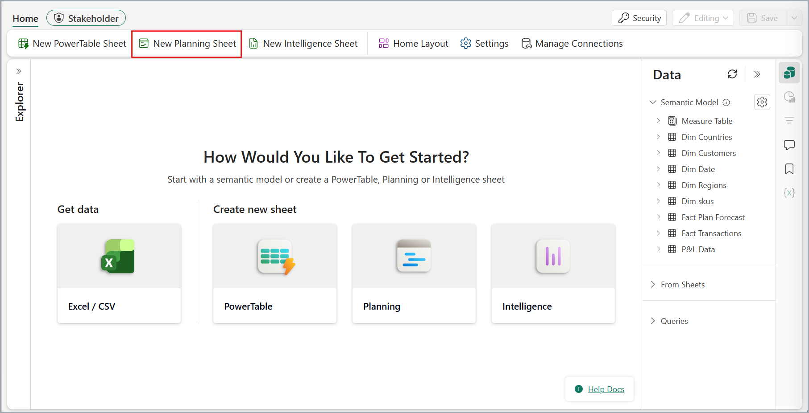

   The **New Planning Sheet** dialog opens.

2. In the **Name** field, enter the following:

   ```text
   Plan Intro
   ```

   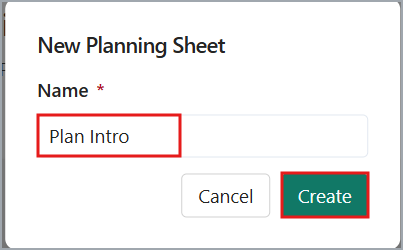

3. Select **Create**.

   A new Planning sheet named **Plan Intro** opens.

### Task 8: Assign dimensions to Rows

In this task, you add the region and product dimensions to the rows of the Planning sheet. These fields set the levels at which you build and review the 2026 sales plan.

1. On the **Data** pane, expand **Semantic Model** > **Dim Regions**.

2. Drag **Region Name** into the **Rows** well in the **Fields** pane.

3. On the **Data** pane, expand **Dim skus**.

4. Drag **Category** into the **Rows** well, below **Region Name**.

5. Drag **Brand** into the **Rows** well, below **Category**.

   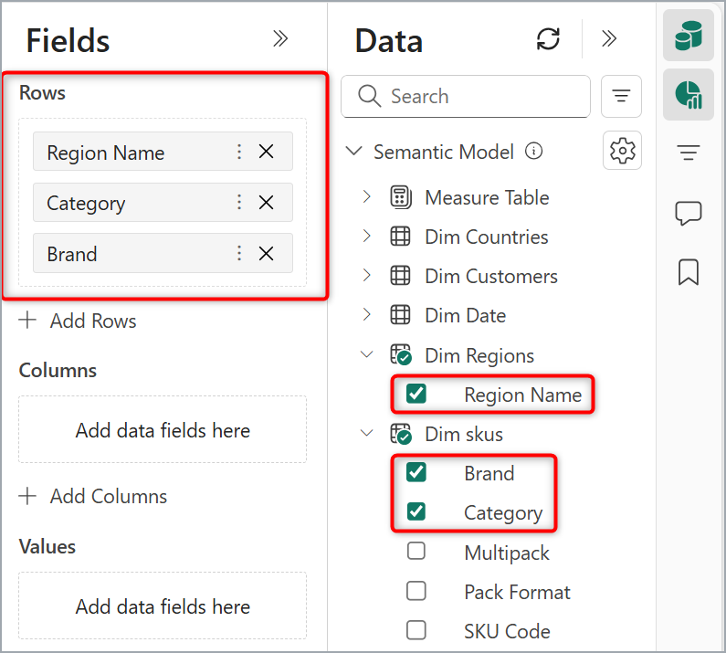

   The **Rows** well lists **Region Name**, **Category**, and **Brand**, and the selected fields show a check mark on the **Data** pane.

6. Verify that the Planning sheet grid lists each region, starting with **All** and **APAC**, with the brands and categories nested under it.

   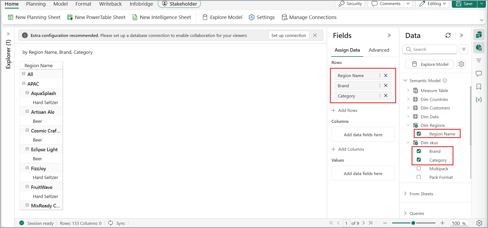

   The status bar shows **Session ready** and the row count for the grid.

### Task 9: Assign the date hierarchy to Columns

In this task, you add the date hierarchy to the columns of the Planning sheet. This lets you plan and compare values by year, quarter, and month.

1. On the **Data** pane, under **Semantic Model**, expand **Dim Date**.

2. Drag **Date Hierarchy** into the **Columns** well in the **Fields** pane.

   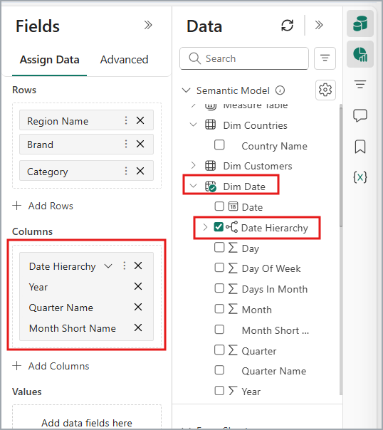

   The **Columns** well shows **Date Hierarchy** with the levels **Year**, **Quarter Name**, and **Month Short Name**.

3. Verify that the Planning sheet grid shows a **Year** column header above the **Region Name** rows.

   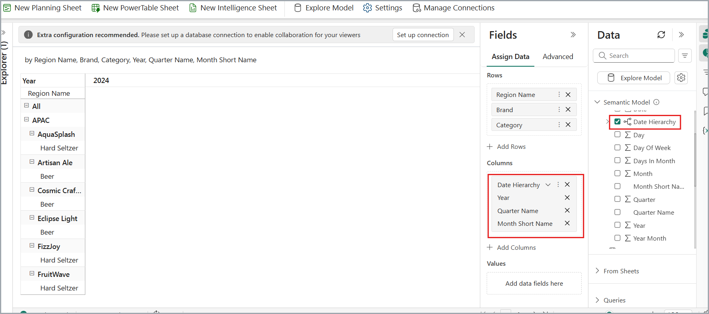

   The sheet title updates to **by Region Name, Brand, Category, Year, Quarter Name, Month Short Name**.

### Task 10: Assign measures to Values

In this task, you add the 2025 Gross Revenue measure to the values of the Planning sheet. This measure gives you the 2025 actuals that the bottom-up plan is built on.

1. On the **Data** pane, under **Semantic Model** > **Measure Table**, expand the **Revenue** folder.

2. Drag **2025 Gross Revenue** into the **Values** well in the **Fields** pane.

   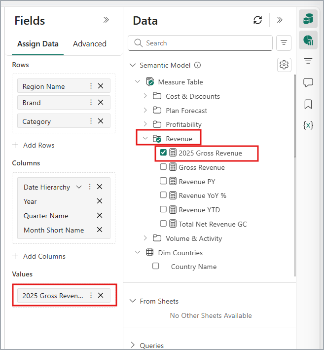

   The **Values** well shows **2025 Gross Revenue**, and the measure shows a check mark on the **Data** pane.

3. Verify that the Planning sheet grid shows the **2025 Gross Revenue** column, labeled **in Millions**, under the **2025** year header.

   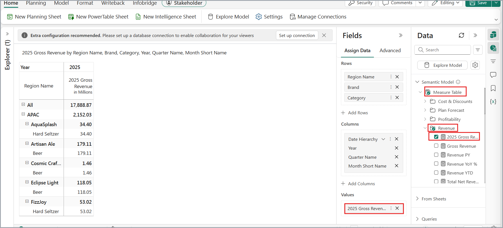

   The grid shows **17,888.87** for **All** and **2,152.03** for **APAC**.

### Task 11: Confirm your matrix is ready

In this task, you confirm that the Planning sheet matrix is complete and adjust the column width for readability. The matrix shows 2025 Gross Revenue by region, brand, and category across the date hierarchy.

1. Verify that the sheet title reads **2025 Gross Revenue by Region Name, Brand, Category, Year, Quarter Name, Month Short Name**.

2. Hover over the column header border between **Region Name** and **2025 Gross Revenue** until the sizing handle appears.

   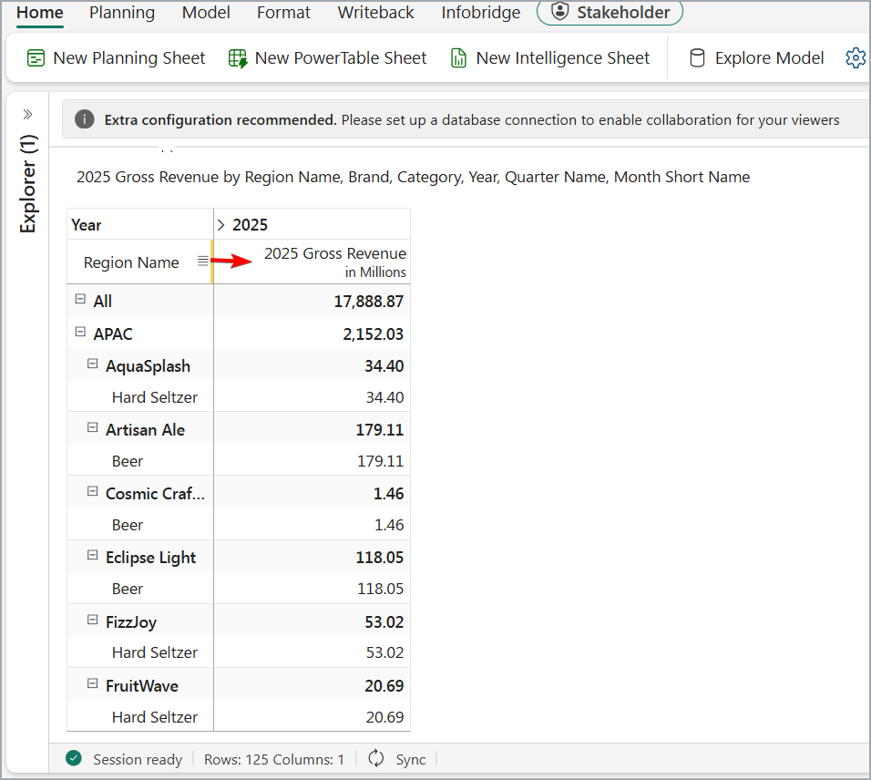

3. Drag the sizing handle to adjust the column width.

   The column resizes, and the status bar shows **Session ready** with **Rows: 125 Columns: 1**.

### Task 12: Set up a database connection for collaboration

In this task, you create a Fabric SQL connection for the plan. Workspace **Viewers** need this connection to collaborate in Reading View.

1. In the **Extra configuration recommended** banner above the Planning sheet, select **Set up connection**.

   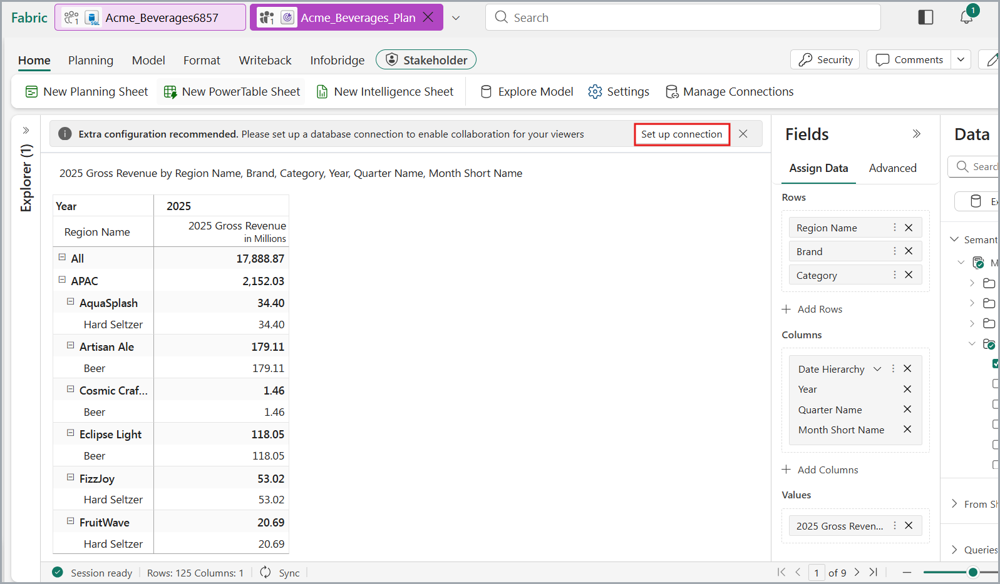

   The **Select Fabric SQL Connection** dialog opens.

2. In the **Select Fabric SQL Connection** dialog, select **+ Create Connection**.

   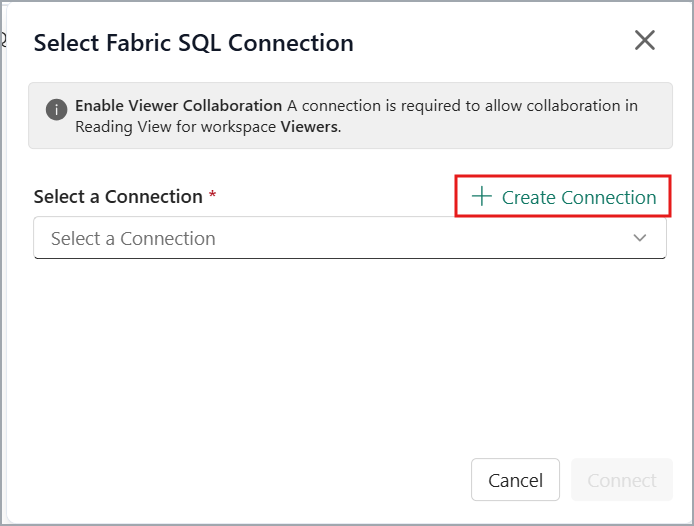

   The **Create New Connection** pane opens.

3. Under **Connection credentials**, select the **Connection** drop-down.

4. Select **Create new connection**.

5. In the **Connection name** field, enter the following:

   ```text
   Acme_Beverages
   ```

6. Verify that **Authentication kind** is set to **Organizational account** and that the **You are currently signed in as** section shows your lab user account.

7. Select **Create**.

   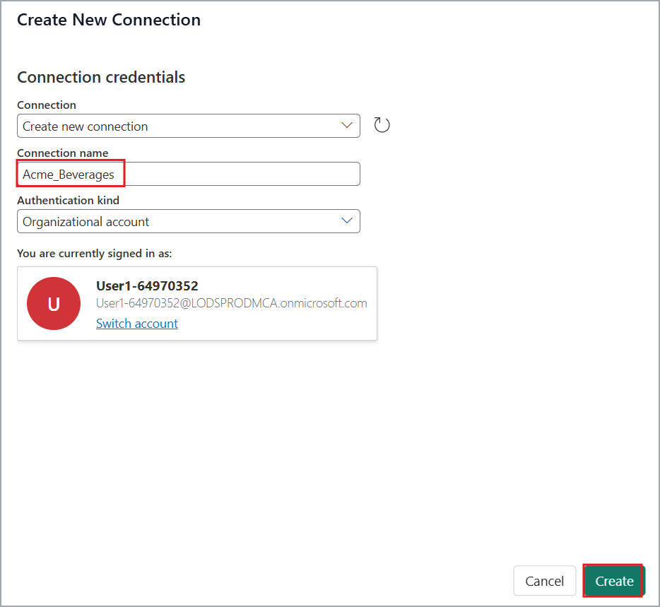

   Fabric creates the connection and returns you to the **Select Fabric SQL Connection** dialog. Your account identifier is added to the connection name automatically.

8. In the **Select a Connection** drop-down, verify that the new connection is selected. Its name starts with **Acme_Beverages** and is followed by your user identifier.

   > **Note:** The user identifier and the number in parentheses after the connection name depend on your lab account. They might differ from the example.

9. Select **Connect**.

   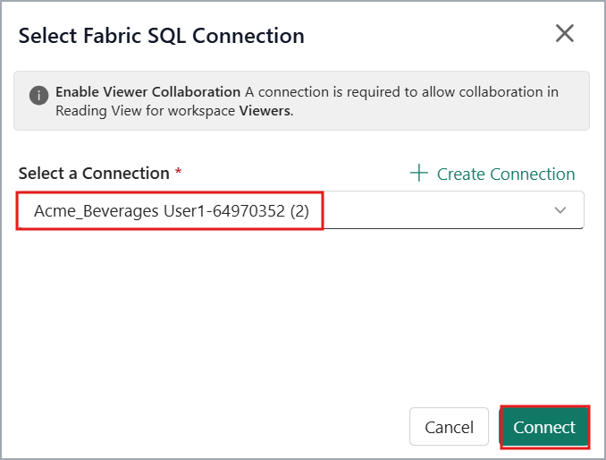

   The dialog closes and the connection is set up for viewer collaboration.

10. In the upper-right corner, open the **Notifications** pane and verify that it shows the message **Connection saved successfully!**

   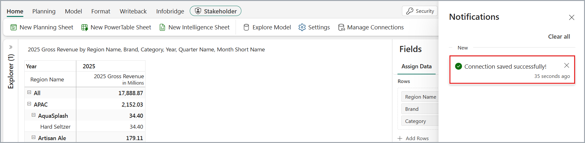

   The SQL connection is established, and the Plan app is ready for collaboration.

## Exercise 2: Explore the interface

In this exercise, you learn the ribbons, header, explorer pane, sidebar panels, and footer so that you can move around the planning environment confidently before you enter plan data.

### Task 1: Explore the ribbons

In this task, you switch to the full ribbon view and review what each ribbon contains. Knowing where each command is helps you work faster in the later planning exercises.

1. Select the **Planning** tab.

2. At the right end of the ribbon, select the down arrow to switch to the full ribbon view.

   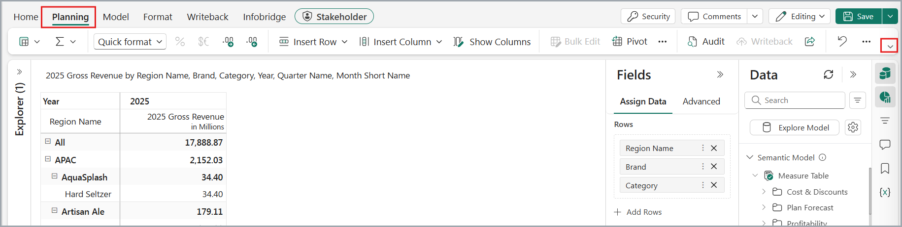

   The ribbon expands and shows labeled command groups, such as **Layout & Number**, **Rows & Columns**, **Tools**, **Actions**, and **Default**.

   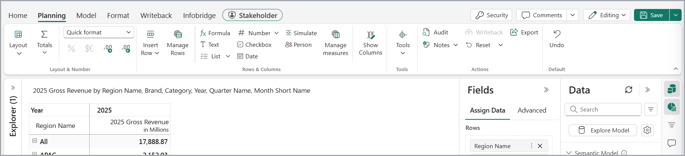

3. Select the **Home** tab and review its commands.

   The **Home** ribbon contains **New Planning Sheet**, **New PowerTable Sheet**, and **New Intelligence Sheet**, which you use to add new sheets. It also contains **Explore Model**, **Settings**, and **Manage Connections**.

4. Select the **Planning** tab and review its commands.

   The **Planning** ribbon contains layout options (**Layout**, **Totals**), formatting options (**Quick format**, percentage, currency, and decimal buttons), row and column commands (**Insert Row**, **Manage Rows**, **Formula**, **Text**, **List**, **Number**, **Checkbox**, **Date**, **Simulate**, **Person**, **Manage measures**, **Show Columns**), **Tools**, and actions such as **Audit**, **Notes**, **Writeback**, **Reset**, **Export**, and **Undo**. In the compact ribbon view, the **Planning** ribbon also shows **Bulk Edit** and **Pivot**.

   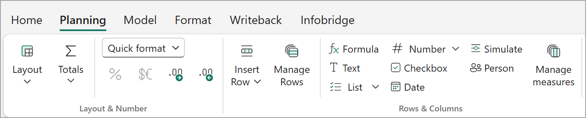

5. Select the **Model** tab and review its commands.

   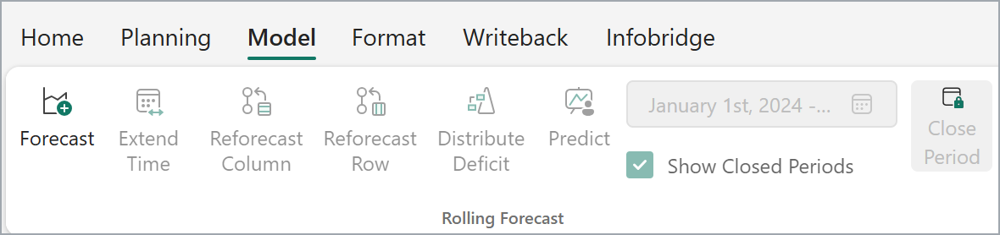

   The **Model** ribbon contains commands for forecasts, scenarios, driver-based models, and cubes. The **Rolling Forecast** group contains **Forecast**, **Extend Time**, **Reforecast Column**, **Reforecast Row**, **Distribute Deficit**, and **Predict**, a date range field that starts with **January 1st, 2024**, the **Show Closed Periods** check box, and **Close Period**. Until you create a forecast, **Forecast** is the only available command in this group.

6. Select the **Format** tab and review its commands.

   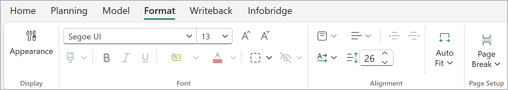

   The **Format** ribbon contains conditional formatting and semantic formatting options. It is organized into the following groups:

   - **Display**: **Appearance**.
   - **Font**: font name (**Segoe UI**), font size (**13**), increase and decrease font size, bold, italic, underline, fill color, font color, and borders.
   - **Alignment**: text alignment, indent, and row height (**26**) options, and **Auto Fit**.
   - **Page Setup**: **Page Break**.

7. Select the **Writeback** tab and review its commands.

   

   The **Writeback** ribbon contains commands to write data to destinations, manage settings, and view logs. It is organized into the following groups:

   - **Writeback**: **Writeback**.
   - **Destination**: **Add destination** and **Manage**.
   - **Data**: **WB Type**, **Filter**, and **Mapping**.
   - **Logs**: **Logs**.
   - **General**: **Settings**.

   **Writeback**, **Manage**, and **Logs** appear dimmed in the ribbon.

### Task 2: Explore the header

In this task, you open each of the four settings in the header. You start with **Security**, where you set up read and write access for data input, scenarios, comments, and data writeback.

1. In the header, select **Security**.

   

   The **Security** pane opens and lists the **Data Input**, **Forecast**, **Scenario**, **Comments**, and **Writeback** categories. **Data Input** is selected and shows the message **No data input columns available.**

2. On the **Security** page, under **Roles**, select **Users**.

   

   The **Users** view opens with the message **No Users Available** and an **Assign Role** button. You use **Assign Role** to add users and map them to roles that manage access and security permissions.

3. Under **Roles**, select **Roles**.

   

   The **Roles (1)** list opens with the **Item Baseline** role, labeled **System Default**. The role settings are organized into the **General**, **Planning**, **PowerTable**, **Intelligence**, and **Reading View Customization** tabs. On the **General** tab, under **Select Sheets**, the **Plan Intro** sheet has **Visible** turned on and **Read Only** turned off. By default, all sheets are accessible to this role. You can configure individual sheets to restrict access or make them read-only, and you can select **Add Roles** to create more roles.

4. Select **Back to Sheet**.

   

   The **Security** page closes and the sheet opens again.

5. In the toolbar, select the **Comments** dropdown arrow.

   

   The menu opens and lists **Add new comment**, **View all comments**, and **Settings**. You use **Comments** to add comments to the plan and view all existing comments. **Add new comment** stays unavailable until you save your changes.

6. In the toolbar, select the **Editing** dropdown.

   

   The menu lists two views. **Editing** (**Make any changes**) is selected by default. **Reading** (**View the file, but make no changes**) opens the sheet in read-only mode. Use this menu to switch between Editing view and Reading view.

7. In the toolbar, select **Save**.

   

   Your changes to the sheet are saved.

   > **Note:** If the sheet has unsaved changes, pointing to **Comments** shows the message **Please save your changes to use Comments.** Select **Save** before you work with comments.

8. Select the **Save** dropdown arrow.

   

   The menu shows **Discard all settings**. This option removes all unsaved changes and keeps the last saved version of the sheet.

   > **Note:** Do not select **Discard all settings** now. Select it only when you want to remove all unsaved changes.

9. Next to **Explorer (1)**, select the collapse arrow (**«**).

   

   The **Explorer** pane collapses. Select the arrow again to expand the pane. In the **Explorer** pane, you select **+ New Sheet** to add a sheet, use the **Search** box to find sheets, and select a sheet in the list, such as **Plan Intro**, to open it.

10. In the sidebar on the right, select the **Data** icon.

    

    The **Data** panel opens. The sidebar has five panels, and you use the **Data** panel to manage data from the semantic model, sheets, or queries. The panel has three sections:

    - **Semantic Model**: lists the model tables **Measure Table**, **Dim Countries**, **Dim Customers**, **Dim Date**, **Dim Regions**, **Dim skus**, **Fact Plan Forecast**, and **Fact Transactions**.
    - **From Sheets**: lists data that comes from sheets.
    - **Queries**: lists data that comes from queries.

11. In the sidebar, select the **Fields** icon.

    

    The **Fields** panel opens. You use this panel to map dimensions and measures into rows, columns, and values. The current sheet has the following mapping:

    - **Rows**: **Region Name**, **Category**, and **Brand**. Select **+ Add Rows** to add more fields.
    - **Columns**: **Date Hierarchy** with **Year**, **Quarter Name**, and **Month Short Name**. Select **+ Add Columns** to add more fields.
    - **Values**: **2025 Gross Revenue**.

12. In the sidebar, select the **Filter** icon.

    

    The **Filter** panel opens. You use this panel to apply page-level and global-level filters. Under **Page level**, the fields **Region Name**, **Category**, **Brand**, **Year**, **Quarter Name**, **Month Short Name**, and **2025 Gross Revenue** are all set to **is (All)**. Drag fields to **Add data fields here** to add more page-level filters. Use the **Global level** section to add filters at the global level.

13. In the sidebar, select the **Comments** icon.

   

   The **All Comments** panel opens. You use this panel to view and manage comments. Use the **Search** box to find comments and the filter drop-down to filter them. The panel shows **No comments found** because no annotations exist yet. Start an annotation to view it in this panel.

14. In the sidebar, select the **Bookmark** icon.

   

   The **Bookmark** panel opens. You use this panel to manage bookmarks on the **Public** and **Private** tabs. Select **Add New** to create a bookmark. The panel shows **No bookmarks available.** because no bookmarks exist yet.

15. In the sidebar, select the **Parameter** icon **{x}**.

   

   The **Parameter** panel opens. You use this panel to add parameters on the **Page Level** and **Global Level** tabs. Select **+ Add new** to create a parameter. The panel shows **No Parameters Found** because no parameters exist yet.

16. In the footer, select **Rows: 125 Columns: 1**.

   

   Statistics for the dimensions and measures in the sheet open. The footer also shows **Session ready** and the **Sync** option.

17. In the footer, use the zoom slider or the **−** and **+** icons to adjust the canvas size.

   The canvas zooms out or in.

18. In the footer, select the **Settings** icon to set the panel aggregation and the number of rows per page.


## Exercise 3: Top-Down and Bottom-Up Planning

In this exercise, you set a top-down 2026 Target distributed by prior-year weights, build a bottom-up 2026 Sales Plan from prior-year actuals with a brand-level adjustment, a trend distribution and a segment-wide uplift, and add inline comments and a **Status** column for row-level collaboration.

### Task 1: Expand the column hierarchy and enable column grand total

In this task, you expand the **Year** column to show quarterly values and add a column grand total on the left of the sheet. Quarterly columns let you review and distribute the plan by period, and the grand total shows the full-year value for each row.

1. On the **2026 Target** sheet, in the **Year** column header, select the expand icon **>** next to **2025**.

   

   The **Year** column expands to show the quarters.

2. Review the **Quarter Name** row, which now shows **Q1**, **Q2**, **Q3** and **Q4** under **2025**, each with a **2025 Gross Revenue** column in millions.

   

   The sheet displays **2025 Gross Revenue** by quarter, for example **4,473.63** for **All** in **Q1**.

3. On the ribbon, select the **Planning** tab.

4. In the **Planning** ribbon, select **Totals**.

   The **Totals** menu opens with the **Row Grand Total**, **Column Grand Total**, **Row Subtotal** and **Column Subtotal** options.

5. In the **Column Grand Total** drop-down, which is set to **Off**, select **Left**.

   

   A column grand total appears on the left of the quarterly columns.

6. Review the **Grand Total** column on the left of the sheet, which shows the full-year **2025 Gross Revenue** values next to the quarterly values.

   

   The **Grand Total** column shows the full-year 2025 actuals, for example **17,888.87** for **All** and **2,152.03** for **APAC**.

### Task 2: Insert the 2026 Target input column

In this task, you create a **2026 Target** input series by copying the **2025 Gross Revenue** series. The new column starts with the 2025 actuals, which gives Finance a baseline to adjust when setting the top-down revenue target.

1. In the **Planning** ribbon, select **Number** > **Copy from another series** > **2025 Gross Revenue**.

   

   The **Data Input** pane opens.

2. In the **Title** field, enter the following:

   ```text
   2026 Target
   ```

   

3. Leave **Insert as** set to **Visual Measure**, **Input type** set to **Number** and **Column aggregation type** set to **Sum**.

4. Select **Create**.

   The **2026 Target** column is created next to each **2025 Gross Revenue** column.

5. Review the **2026 Target** column in the **Grand Total** and in each quarter (**Q1**, **Q2**, **Q3** and **Q4**).

   

   The **2026 Target** column contains the 2025 values, for example **17,888.87** for **All** in the **Grand Total** and **4,473.63** for **All** in **Q1**.

### Task 3: Enter the top-level target

In this task, you enter the full-year 2026 revenue target in the **Grand Total** cell of the **2026 Target** column. Plan distributes the value down to every region, category and brand based on the 2025 gross revenue mix, which gives Finance a top-down starting point.

1. In the **Grand Total** column, double-click the **2026 Target** cell in the **All** row.

   The cell shows **17,888.87** and the formula bar becomes active.

2. In the formula bar, enter the following:

   ```text
   18.5b
   ```

   The formula bar shows **18,500,000,000** as a preview of the value.

3. Select the check mark to the right of the formula bar.

   

   The **2026 Target** cell for **All** in the **Grand Total** column shows **18,500.00**.

4. Review the **2026 Target** values for the regions, brands and quarters.

   

   The $18.5B target is distributed proportionally to all regions, categories and brands based on the 2025 gross revenue mix. Regions and brands with higher 2025 actuals receive a larger share of the target. For example, **APAC** shows **2,225.55** and **Q1** for **All** shows **4,626.46**.

### Task 4: Apply an H2 skew

In this task, you lock the **Q1** and **Q2** targets so that later changes to the full-year target flow only to the second half of the year. This lets Finance weight growth toward H2 without changing the first-half values.

1. In the **Q1** column, select the **2026 Target** cell in the **All** row.

   The cell shows **4,626.46**, and the distribution icon appears to the right of the cell.

2. Select the distribution icon next to the selected cell.

   A menu opens with distribution and lock options.

3. Select **Lock all children**.

   

   The **Q1** **2026 Target** cell and all cells below it are locked.

4. In the **Q2** column, select the **2026 Target** cell in the **All** row.

   The cell shows **4,635.68**.

5. Select the distribution icon next to the selected cell.

6. Select **Lock all children**.

   

   The **2026 Target** columns for **Q1** and **Q2** turn grey to show that they are locked.

> **Note:** When you enter a new value in the **Grand Total** cell, Plan skips the locked quarters and distributes the value only to the unlocked periods (**Q3** and **Q4**).

7. In the **Grand Total** column, select the **2026 Target** cell in the **All** row.

   The cell shows **18,500.00**, and its value appears in the formula bar above the grid.

8. In the formula bar, replace the current value with the following:

   ```text
   18.75b
   ```

   

   A preview below the formula bar shows **18,750,000,000**.

9. Press **Enter**.

   

   The **Grand Total** **2026 Target** cell for **All** shows **18,750.00**. Plan distributes the additional $0.25B only across **Q3** and **Q4**, and the locked **Q1** value stays at **4,626.46**.

10. In the **Q1** column, select the **2026 Target** cell in the **All** row.

    The cell shows **4,626.46**, and the distribution icon appears to the right of the cell.

11. Select the distribution icon next to the selected cell.

    A menu opens with the **Unlock this cell** and **Unlock all children** options.

12. Select **Unlock all children**.

    

    The **Q1** **2026 Target** cell and all cells below it are unlocked.

13. In the **Q2** column, select the **2026 Target** cell in the **All** row.

    The cell shows **4,635.68**.

14. Select the distribution icon next to the selected cell.

15. Select **Unlock all children**.

    

    The grey shading is removed from the **Q1** and **Q2** **2026 Target** columns, which shows that these cells are no longer locked. The **Total** **2026 Target** for **All** remains **18,750.00**.

> **Note:** In practice, top-down and bottom-up planning are typically done on separate sheets at different levels of granularity. Finance works from the total down, while Sales builds from the detail up. For this training, both are demonstrated on the same sheet to keep the setup simple and focused on the mechanics.

### Task <VALUE>: Insert the 2026 Sales Plan input column

In this task, you create a **2026 Sales Plan** input column by copying the **2025 Gross Revenue** series. This gives Sales a bottom-up starting point that is pre-populated with 2025 actuals, which you adjust in later tasks.

1. On the **Planning** ribbon, in the **Rows & Columns** group, select **Number**.

   A menu opens with the **Insert a new empty series** and **Copy from another series** options.

2. Select **Copy from another series** > **2025 Gross Revenue**.

   

   The **Data Input** pane opens on the right side of the sheet.

3. In the **Title** field, enter the following:

   ```text
   2026 Sales Plan
   ```

4. Confirm that the remaining fields are set as follows:

   - **Insert as**: **Visual Measure**
   - **Input type**: **Number**
   - **Column aggregation type**: **Sum**
   - **Row aggregation type**: **Sum**
   - **Distribute parent value to children**: selected

5. Select **Create**.

   

   The **2026 Sales Plan** column is added next to **2026 Target** in each period and is pre-populated with the 2025 values. For example, the **Grand Total** **2026 Sales Plan** cell for **All** shows **17,888.87**, and the **Q1** cell for **All** shows **4,473.63**. The **Manage measures** counter on the ribbon changes to **2**.

   

### Task <VALUE>: Summit Lager holds steady in NA

In this task, you show all rows on one page, collapse the row hierarchy to the region level, and then drill into North America to find the Summit Lager row. This prepares the row you adjust for the agreed Summit Lager plan in North America.

1. In the status bar at the bottom of the sheet, select the **Settings** (gear) icon.

   The **Settings** pane opens with the **Panel Aggregation** and **Rows Per Page** fields.

2. Select the **Rows Per Page** dropdown, which is set to **Auto**.

3. Select **All**.

   

   All rows of the sheet are shown on a single page.

4. Hover over the **APAC** row, and then select the row gripper icon that appears to the left of the row.

   A menu opens with the **Select**, **Expand**, **Collapse**, **Insert**, **Actions**, and **Audit** options.

5. Select **Collapse** > **Specific Level** > **Region Name**.

   

   The row hierarchy collapses to the region level. The sheet shows only the **All**, **APAC**, **EU**, **LA**, and **NA** rows.

   

6. Select the expand icon (**⊞**) next to **NA**.

   The **NA** row expands and shows the **Beer**, **Hard Seltzer**, and **Non-Alcoholic** category rows.

7. Select the expand icon (**⊞**) next to **Beer**.

   

   The **Beer** row expands and lists its brands, including the **Summit Lager** row. In the **Grand Total** columns, **Summit Lager** shows **4,395.74** for **2025 Gross Revenue**, **4,607.33** for **2026 Target**, and **4,395.74** for **2026 Sales Plan**.

8. In the **Summit Lager** row, double-click the **Grand Total** cell in the **2026 Sales Plan** column.

   The cell switches to edit mode, and the formula bar shows the existing value **4395741014.28001**.

9. Place the cursor at the end of the existing value in the formula bar, and then enter the following:

   ```text
   +8%
   ```

   

   A preview below the formula bar shows the new value **4,747,400,295.422**.

10. Press **Enter**.

    

    The **Values saved** notification appears, and the **Summit Lager** **2026 Sales Plan** **Grand Total** changes to **4,747.40**. The change rolls up through the hierarchy: **Beer** changes to **8,386.03**, **NA** changes to **9,572.22**, and **All** changes to **18,240.53**.

11. Select the **Grand Total** cell for **Summit Lager** in the **2026 Sales Plan** column.

    The distribution icon appears next to the cell.

12. Select the distribution icon (**⌄**) next to the cell.

    A menu opens with the **Distribute equally**, **Distribute to column with trend**, **Distribute to columns by weights of 2025 Gross Revenue**, **Distribute to columns by weights of 2026 Target**, **Distribute to columns by weights of 2026 Sales Plan**, **Lock this cell**, and **Lock all children** options.

13. Select **Distribute to column with trend**.

    A slider and the **Input custom value** option appear.

14. Drag the slider to **4%**.

    

    The adjusted annual total of **4,747.40** is distributed across the quarters with a 4% growth trend.

15. Scroll right and review the quarterly **2026 Sales Plan** values in the **Summit Lager** row.

    

    **Q1** receives the smallest share and **Q4** receives the largest. The values are **986.27** for **Q1**, **1,109.42** for **Q2**, **1,247.94** for **Q3**, and **1,403.77** for **Q4**.

### Task <N>: Apply a summer Q3 uplift across key markets

In this task, you use **Bulk Edit** to apply an 8% uplift to the **2026 Sales Plan** for Beer and Hard Seltzer in the EU and Latin America during Q3. This applies the summer promotion to the whole segment in one action, so you don't need to edit each cell.

1. On the **Planning** ribbon, in the **Tools** group, select **Bulk Edit**.

   

   The **Bulk Edit** dialog opens.

2. In the **Bulk Edit** dialog, configure the following:

   - **Measure**: select **2026 Sales Plan**.
   - **Select Filter**: select **+ Add Filter** for each filter and set the following:
     - **Region Name** > **Is** > **EU**, **LA**
     - **Category** > **Is** > **Beer**, **Hard Seltzer**
     - **Quarter Name** > **Is** > **Q3**
   - **Apply to Row Level**: select **Brand**.
   - **Apply to Column Level**: select **Month Short Name**.
   - **Type**: select **Append By**.
   - **Value**: enter the following:

     ```text
     8%
     ```

   - **Distribution**: keep **Distribute by weights of 2026 Sales Plan**.

   

3. Select **Apply**.

   

   The **Values saved** notification appears, and the updated cells are highlighted. The **2026 Sales Plan** Grand Total for **All** changes to **18,362.79**. The Grand Total for **EU** changes to **4,539.45**, and the Grand Total for **LA** changes to **2,099.09**.

4. Review the **Q3** **2026 Sales Plan** values for **EU** and **LA**.

   

   The **Q3** value for **EU** changes to **1,195.33**, and the **Q3** value for **LA** changes to **551.20**. The **Q3** total for **All** changes to **4,747.00**. The values for **APAC** and **NA** don't change.

5. Verify that the **Q3** **2026 Sales Plan** values for **Beer** and **Hard Seltzer** in **EU** and **LA** increased by 8%, and that the rest of the plan is unchanged.

   

   The highlighted cells show the updated values: **18,362.79** for the **All** Grand Total, **4,539.45** for **EU**, **2,099.09** for **LA**, and **4,747.00** for the **All** **Q3** total. The **Q3** value for **EU** is **1,195.33**, and the **Q3** value for **LA** is **551.20**.

### Task <N>: Add inline comments

In this task, you add an inline comment to the Summit Lager plan value to record why the number was changed. Inline comments keep the reasoning behind plan changes next to the data, so reviewers and approvers understand each adjustment.

1. In the grid, under **NA** > **Beer**, select the **Grand Total** cell of the **2026 Sales Plan** column for **Summit Lager** (**4,747.40**).

2. On the top-right toolbar, select **Comments**.

   

   A comment box opens next to the selected cell.

3. In the comment text box, enter the following:

   ```text
   8% uplift agreed with the NA sales lead. Annual total distributed across quarters with a 4% growth trend
   ```

4. Select the **Send** (arrow) button.

   

   The **Comment added** notification appears, and the **Summit Lager** cell shows a green comment indicator in its corner.

5. Select the comment indicator on the **Summit Lager** **2026 Sales Plan** cell.

   

   The comment opens and shows the author, the date and time, and the comment text. Use the **Reply** box to reply to the comment. Use the **Edit** (pencil) and **Delete** (trash) icons to change or remove it.

6. In the comment card, select the **More options** (**...**) icon.

   

   A menu opens with the **Resolve Thread** and **Lock Thread** actions, and a **Sort by** section with **Newest to Oldest** and **Oldest to Newest** options. Use these options to close a discussion, prevent further replies, or change the order of replies in the thread.

### Task <N+1>: Enable the Comments column

In this task, you turn on the **Comments** column so that comments appear in a dedicated column in the grid. This lets reviewers read the reasoning for each row next to the plan numbers, without opening each comment indicator.

1. On the **Planning** ribbon, select the **Comments** dropdown arrow.

2. Select **Settings**.

   

   The **Comment Settings** dialog opens.

3. Under **Comments Column**, set the toggle to **Show**.

   

4. Select **Save**.

   

   A **Comments** column appears on the right side of the grid. This row-level column shows comments next to the plan numbers for each row.

5. In the **Comments** column, double-click the cell for the **NA** row.

   A comment card opens with an **Assign to user** option and a text box.

6. In the comment text box, enter the following:

   ```text
   Sales Plan reviewed and ready for submission
   ```

7. In the same text box, type the following to tag another user:

   ```text
   @
   ```

   A dropdown list of users appears.

8. In the dropdown list, select the user to tag, for example **Accounting-User-<ID>**.

   The tagged user's name appears as a link in the comment text.

9. Select the **Post** (send arrow) button in the lower-right corner of the comment card.

   

   A **Comment added successfully** notification appears in the upper-right corner. The comment appears in the **Comments** column for the **NA** row, and the comment card shows your user name, the date and time, the comment text, and the tagged user.

   

### Task <N+2>: Add collaboration columns

In this task, you collapse the column hierarchy and start adding a list column to the grid. Collaboration columns let reviewers record structured inputs, such as a status, next to the plan numbers for each row.

1. In the column header area, select the collapse arrow (**˅**) next to **2025** in the **Year** row.

   

   The quarter columns collapse, and the grid shows the year-level totals.

2. On the **Planning** ribbon, select **List** > **Single Select**.

   

3. In the **Data Input** pane, in the **Title** field, enter the following:

   ```text
   Status
   ```

   **Insert as** remains set to **Visual Column**, and **Input type** remains set to **Single Select**.

4. Under **Options**, select **Presets**.

   

   The **Add options from Preset** dialog opens with a list of preset option sets, such as **Yes/No**, **Up/Down**, **Open/Closed**, **Project Status**, **Approval Status**, and **Process Status**.

5. In the **Add options from Preset** dialog, select **Process Status**.

6. Select **Apply**.

   

   The dialog closes. The **Options** section of the **Data Input** pane lists the preset values **Not Started**, **Started**, **In Progress**, **In Review**, and **Completed**, each with its own color.

7. Keep the default settings for the options and select **Create**.

   

   A **Measure created successfully** notification appears in the upper-right corner. The new **Status** column appears in the grid next to the **Comments** column.

   

8. In the grid, in the **NA** row, select the **Status** cell.

   

   A drop-down list opens with a **Search for an option** box and the options **Not Started**, **Started**, **In Progress**, **In Review**, and **Completed**.

9. In the drop-down list, select **In Progress**.

   

   The **Status** cell in the **NA** row shows **In Progress** with a yellow highlight.

10. In the upper-right corner, select **Save**.

    

    A **Report saved successfully!** notification appears in the upper-right corner.

    

## Exercise 4: Optimizer

In this exercise, you build a planning sheet that combines the 2026 Sales Plan with 2025 COGS as a cost baseline and use the Optimizer to find the mix of revenue growth and cost reduction that reaches a $12.5B gross profit target.

### Task 1: Set up the Gross Profit sheet

In this task, you create a new planning sheet named Gross Profit and assign its rows, columns, and values. This sheet brings revenue and cost data together so the Optimizer can calculate gross profit by region, category, and brand.

1. On the **Home** tab, in the **Create** group, select **New Planning Sheet**.

   

   The **New Planning Sheet** dialog opens.

2. In the **Name** field, enter the following:

   ```text
   Gross Profit
   ```

   

3. Select **Create**.

   The new **Gross Profit** sheet opens with the **Fields** and **Data** panes on the right.

4. In the **Data** pane, under **Semantic Model** > **Dim Regions**, select the **Region Name** check box.

   **Region Name** appears in the **Rows** well of the **Fields** pane.

5. Under **Semantic Model** > **Dim skus**, select the **Category** check box.

6. Under **Semantic Model** > **Dim skus**, select the **Brand** check box.

   

   **Category** and **Brand** appear in the **Rows** well under **Region Name**.

   > **Note:** The rows must be in the order **Region Name**, **Category**, **Brand**. If **Brand** appears above **Category** in the **Rows** well, drag **Category** above **Brand**.

7. Under **Semantic Model** > **Dim Date**, select the **Date Hierarchy** check box.

   **Date Hierarchy** appears in the **Columns** well with the levels **Year**, **Quarter Name**, and **Month Short Name**.

8. In the **Data** pane, select **From Sheets** > **Plan Intro**, and then select the **2026 Sales Plan** check box.

   **Sum of 2026 Sales Plan** appears in the **Values** well.

9. Under **Semantic Model**, in the measure table, select the **2025 COGS** check box.

   

   The **Values** well shows **Sum of 2026 Sales Plan** and **2025 COGS**.

10. In the **Values** well, double-click the **Sum of 2026 Sales Plan** label.

    The label becomes editable.

11. Enter the following and press **Enter**:

    ```text
    2026 Sales Plan
    ```

    The measure label in the **Values** well changes to **2026 Sales Plan**.

12. In the **Data** pane, verify that the following check boxes are selected: **Semantic Model** > **Measure Table** > **Cost & Discounts** > **2025 COGS** and **From Sheets** > **Plan Intro** > **2026 Sales Plan**.

   

    Both fields appear in the **Values** well.

13. In the **Values** well, drag **2025 COGS** above the **2026 Sales Plan** field.

   

    **2025 COGS** moves to the first position in the **Values** well.

14. Verify that the **Values** well shows **2025 COGS** first and **2026 Sales Plan** second.

   

    > **Note:** If the label still reads **Sum of 2026 Sales Plan**, repeat steps 10 and 11 to rename it to **2026 Sales Plan**.

### Task 2: Create data input columns for the Optimizer

In this task, you create editable data input columns by copying the existing **2026 Sales Plan** and **2025 COGS** series. The Optimizer adjusts these input columns to calculate the revenue growth and cost reduction needed to reach the gross profit goal.

1. On the **Planning** ribbon, select **Number** > **Copy from another series** > **2026 Sales Plan**.

   

   The **Save changes to proceed** dialog box opens.

2. In the **Save changes to proceed** dialog box, select **Save and continue**.

   

   The changes are saved and the **Data Input** pane opens.

3. In the **Data Input** pane, in the **Title** field, enter the following:

   ```text
   Sales Plan
   ```

   

4. Verify that **Insert as** is set to **Visual Measure**, **Input type** is set to **Number**, **Column aggregation type** and **Row aggregation type** are set to **Sum**, and **Distribute parent value to children** is selected.

5. Select **Create**.

   The **Sales Plan** column is added to the table and shows the same values as **Sum of 2026 Sales Plan**, for example **18,362.79** for **All**.

6. On the **Planning** ribbon, select **Number** > **Copy from another series** > **2025 COGS**.

   

7. In the **Data Input** pane, in the **Title** field, enter the following:

   ```text
   COGS
   ```

   

8. Verify that **Insert as** is set to **Visual Measure**, **Input type** is set to **Number**, and **Column aggregation type** and **Row aggregation type** are set to **Sum**.

9. Select **Create**.

   

   The **COGS** column is added to the table and shows the same values as **2025 COGS**, for example **7,543.23** for **All**.

   > **Note:** The **Sales Plan** and **COGS** columns are editable copies, and the Optimizer updates only these copies. The original **2026 Sales Plan** series from **From Sheets** and the **2025 COGS** semantic model measure stay unchanged. You hide the originals now to keep the grid clean, and you show them again after the Optimizer runs so that you can compare the results.

10. On the **Planning** ribbon, select **Show Columns**.

    The **Show Columns** list opens.

11. In the **Show Columns** list, clear the **2025 COGS** and **2026 Sales Plan** check boxes.

    

    The grid shows only the **Sales Plan** and **COGS** columns.

### Task 3: Calculate Gross Profit

In this task, you add a formula column that calculates gross profit from the editable **Sales Plan** and **COGS** columns. The Optimizer uses this gross profit value to check progress toward the $12.5B goal.

1. On the **Planning** ribbon, select **Formula**.

   

2. In the **Formula Measure** pane, configure the following settings:

   - **Title**: enter the following:

     ```text
     Gross Profit
     ```

   - **Insert as**: keep **Visual Measure** selected.
   - **Data type**: keep **Number** selected.
   - **Formula**: enter the following:

     ```text
     [Sales Plan]-[COGS]
     ```

   - **Column aggregation type**: select **Formula**.
   - **Row aggregation type**: select **Formula**.

   

   > **Note:** When you enter the formula, select the editable **Sales Plan** and **COGS** input columns that you created in the previous task. Do not select the original **2026 Sales Plan** or **2025 COGS** columns.

3. Select **Create**.

   The **Gross Profit** column is added to the grid and is calculated from the **Sales Plan** and **COGS** columns. For example, the **All** row shows **10,819.56**.

4. Collapse the row hierarchy to the **Category** level.

   

   The grid shows **Region Name**, **Brand** and **Category** rows with the **Sales Plan**, **COGS** and **Gross Profit** columns.

### Task 4: Run the Optimizer

In this task, you start the Optimizer and set the CFO's $12.5B gross profit goal as the target. You tell the Optimizer to adjust the **Sales Plan** and **COGS** columns to reach that goal.

1. In the **Gross Profit** column, select the grand total cell in the **All** row.

   The **Optimize** option on the **Planning** ribbon becomes active.

2. On the **Planning** ribbon, select **Tools** > **Optimize**.

   

   The **Objective & Variables** dialog opens and shows **GrandTotal** and **2025 > Gross Profit** as the cell to optimize.

3. In the **Objective & Variables** dialog, configure the following settings:

   - **Objective**: select **Target**.
   - **Target Value**: enter the following:

     ```text
     12.5b
     ```

   - **Variables to Update**: select **Sales Plan** and **COGS**.

   

4. Select **Next**.

   The Optimizer moves to the next page of the dialog.

5. On the **Add Constraints** page, leave the list empty and select **Run**. This run uses no constraints.

   

   The Optimizer runs and the **Output** page opens.

6. Under **Results**, confirm that **Target Value** shows **12.50b** and **Achieved** shows **12.50b** with a green check mark.

7. Under **Variables**, review the Optimizer's solution for **Sales Plan** and **COGS**. For example, **Sales Plan** shows **19.87b** and **COGS** shows **7371.50m**.

   > **Note:** The Optimizer can return different **Sales Plan** and **COGS** values on each run. Your values can differ from the examples in this lab. **Achieved** must still match the **Target Value** of **12.50b**.

8. Select **Apply**.

   

   The Optimizer writes the optimized **Sales Plan** and **COGS** values to the sheet, and the **Gross Profit** grand total in the **All** row shows **12,500.00**.

9. In the grid, expand the **APAC** row and its brands to review how the Optimizer distributed the changes across the **Region Name**, **Brand** and **Category** hierarchy.

   

   Each brand and category shows updated **Sales Plan**, **COGS** and **Gross Profit** values. For example, **AquaSplash** > **Hard Seltzer** shows **35.97**, **11.64** and **24.34**.

10. On the **Planning** ribbon, select **Show Columns**.

    The **Show Columns** pane opens and lists the fields in the sheet.

11. In the **Show Columns** pane, select the check boxes for **2025 COGS** and **2026 Sales Plan**.

    

    The **2025 COGS** and **2026 Sales Plan** columns appear next to the optimized **Sales Plan** and **COGS** columns.

12. In the **All** row, compare **Sales Plan** with the original **2026 Sales Plan**. For example, **Sales Plan** shows **19,203.01** and **2026 Sales Plan** shows **18,362.79**, an increase of about **840** million.

13. In the **All** row, compare **COGS** with the original **2025 COGS**. For example, **COGS** shows **6,703.01** and **2025 COGS** shows **7,543.23**, a reduction of about **840** million.

    The revenue increase and the cost reduction together deliver the **12,500.00** million ($12.5B) **Gross Profit** target.

## Exercise 5: Approval workflow

In this exercise, you configure a two-level approval workflow on the **Plan Intro** sheet, with **Regional Manager** and **Finance Director** levels, and then verify it by making a change and submitting it for review.

> **Note:** This exercise is optional.

### Task 1: Enable the approval workflow

In this task, you set up two approval levels so that plan changes go to the Regional Manager first and then to the Finance Director. This makes sure every change to the 2026 plan is reviewed before the plan is finalized.

1. In the **Explorer** pane, select the **Plan Intro** sheet.

2. On the ribbon, select **Model** > **Approval**.

   

   The **Approval Workflow** pane opens on the **Who needs to approve your data?** page. It shows two level cards named **Level** and **Level (2)**.

3. In the first level card, select the edit (pencil) icon next to **Level**.

   

4. In the level name field, enter the following:

   ```text
   Regional Manager
   ```

5. Under **Select Approvers By**, confirm that **Email Address** is selected.

6. Select the **Select users...** field and enter the regional manager's name or email address:

   ```text
   <REGIONAL_MANAGER_NAME_OR_EMAIL>
   ```

7. Select the regional manager's account from the list.

   The user appears in the **Select users...** field of the **Regional Manager** level.

8. In the second level card, select the edit (pencil) icon next to **Level (2)**.

9. In the level name field, enter the following:

   ```text
   Finance Director
   ```

10. Under **Select Approvers By**, confirm that **Email Address** is selected.

11. Select the **Select users...** field and enter the finance director's name or email address:

    ```text
    <FINANCE_DIRECTOR_NAME_OR_EMAIL>
    ```

12. Select the finance director's account from the list.

    The user appears in the **Select users...** field of the **Finance Director** level.

13. Leave **Allow entry on Totals/Subtotals** selected for both levels.

14. Select **Next**.

    

    The **How should the approval flow work?** page opens.

15. Under **Reset on Rejection**, turn on the **Reset all previous levels to In Progress** toggle.

16. Under **Teams Notifications**, confirm that the **When submitted For review** and **When approved/rejected** toggles are turned on.

17. Select **Submit**.

    

    The approval workflow is saved for the **Plan Intro** sheet with the **Regional Manager** and **Finance Director** levels.

18. Wait for the approval workflow to finish saving after you select **Submit**.

   

   The **How should the approval flow work?** page closes and the sheet opens again.

19. In the sheet, scroll right to the end of the columns and locate the **Status** column.

   

   The renamed approval columns are added to the sheet. The **Status** column shows **In Progress** for the **NA** row.

### Task <TASK_NUMBER>: Verify the approval workflow

In this task, you change a value in the 2026 Sales Plan to confirm that the approval workflow tracks plan edits. This shows that changes to the plan go through the approval process before the plan is finalized.

1. In the sheet, under **Region Name**, select the expand (**+**) icon next to **APAC**.

   The **APAC** row expands and shows the **Beer**, **Hard Seltzer**, **Non-Alcoh...**, and **Ready to D...** categories.

2. Double-click the **Beer** cell under **Grand Total** > **2026 Sales Plan**.

   The formula bar opens and shows the current value of the cell.

3. In the formula bar, place the cursor after the existing value and enter the following:

   ```text
   +10%
   ```

   

   A preview of the new value, **2,083,714,845.19**, appears below the formula bar.

4. Press **Enter**.

   

   The **Beer** value in the **2026 Sales Plan** column changes to **2,083.71**. The **APAC** total changes to **2,341.46**, and the quarterly **2026 Sales Plan** values for **APAC** and **Beer** update.

5. In the sheet, under **Regional Manager**, select the cell in the **Beer** row under **APAC**.

   A dropdown list opens with the **Search for an option** box and the **In Progress**, **Submitted**, and **Reopened** options.

6. In the dropdown list, select **Submitted**.

   

   The **Regional Manager** cell for the **Beer** row shows **Submitted**.

7. Verify that the **Finance Director** cell in the **Beer** row shows **Pending**.

   

   The **Pending** status confirms that the submission is routed to the Finance Director for approval.

   > **Note:** When the Regional Manager submits the change, a Microsoft Teams notification is sent to the Finance Director. The Finance Director can then approve or reject the change.

8. Under **Finance Director**, select the **Pending** cell in the **Beer** row.

   

   A dropdown list opens with **Pending** as the current value and the **Approved** and **Rejected** options. The Finance Director selects one of these options to approve or reject the change.

**Outcomes**

- Training environment set up: semantic model imported, SQL database created, Plan app built, and both connections configured.
- **Plan Intro** sheet created with **Region Name** > **Category** > **Brand** rows, date hierarchy columns, and **Gross Revenue** values.
- **2026 Target** set at $18.75B and distributed by prior-year weights with an H2 skew applied across **Q3** and **Q4**.
- **2026 Sales Plan** created: Summit Lager NA adjusted by +8% with a 4% quarterly growth trend, and EU and LA Beer and Hard Seltzer Q3 uplift of +8% applied through **Bulk Edit**.
- Inline comment added to Summit Lager NA, and **Comments** column enabled with a row-level comment assigned to another user.
- **Gross Profit** sheet built with **2026 Sales Plan** and **2025 COGS** as inputs and **Gross Profit** as a formula measure.
- Optimizer run with a $12.5B gross profit target: Sales Plan increased from $18,552M to $19,547M, and COGS reduced from $7,543M to $7,047M.
- Original and optimized values compared side by side.
- (Optional) Two-level approval workflow configured: **Regional Manager** and **Finance Director** levels added, and Summit Lager APAC submission routed to Finance Director for approval.

---

## Summary

In this lab, you:

- Set up a training environment by importing the Acme Beverages semantic model, creating a Fabric SQL database, building a Plan app, and configuring semantic model and SQL connections
- Created the Plan Intro sheet with Region Name, Category, and Brand rows, a date hierarchy in columns, and 2025 Gross Revenue values, then explored the Plan interface
- Set a top-down 2026 Target of $18.75B, distributed by 2025 revenue weights, with an H2 skew applied to Q3 and Q4 by locking Q1 and Q2
- Built a bottom-up 2026 Sales Plan with an 8% Summit Lager uplift in North America using a 4% quarterly growth trend, plus an 8% Q3 Bulk Edit uplift for Beer and Hard Seltzer in the EU and Latin America
- Added inline comments, a Comments column with an @mention, and a Status column to support collaboration
- Built a Gross Profit sheet and ran the Optimizer to hit a $12.5B target, increasing the Sales Plan from $18,552M to $19,547M and reducing COGS from $7,543M to $7,047M, and optionally configured a two-level approval workflow
