# Lab 02- Forecasting and Writeback

## Scenario

Acme Beverages relies on 24 months of historical sales actuals to plan for the year ahead. Its finance team builds forecasts manually, which makes it hard to account for seasonal demand, keep the forecast current as new actuals arrive, and share a finalized forecast with downstream systems.

To solve this, Acme Beverages adopts a rolling forecast process in its planning app, backed by a Fabric SQL database. The key components are:

- **Forecast sheet**: Combines 2024 and 2025 actuals with the **Forecast** measure, which covers January to December 2026.
- **Statistical Forecasting**: Uses Trend Decomposition with MSTL to detect annual and quarterly seasonality and generate a full year of forecasted values.
- **Close Period and Reforecast**: Locks in actuals as they arrive, extends the forecast horizon, and reseeds newly opened periods.
- **Writeback**: Commits the finalized forecast to the Acme_Beverages Fabric SQL database and logs each writeback.

In this lab, you are a financial planning analyst at Acme Beverages. You build the 2026 rolling forecast, keep it current as January 2026 actuals arrive, and write the finalized forecast back to the database.

## Introduction

In this lab, you build a rolling forecast in the **Acme_Beverages_Plan** app. You start by creating the **Forecast** sheet and a blank **Forecast** measure. Then you populate the **Forecast** measure with Statistical Forecasting, using 24 months of historical actuals and the **Trend Decomposition with MSTL** algorithm. Next, you bring in January 2026 actuals, close the period, extend the forecast horizon to January 2027, and reforecast the newly opened period. Finally, you write the forecast back to the **Acme_Beverages** Fabric SQL database, verify the results in the **Forecast** table, and review the writeback logs.

## Objectives

After completing this lab, you will be able to:

- Create the **Forecast** sheet anchored on 2024 and 2025 actuals with a blank **Forecast** measure for Jan–Dec 2026.
- Generate a statistical forecast in the **Forecast** measure using Trend Decomposition with MSTL, annual and quarterly seasonality, and a 4% growth factor.
- Compare January 2026 actuals against the forecasted value.
- Close the January 2026 period and extend the forecast horizon to January 2027.
- Reforecast January 2027 by seeding it from January 2026 actuals and applying a growth assumption.
- Configure a writeback destination and writeback settings, then write the forecast back to the Fabric SQL database.
- Verify the written-back data in the database and review the writeback logs.

## Architecture

The analyst opens the Acme_Beverages_Plan planning app, which reads sales actuals from the semantic model and builds a Rolling Forecast sheet. Statistical Forecasting (MSTL) populates the Forecast measure, and Close Period and Reforecast keep it current as new actuals arrive. Writeback then commits the finalized forecast to the Forecast table in the Acme_Beverages Fabric SQL database, where the results and writeback logs are verified.

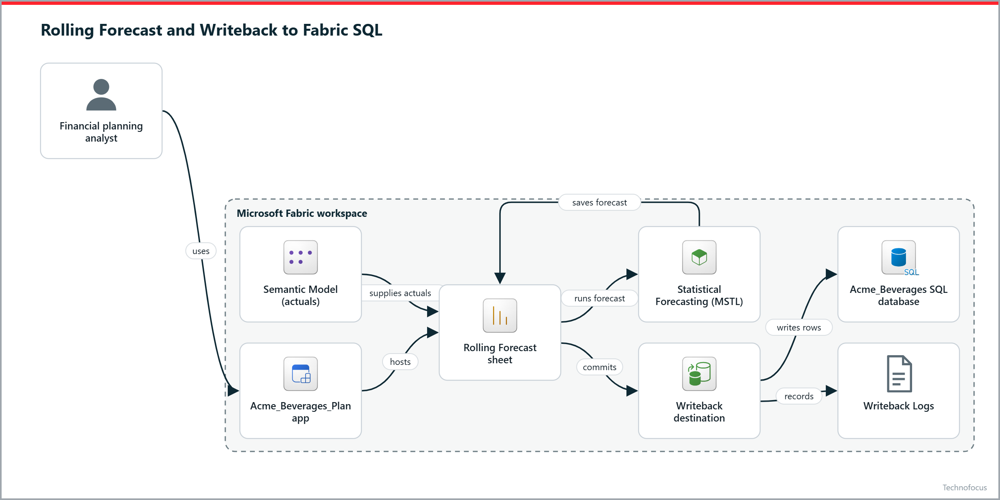

## Prerequisites

- Completion of Lab 01, including the **Acme_Beverages_Plan** app.
- The database connection and the **Acme_Beverages** Fabric SQL database created in Lab 01.
- Access to your folder in the training workspace.

## Scenario

Acme Beverages relies on 24 months of historical sales actuals to plan for the year ahead. Its finance team builds forecasts manually, which makes it hard to account for seasonal demand, keep the forecast current as new actuals arrive, and share a finalized forecast with downstream systems.

To solve this, Acme Beverages adopts a rolling forecast process in its planning app, backed by a Fabric SQL database. The key components are:

- **Forecast sheet**: Combines 2024 and 2025 actuals with the **Forecast** measure, which covers January to December 2026.
- **Statistical Forecasting**: Uses Trend Decomposition with MSTL to detect annual and quarterly seasonality and generate a full year of forecasted values.
- **Close Period and Reforecast**: Locks in actuals as they arrive, extends the forecast horizon, and reseeds newly opened periods.
- **Writeback**: Commits the finalized forecast to the Acme_Beverages Fabric SQL database and logs each writeback.

In this lab, you are a financial planning analyst at Acme Beverages. You build the 2026 rolling forecast, keep it current as January 2026 actuals arrive, and write the finalized forecast back to the database.

# Exercise 1: Create the Rolling Forecast

In this exercise, you set up the **Forecast** sheet anchored on 2024 and 2025 actuals and create a blank **Forecast** measure that is ready to be populated.

## Task 1: Set up the Forecast sheet

In this task, you create a new Planning sheet named **Forecast** and lay out the products by row and the date hierarchy by column. The **Forecast** measure and statistical forecasting in later tasks build on this layout.

1. In Fabric, select the **Acme_Beverages_Plan** app tab that you created in Lab 01.
2. On the **Home** tab, in the **Create** group, select **New Planning Sheet**.

   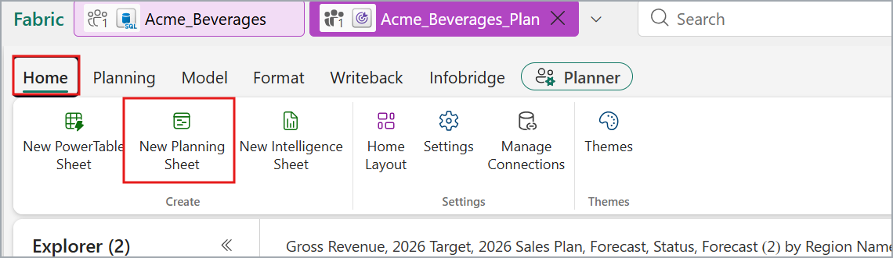

3. In the **New Planning Sheet** dialog, in the **Name** box, enter +++Forecast+++.
4. Select **Create**.

   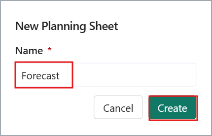

   The **Forecast** sheet is added to the **Explorer** pane and opens.

5. In the **Data** pane, expand **Semantic Model** > **Dim skus**.
6. Select the **Brand** checkbox.
7. Select the **Category** checkbox.

   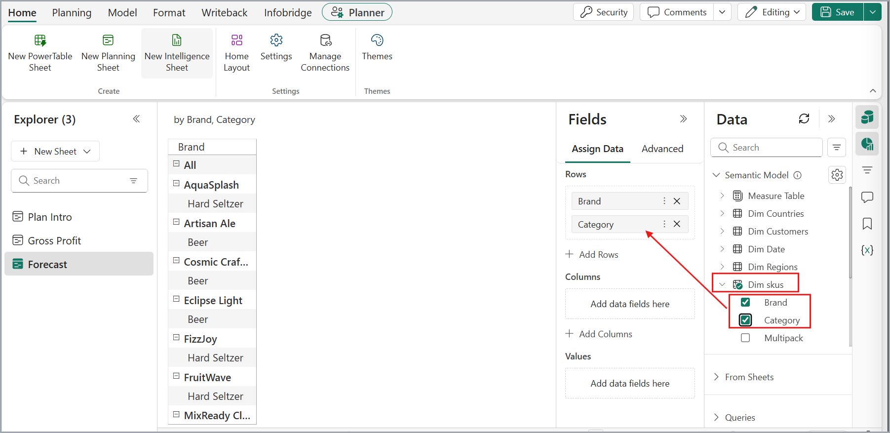

   **Brand** and **Category** appear under **Fields** > **Assign Data** > **Rows**, and the grid lists each brand with its category, such as **AquaSplash** > **Hard Seltzer**.

8. In the **Data** pane, expand **Semantic Model** > **Dim Date**.
9. Select the **Date Hierarchy** checkbox.

   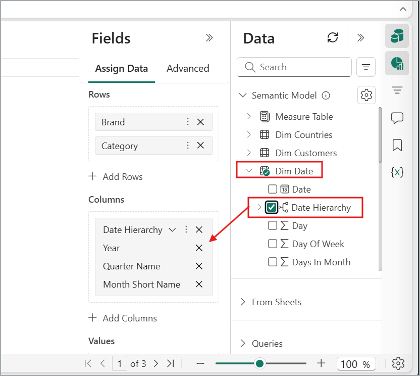

   **Date Hierarchy** appears under **Fields** > **Assign Data** > **Columns** with the levels **Year**, **Quarter Name**, and **Month Short Name**.

10. In the **Data** pane search box, enter +++Gross Revenue+++.
11. Select the **Gross Revenue** checkbox.

    **Gross Revenue** appears under **Fields** > **Assign Data** > **Values**, and the grid shows gross revenue by brand, category, and period.

12. In the **Fields** pane, on the **Assign Data** tab, confirm that **Rows** contains **Brand** and **Category**, **Columns** contains **Date Hierarchy** with **Year**, **Quarter Name**, and **Month Short Name**, and **Values** contains **Gross Revenue**.

    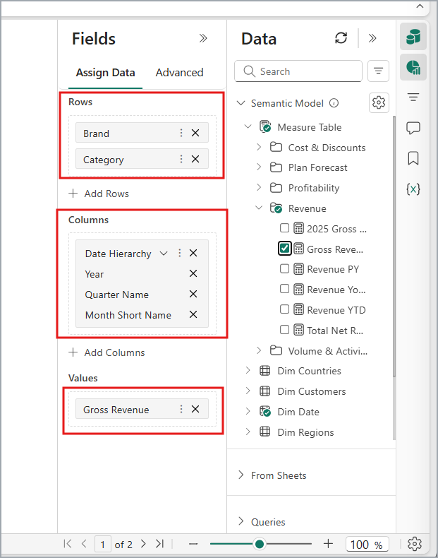

13. On the right sidebar, select the **Filter** icon.

    The **Filter** pane opens with **Page level** filters for **Brand**, **Category**, **Year**, **Quarter Name**, and **Month Short Name**.

14. In the **Filter** pane, under **Page level**, expand the **Year** filter card.
15. On the **Basic** tab, select the **2024** checkbox.
16. Select the **2025** checkbox.

    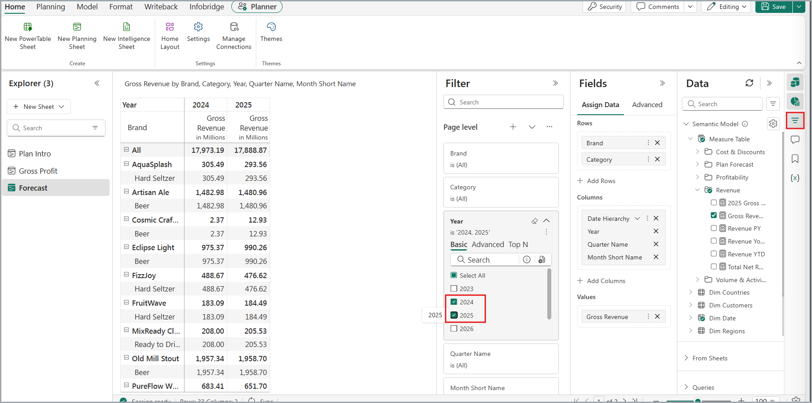

    The **Year** filter card shows **is '2024, 2025'**, and the grid shows **Gross Revenue** columns for **2024** and **2025** only.

17. Select **Planning** > **Totals**.
18. In the **Totals** menu, in the **Column Subtotal** list, select **Left**.

    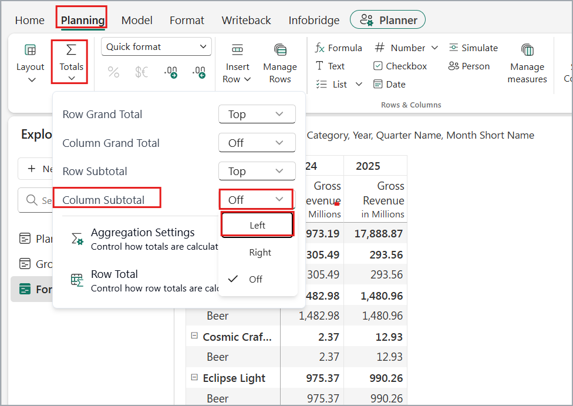

    Column subtotals appear on the left side of the column groups in the grid.

## Task 2: Create the Forecast measure

In this task, you create the **Forecast** measure from the **Model** tab. This measure holds the forecasted values that extend the 2024 and 2025 actuals into 2026.

1. On the **Model** tab, in the **Rolling Forecast** group, select **Forecast**.

   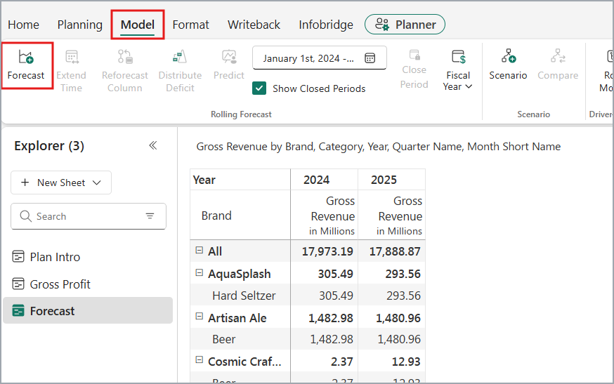

2. In the **Save changes to proceed** dialog, select **Save and continue**.

   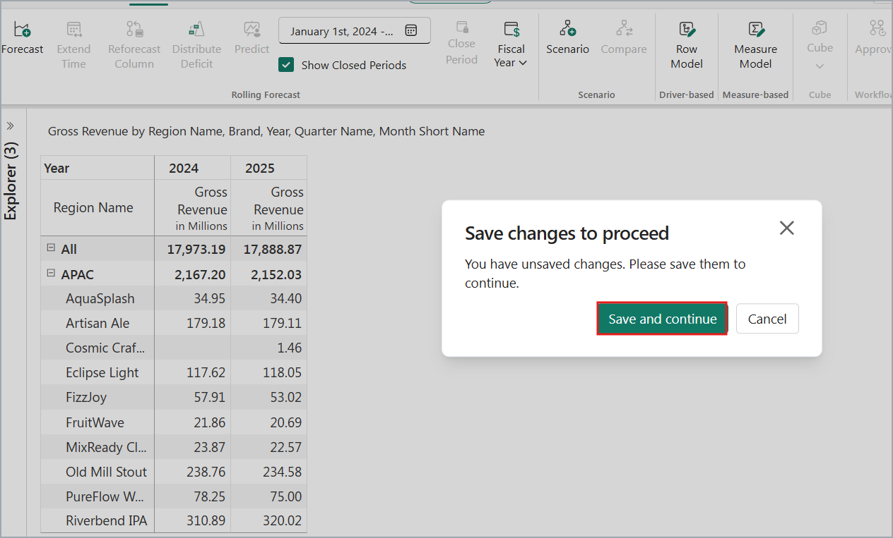

   Your changes are saved, and the **Insert Forecast Measures** dialog opens on the **Basics** page.

3. On the **Basics** page, enter the following details:
   - Measure Name - +++Forecast+++
   - Forecast Period - **Jan 2026 - Dec 2026**
   - Multi Dimension Allocation - **Off**

   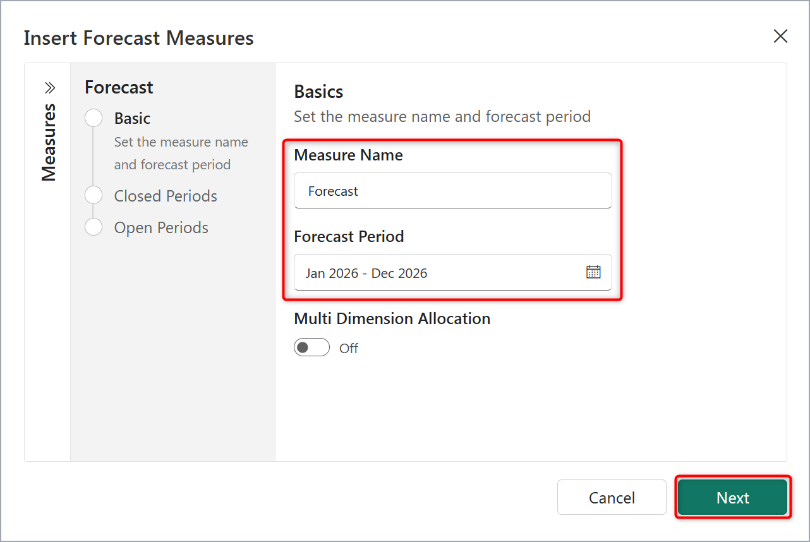

4. Select **Next**.

   The **Closed Periods** page opens.

5. On the **Closed Periods** page, enter the following details:
   - Configure as - **Link to Measure**
   - Source Measure - **Gross Revenue**

   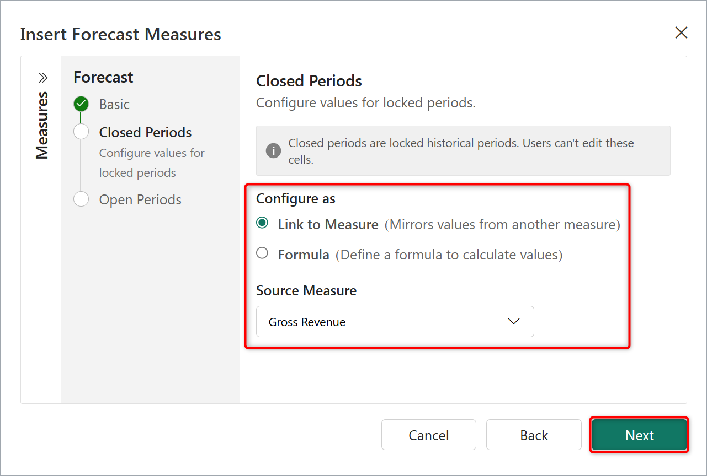

6. Select **Next**.

   Closed periods of the **Forecast** measure now mirror the **Gross Revenue** actuals and stay locked for editing. The **Open Periods** page opens.

7. On the **Open Periods** page, enter the following details:
   - Configure as - **Data Input**
   - Default Value - **None**

   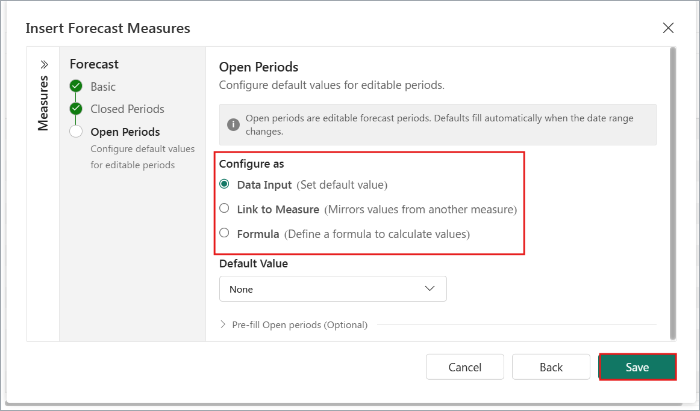

8. Select **Save**.

   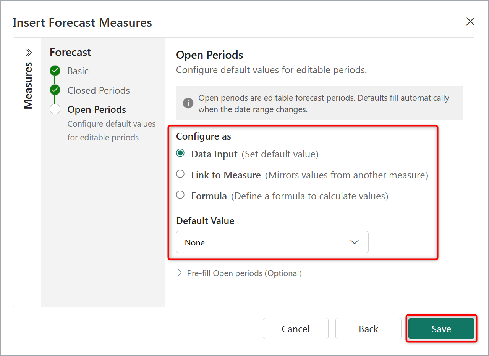

   The **Insert Forecast Measures** dialog closes, and the **Forecast** measure appears in the grid next to **Gross Revenue**.

9. Review the **Forecast** columns for **2024** and **2025** in the grid.

   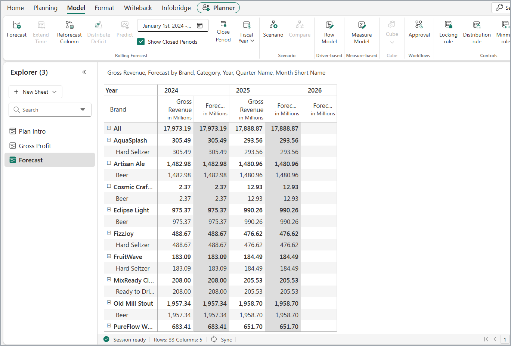

   The **Forecast** values for **2024** and **2025** are greyed out and match **Gross Revenue**, which shows that these years are closed periods. The **2026** **Forecast** column is empty. It appears because the forecast period covers 2026, even though the **Year** filter is limited to **2024** and **2025**. **Gross Revenue** shows no 2026 column.

10. In the **Year** column header row, select the expand arrow (**>**) next to **2026**.

    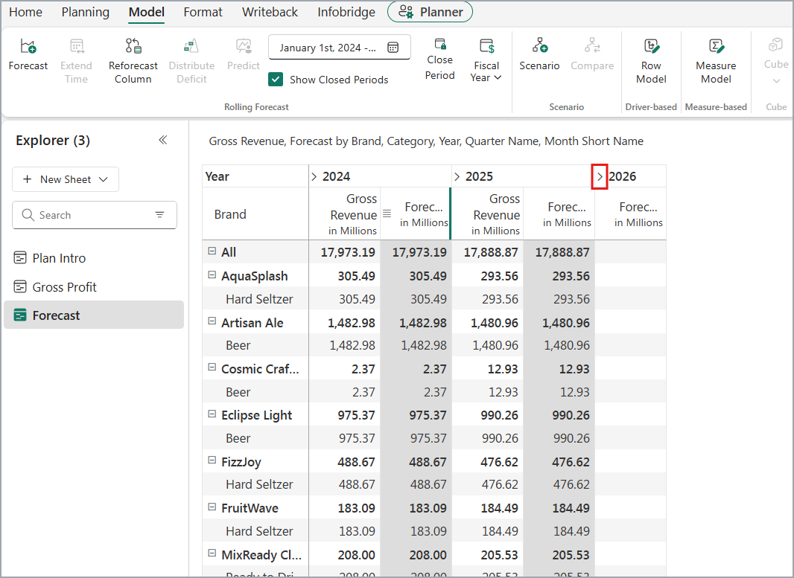

    The **2026** header expands to show the quarter columns, starting with **Q1**. These open forecast periods are empty and ready for forecasting.

11. In the grid, hover over a brand row header, such as **AquaSplash**.
12. Select the row menu icon to the left of the row.
13. In the menu, select **Collapse**.
14. In the **Collapse** submenu, select the **Specific Level** drop-down.
15. Select **Category**.

    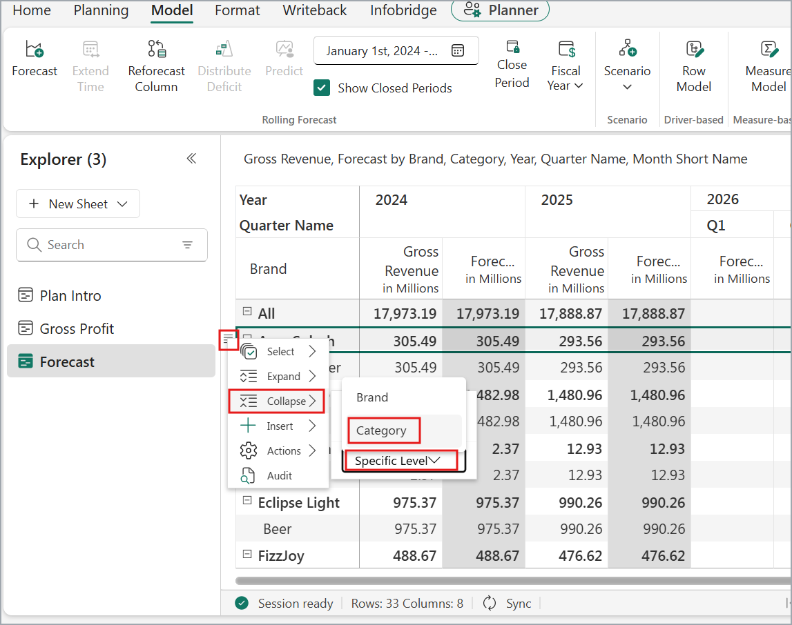

    The row headers collapse to the **Category** level, which makes the category-level values easier to examine.

16. Review the collapsed grid.

    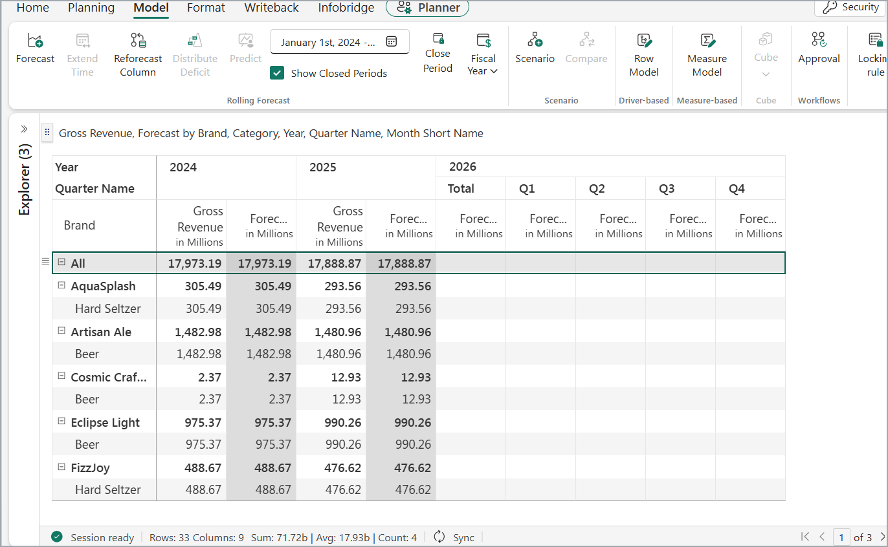

    The grid shows the **All** row, followed by each brand with its category beneath it, such as **AquaSplash** > **Hard Seltzer** and **Artisan Ale** > **Beer**.

# Exercise 2: Generate Statistical Forecast

In this exercise, you run Statistical Forecast on 24 months of historical actuals to generate a complete Jan–Dec 2026 forecast in one pass.

## Task 1: Run the forecast

In this task, you configure and run the Predict feature on the grand total of the **Forecast** measure. The model uses Trend Decomposition with MSTL to detect annual and quarterly seasonal patterns, so the 2026 forecast reflects seasonal demand.

1. In the grid, select the cell where the **All** row meets the **2026** **Total** **Forecast** column.
2. On the ribbon, select **Model** > **Predict**.

   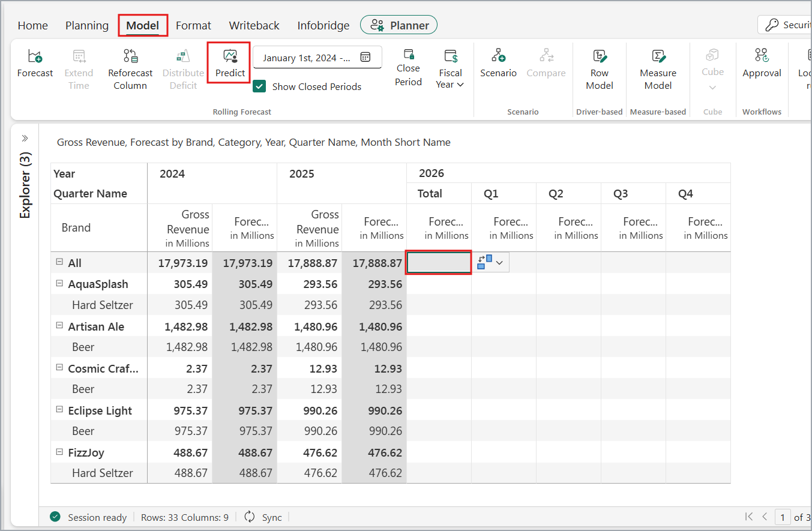

   The **Predict** pane opens.

3. Confirm that **Row Selected** is set to **GrandTotal**.
4. Confirm that **Measure Selected** is set to **Forecast**.
5. Select the lock icon next to **Row Selected**.
6. Select the lock icon next to **Measure Selected**.

   The row and measure selections are locked so that they do not change while you configure the forecast.

7. Under **Set Period Range**, confirm the following default values:
   - Historic Data Range - **Jan 2024 - Dec 2025**
   - Forecast Date Range - **Jan 2026 - Dec 2026**

   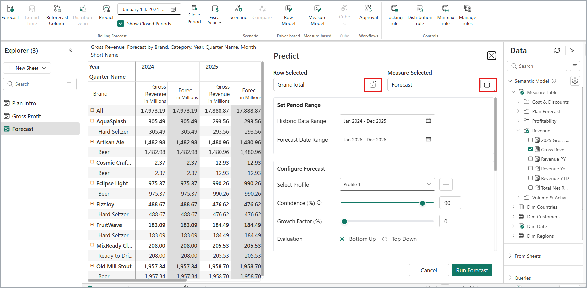

8. Under **Configure Forecast**, enter the following details:
   - Select Profile - **Profile 1**
   - Confidence (%) - +++90+++
   - Growth Factor (%) - +++4+++
   - Evaluation - **Bottom Up**
   - Round all negative values to zero - **No**

   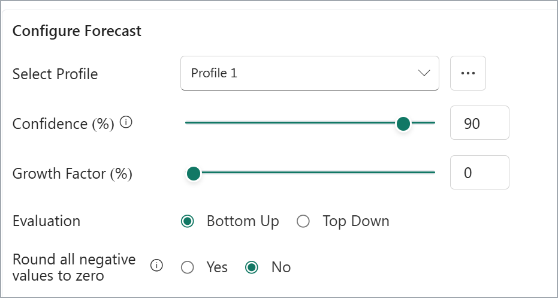

   > **Note:** **Confidence (%)** indicates the level of certainty that the actual value falls within the predicted range.

9. Under **Choose Algorithm**, confirm that **Trend Decomposition with MSTL** is selected.

   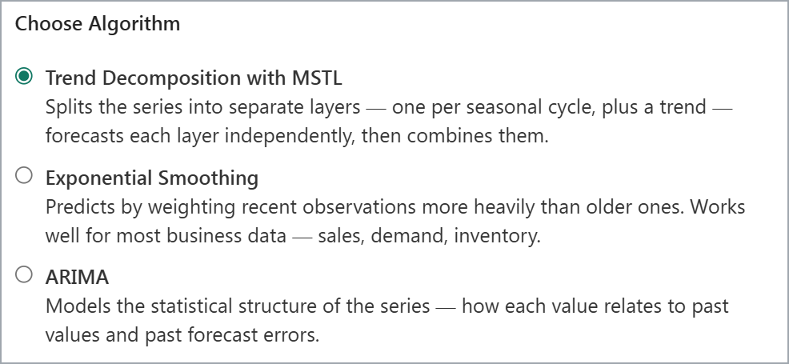

   > **Note:** **Trend Decomposition with MSTL** splits the series into separate layers, one per seasonal cycle plus a trend, forecasts each layer independently, and then combines them. It fits beverage sales data, where patterns repeat at both the annual and quarterly levels.

10. Under **Customize Algorithm** > **Set Seasonality**, select the **Year** checkbox.
11. Under **Customize Algorithm** > **Set Seasonality**, select the **Quarter** checkbox.

    The model detects and accounts for seasonal patterns at both cycle levels at the same time.

12. Select **Run Forecast**.

    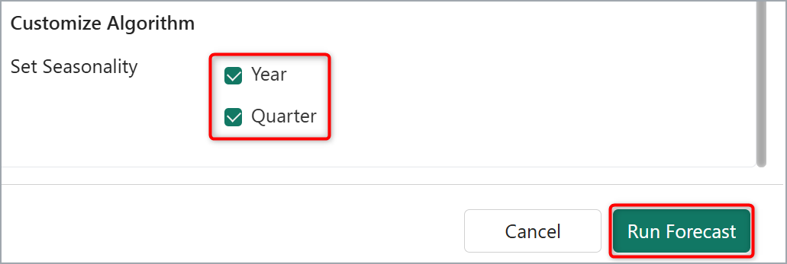

    The forecast preview opens in the **Predict** pane. The chart shows historical data in grey, predicted values in green, and the confidence range as green shading.

13. In the **Forecast Table** below the chart, review the **Period**, **Type**, **Value**, **Confidence Range (+)**, and **Confidence Range (-)** columns.
14. Select **Save Forecast**.

    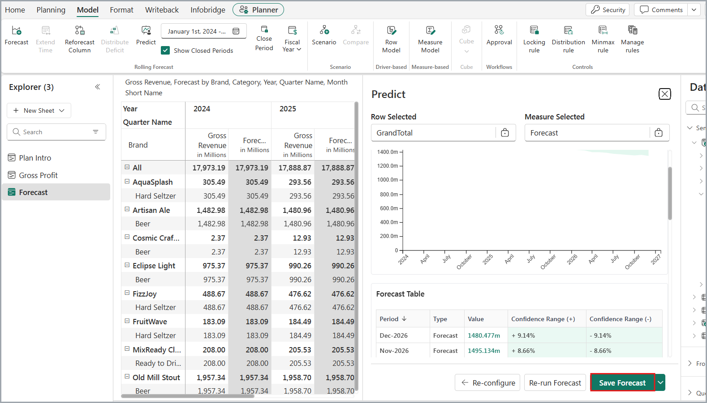

    The **Save to Forecast Measure** dialog opens.

15. In the **Save to Forecast Measure** dialog, confirm the following values:
    - Select Measure - **Forecast**
    - Date Range - **Jan 2026 - Dec 2026**

    > **Important:** Existing values in the selected date range are overwritten, and the open period is extended to match the date range.

16. Select **Save**.

    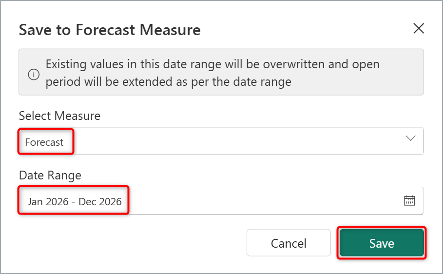

    The **Values saved** notification appears, and the forecasted values are saved to the **Forecast** measure for **Jan 2026 - Dec 2026**.

17. In the grid, review the **2026** columns.

    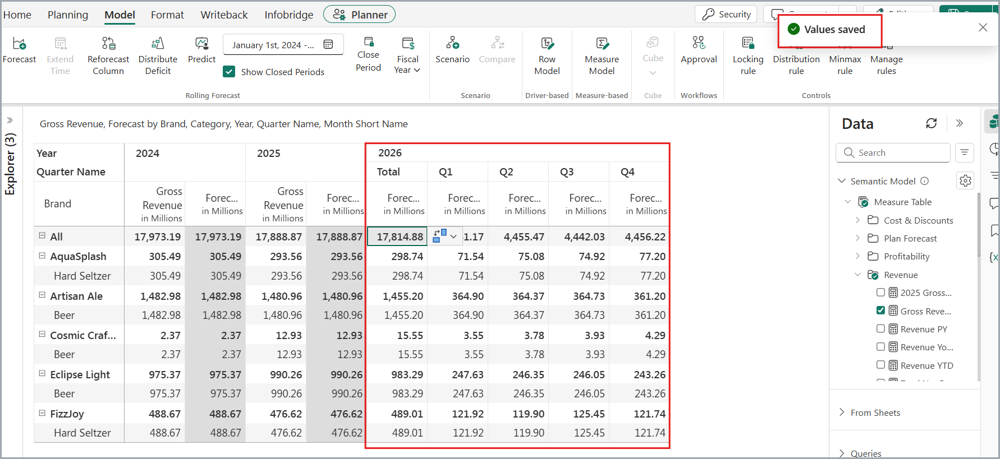

    The statistical forecast is calculated at the grand total level and distributed across the row and column hierarchies, so every brand and category shows **Forecast** values for **Total**, **Q1**, **Q2**, **Q3**, and **Q4** of 2026.

# Exercise 3: Close the Period, Extend, and Reforecast

In this exercise, you close January 2026 to lock in its actuals, extend the forecast horizon by one month, and reforecast the newly opened January 2027 period.

## Task 1: Reveal January 2026 actuals

In this task, you add 2026 to the year filter and compare the January 2026 forecast with the January 2026 actuals. This comparison shows the gap that closing the period resolves.

1. In the right sidebar, select the **Filter** icon.

   The **Filter** pane opens.

2. Under **Page level**, select the **Year** filter card to expand it.
3. On the **Basic** tab, select the **2026** check box, and keep **2024** and **2025** selected.

   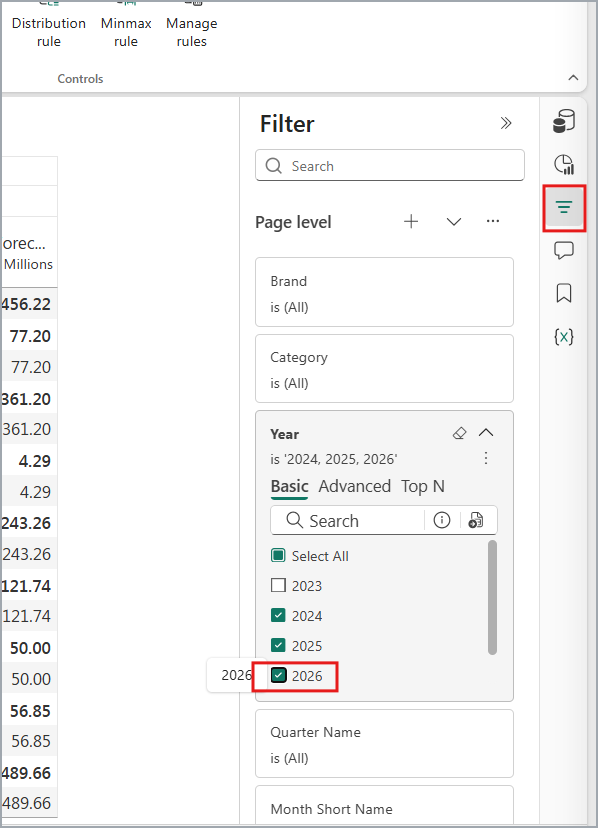

   The **Year** filter shows **is '2024, 2025, 2026'**, and the grid shows **Gross Revenue** and **Forecast** columns for 2026.

4. In the grid, expand the **2026** > **Q1** column headers to show the **Jan**, **Feb**, and **Mar** columns.
5. Under **2026** > **Q1** > **Jan**, compare the **Gross Revenue** and **Forecast** values in the **All** row.

   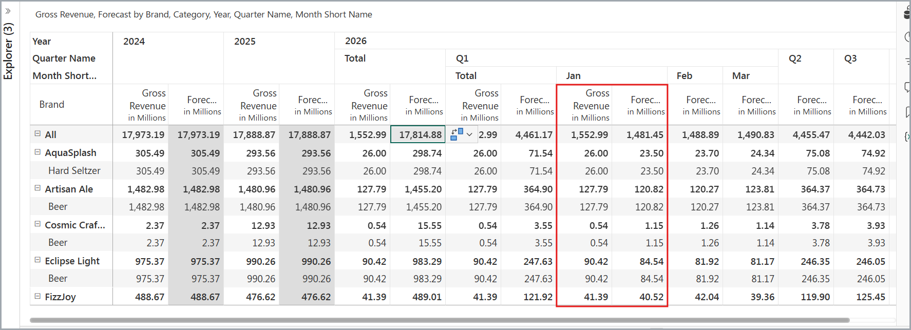

   The **Gross Revenue** column shows the January 2026 actual of **1,552.99**. The **Forecast** column shows the value that you generated in the previous exercise.

   > **Note:** Your **Forecast** value for January 2026 can differ slightly from the reference value. After you close the period in the next task, the January 2026 **Forecast** value is replaced automatically with the **Gross Revenue** actuals.

## Task 2: Close January and extend the forecast

In this task, you close the January 2026 period so that its actuals are locked in and the forecast horizon extends by one month. This step keeps the rolling forecast current as new actuals arrive.

1. On the ribbon, select the **Model** tab.
2. In the **Rolling Forecast** group, select **Close Period**.

   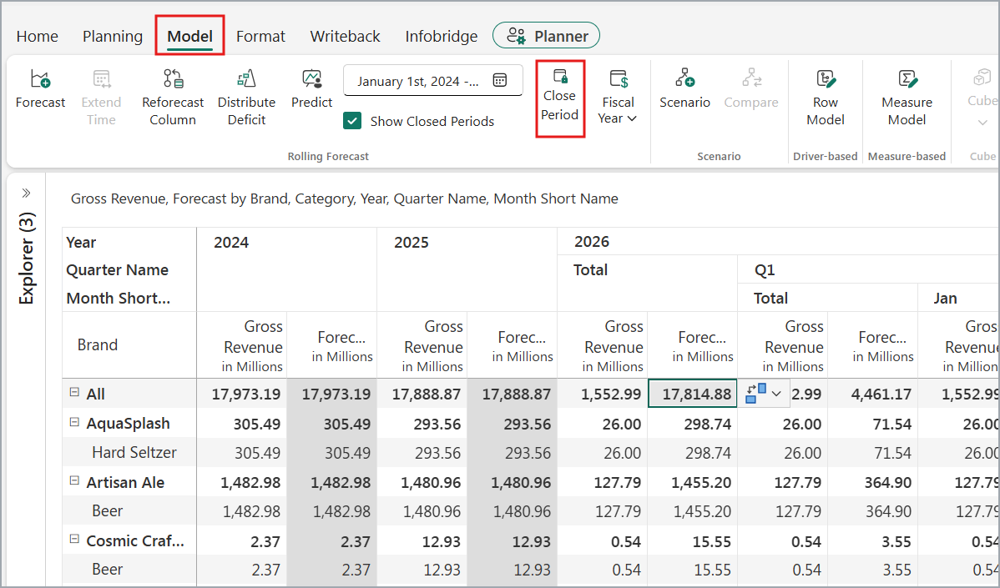

3. In the **Close Period** dialog, confirm that **Select Measure** is set to **Forecast**.
4. Select the **Close Period till** dropdown.
5. Scroll down the list, and then select **Custom**.
6. Confirm that **Selected Period** is set to **Jan 2026**.

   > **Note:** If **Selected Period** shows a different month, select the calendar icon, and then select **Jan 2026**.

7. Select the **Extend Forecast Range** checkbox.
8. Confirm that **Duration** is set to **1 Month**.

   When January 2026 closes, **Jan 2027** is added to the forecast horizon. This keeps a continuous 12-month forward window.

9. Select **Preview**.

   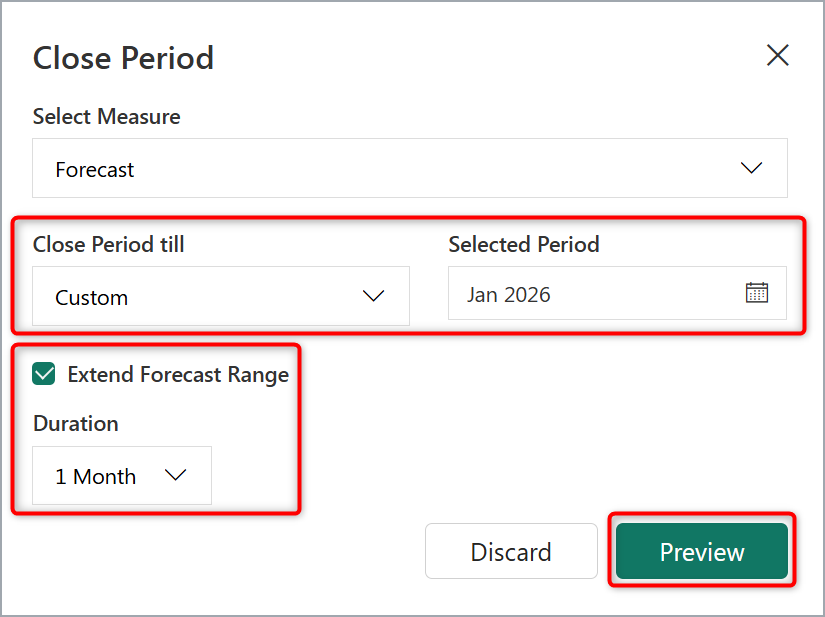

   The **Confirm Close Period** dialog opens.

10. In the **Confirm Close Period** dialog, verify the following values for the **Forecast** measure:
    - Closed Period - **Jan 2024 - Jan 2026**
    - Open Period - **Feb 2026 - Jan 2027**

    The open period starts in **Feb 2026**, and the forecast horizon now extends to **Jan 2027**.

11. Select **Save**.

    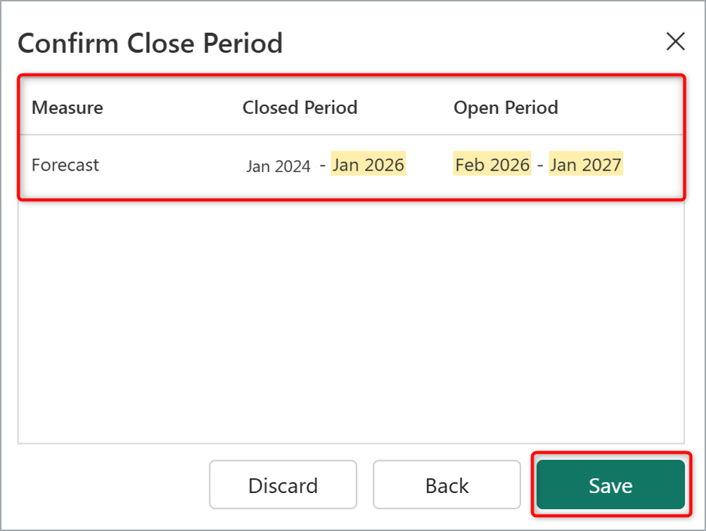

    The dialog closes, and the closed period updates.

12. In the grid, under **2026** > **Q1** > **Jan**, compare the **Gross Revenue** and **Forecast** columns for each **Brand** row.

    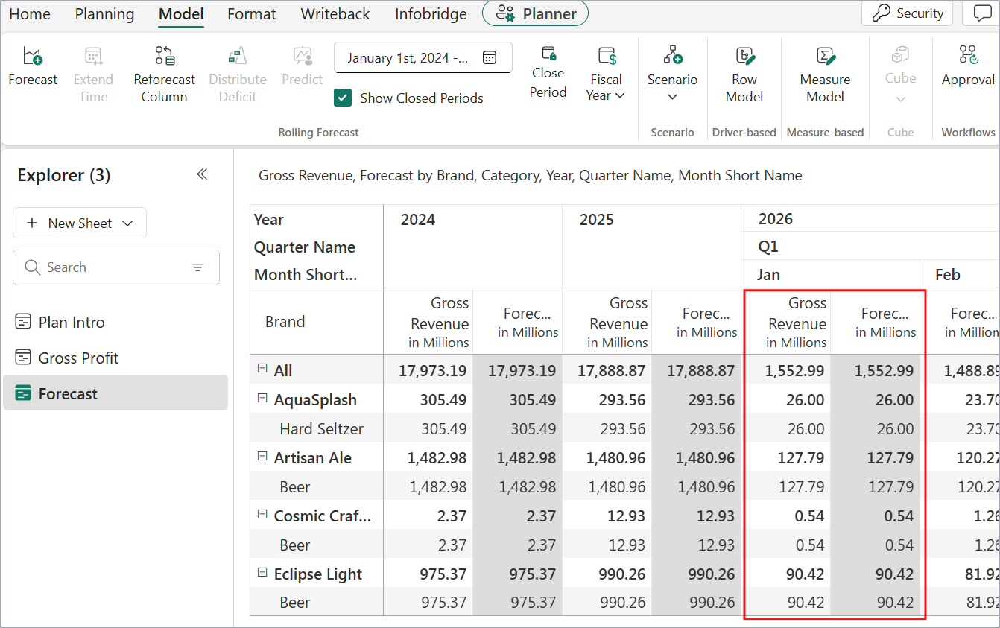

    The January 2026 **Forecast** values now match the **Gross Revenue** actuals, for example **1,552.99** in the **All** row. The **Forecast** cells are greyed out, which shows that January 2026 is a closed period.

13. Under **2026** > **Q1** > **Jan**, review the **Gross Revenue** and **Forecast** values for each **Category** row.

    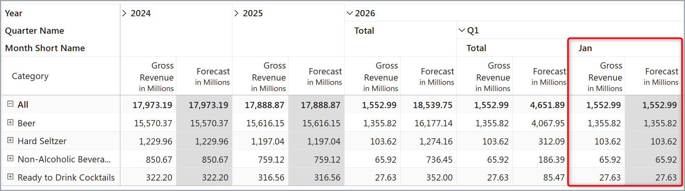

    Each category's January **Forecast** value equals its **Gross Revenue** actual, for example **1,355.82** for **Beer** and **103.62** for **Hard Seltzer**. The **2026** > **Total** **Forecast** value of **18,539.75** combines the closed January actuals with the forecast for the remaining open months.

14. In the grid, expand **2027** and review the **Forecast** columns under **2027** > **Q1** > **Jan** for each **Category** row.

   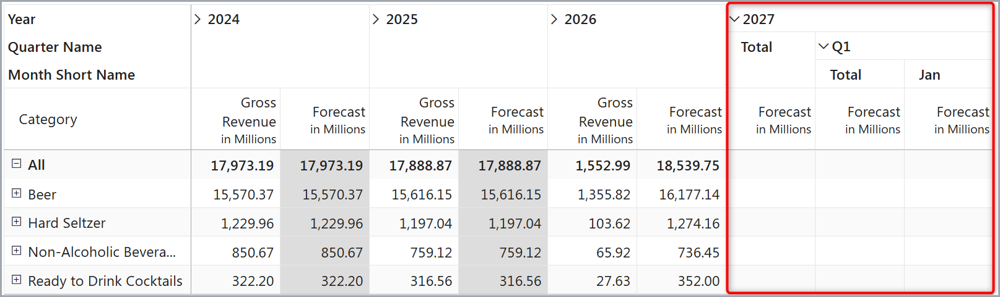

   The forecast horizon now extends to **2027**. The **2027** **Forecast** cells are empty because the newly opened January 2027 period has no values yet.

## Task 3: Seed Jan 2027 with Jan 2026 actuals

In this task, you use **Reforecast Column** to copy the January 2026 **Gross Revenue** actuals into the newly opened January 2027 forecast period. This gives the extended forecast horizon a realistic baseline instead of empty values.

1. On the ribbon, select **Model** > **Reforecast Column**.

   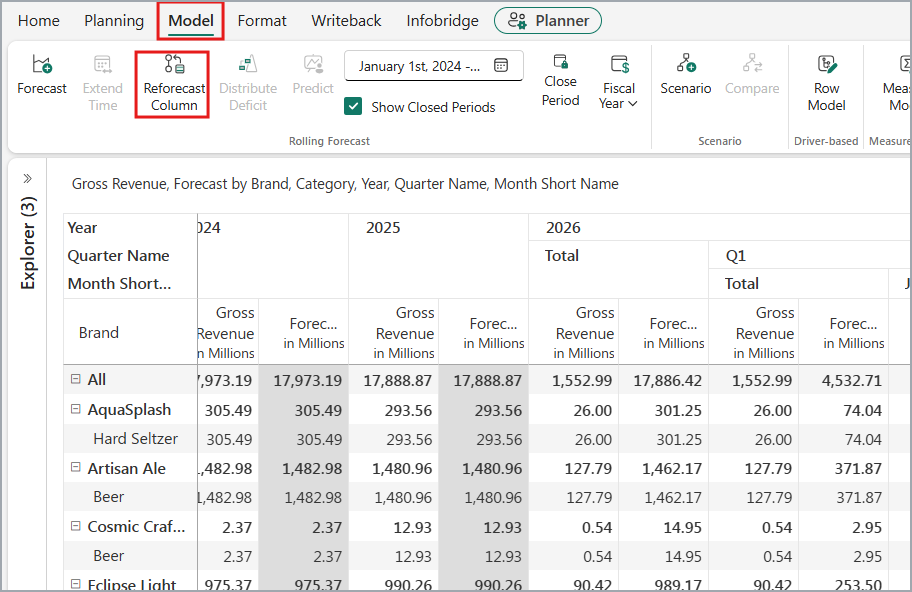

   The **Reforecast** dialog opens.

2. In the left pane of the **Reforecast** dialog, verify that **Forecast v1** is selected and that the **Jan 2027 - Jan 2027** range is selected.
3. Under **Set Period Range**, enter the following details:
   - Target Period - **Jan 2027 - Jan 2027**
   - Copy Source - **Gross Revenue**
   - Apply Operation - **Period Range**
   - Source Periods - **Jan 2026 - Jan 2026**
4. Select **Apply**.

   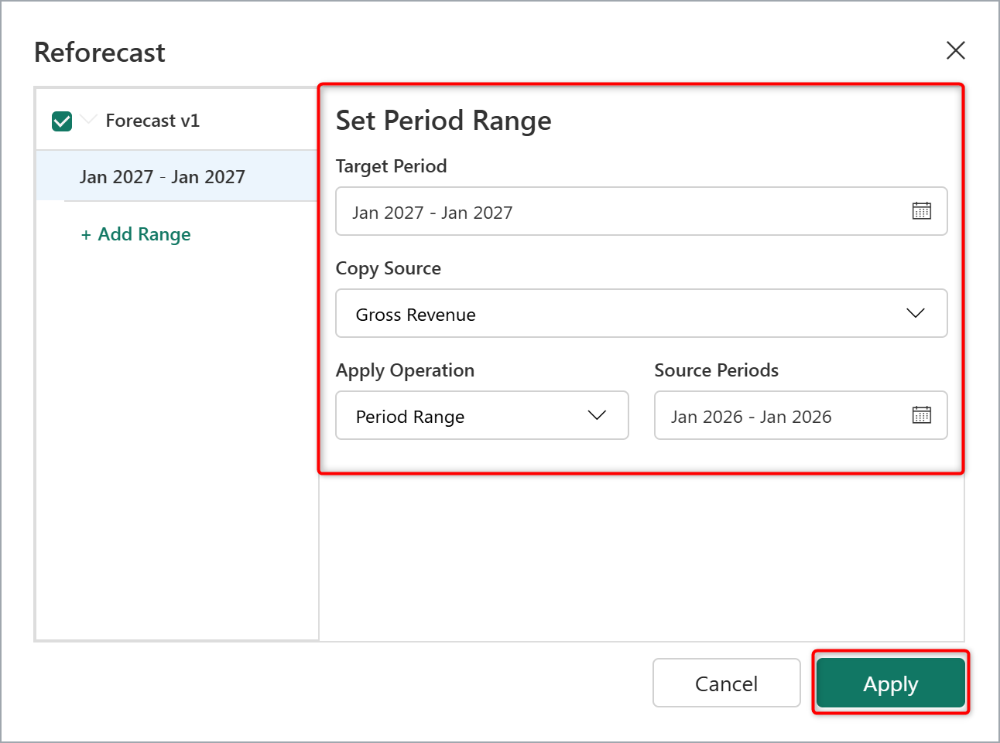

   The dialog closes, and the grid refreshes with the reforecast values.

5. In the grid, under **2027** > **Q1** > **Jan**, review the **Forecast** values for each **Brand** row.

   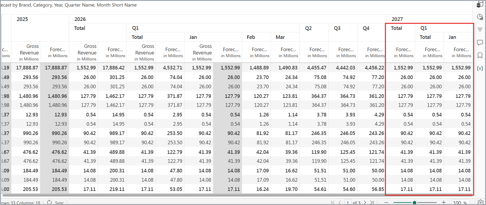

   January 2027 now uses the January 2026 actuals as its starting values, for example **1,552.99** in the **All** row, **26.00** for **AquaSplash**, and **127.79** for **Artisan Ale**. The team now has a realistic baseline for the extended forecast horizon.

## Task <N>: Apply a growth assumption to January 2027

In this task, you apply a 4% growth assumption to the January 2027 forecast. This adjusts the baseline copied from the January 2026 actuals to reflect expected growth for the new period.

1. In the grid, under **2027** > **Total**, double-click the **Forecast** cell in the **All** row.

   The cell enters edit mode, and the formula bar shows the current value **1552989286.05662**.

2. In the formula bar, place the cursor after the existing value, and then enter the following:

   +++ +4%+++

   The formula bar shows **=1552989286.05662+4%**, and the preview value **1,615,108,857.499** appears below it.

3. Select the check mark (**✓**) to the right of the formula bar.

   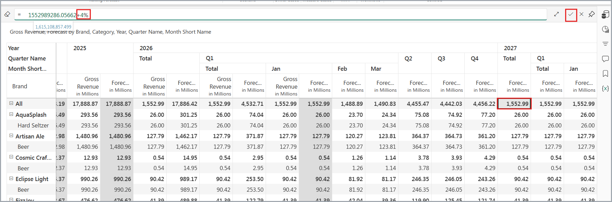

   A **Values saved** notification appears.

4. In the grid, under **2027** > **Q1** > **Jan**, review the **Forecast** values for each **Brand** row.

   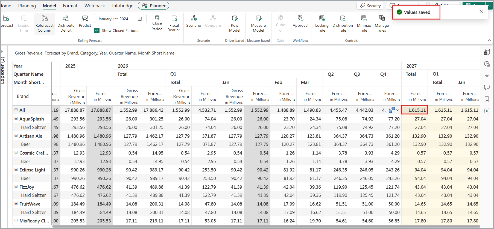

   January 2027 is now populated at **1,615.11** (in millions) in the **All** row. The 4% increase is distributed across the brands, for example **27.04** for **AquaSplash** and **132.90** for **Artisan Ale**.

# Exercise 4: Writeback

In this exercise, you commit the finalized **Forecast** to the Fabric SQL database by adding a writeback destination, exploring the writeback settings, running writeback, verifying the results in the database, and reviewing the logs.

## Task 1: Add a writeback destination

In this task, you add the **Forecast** table in the **Acme_Beverages** database as the writeback destination. This tells the planning app where to commit the finalized forecast values.

1. On the ribbon, select **Writeback** > **Add destination**.

   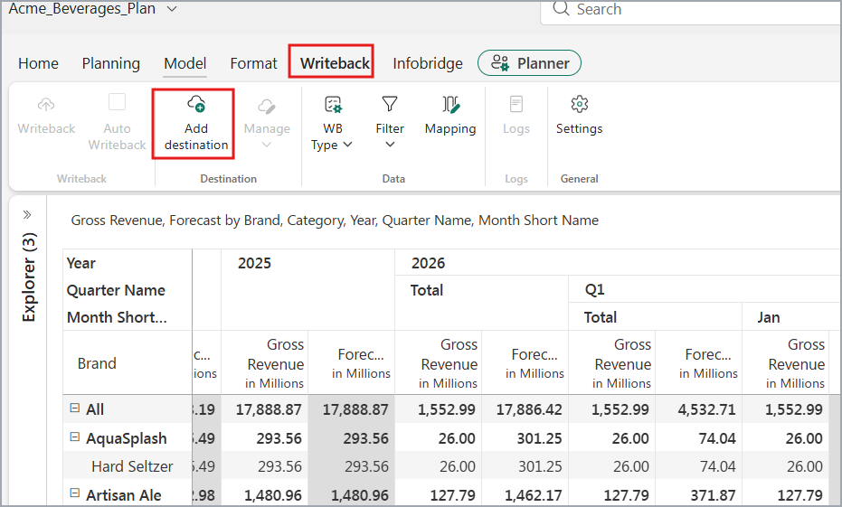

   The **Create destination** dialog opens.

2. In the **Create destination** dialog, enter the following details:
   - Select connection - **Acme_Beverages JohnS (2)** (the database connection you created in Exercise 1 Part 1)
   - Database name - **Acme_Beverages** (the database you created in Exercise 1 Part 1)
   - Schema - **dbo**
   - Table name - +++Forecast+++

   

   > **Note:** The connection name in your environment can differ from **Acme_Beverages JohnS (2)**. Select the connection you created in Exercise 1 Part 1.

3. In the **Create Destination** dialog, confirm that the connection, database, schema, and table details match the values you entered:
   - Select a Connection - your database connection, for example **Acme_Beverages User1-66670356 (2)**
   - Database Name - **Acme_Beverages**
   - Schema - **dbo**
   - Table Name - **Forecast**

   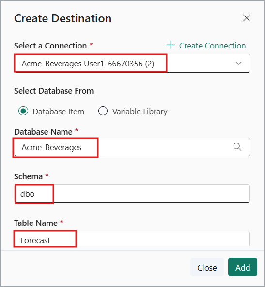

4. Scroll down in the **Create Destination** dialog, and then enter the following details:
   - Decimal Precision - +++2+++
   - Text Length - **Length of all string columns** with **512** selected

   > **Important:** The decimal precision setting is a one-time action and cannot be changed later. Confirm that the value is **2** before you continue.

   > **Note:** You can select **Custom** under **Text Length** to set different lengths for individual string columns. For this lab, keep the default value of **512**.

5. Select **Add**.

   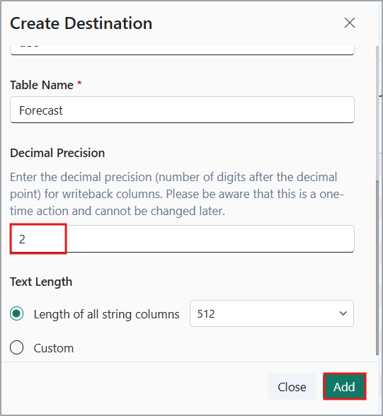

   A **Writeback settings saved successfully** message appears, and the **Destination added** dialog opens.

6. In the **Destination added** dialog, review the destination details:
   - **Destination ready for writeback** appears with a green check mark.
   - Table is **Forecast**.
   - Database is **Acme_Beverages**.
   - Under **ACME Beverages**, both **Verified — you have permission to make changes to this model** and **Verified — XMLA read-write is enabled** appear with green check marks.

   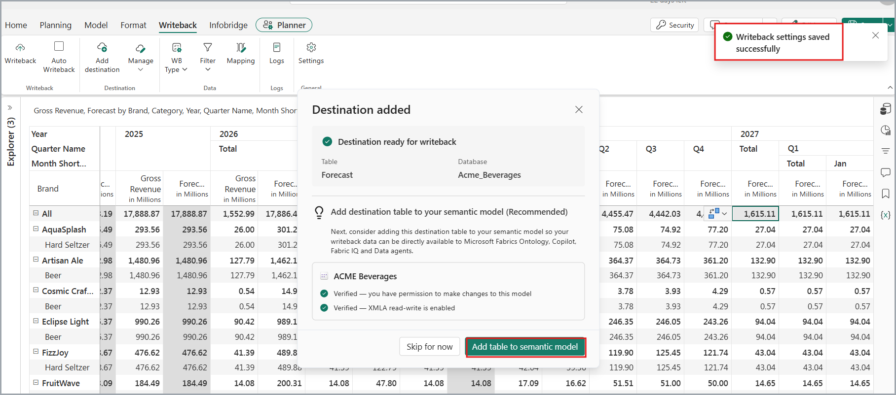

   > **Note:** The **Add table to semantic model** option is recommended. It makes the writeback data available to Microsoft Fabric Ontology, Copilot, Fabric IQ, and Data agents. This lab does not use that option.

7. Select **Skip for now**.

   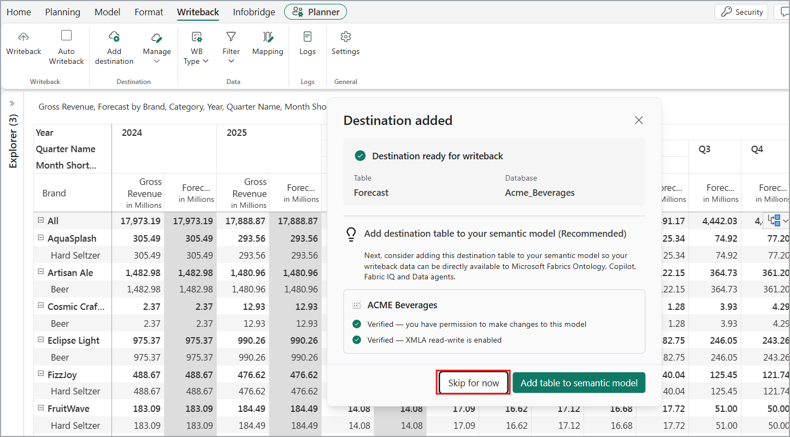

   The **Destination added** dialog closes, and the **Forecast** table in the **Acme_Beverages** database is set as the writeback destination.

8. Confirm that the **Destination saved successfully.** message appears in the upper-right corner, below the **Security** button.

   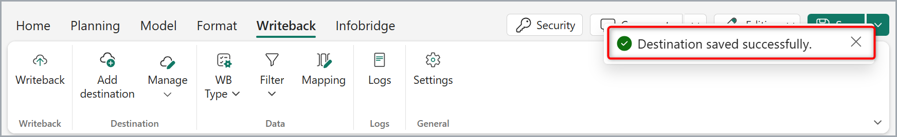

   > **Note:** Select **X** on the message to close it, or wait for it to close automatically.

## Task 2: Configure writeback settings

In this task, you open the writeback settings and review the writeback types available on the **General** tab. The writeback type controls how forecast values are stored in the **Forecast** table in the **Acme_Beverages** database.

1. On the **Writeback** ribbon, in the **General** group, select **Settings**.

   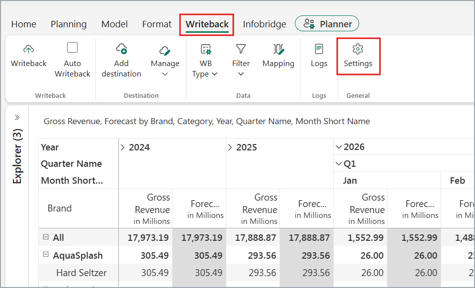

   The **Writeback Settings** panel opens.

2. Review the four tabs at the top of the **Writeback Settings** panel: **General**, **Data**, **Destinations**, and **Advanced**.

   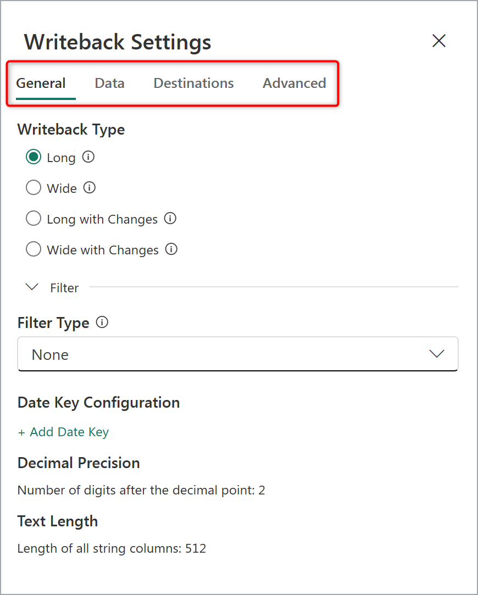

   The **General** tab is selected by default. It shows the **Writeback Type**, **Filter Type**, **Date Key Configuration**, **Decimal Precision**, and **Text Length** settings.

3. On the **General** tab, under **Writeback Type**, select the information icon next to **Long**.

   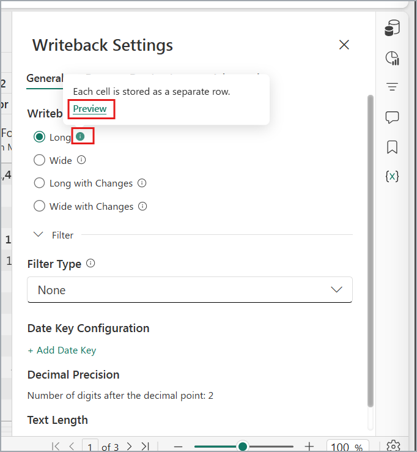

   A tooltip appears with the description **Each cell is stored as a separate row.** and a **Preview** link.

   > **Note:** **Long** is selected by default. You review the remaining writeback types, **Wide**, **Long with Changes**, and **Wide with Changes**, in the same way by selecting the information icon next to each one.

4. In the **Long** tooltip, select **Preview**.

   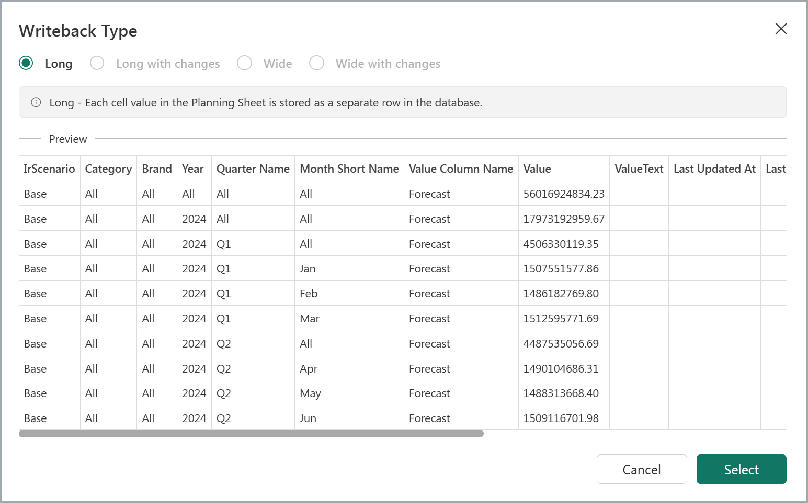

   The **Writeback Type** dialog opens with **Long** selected. The description reads **Long - Each cell value in the Planning Sheet is stored as a separate row in the database.** The **Preview** grid shows one row per cell value, with the columns **IrScenario**, **Category**, **Brand**, **Year**, **Quarter Name**, **Month Short Name**, **Value Column Name**, **Value**, **ValueText**, and **Last Updated At**. The **Value Column Name** column identifies the measure, such as **Forecast**.

5. Select **Cancel** to close the **Writeback Type** dialog.

6. On the **General** tab, under **Writeback Type**, select the information icon next to **Wide**.

   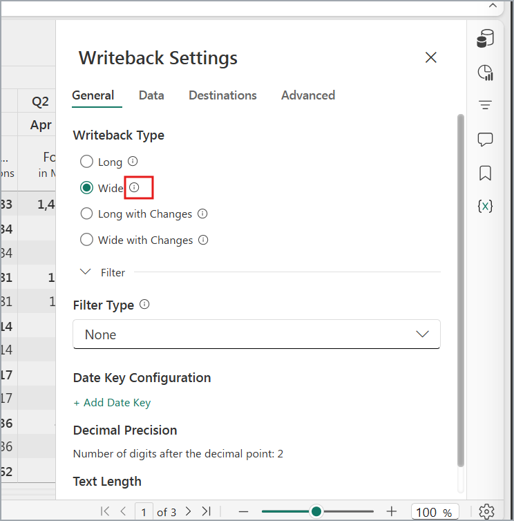

   A tooltip appears with a **Preview** link.

7. In the **Wide** tooltip, select **Preview**.

   

   The **Writeback Type** dialog opens with **Wide** selected. The description reads **Wide - Measures are stored as separate columns in the database.** The **Preview** grid shows the columns **IrScenario**, **Brand**, **Category**, **Year**, **Quarter Name**, **Month Short Name**, **Gross Revenue**, **Forecast**, and **IrWritebackUser**. Each measure has its own column, so **Gross Revenue** and **Forecast** appear side by side in the same row.

8. Select **Cancel** to close the **Writeback Type** dialog.

9. On the **General** tab, under **Writeback Type**, select the information icon next to **Long with Changes**.

   A tooltip appears with a **Preview** link.

10. In the **Long with Changes** tooltip, select **Preview**.

   

   The **Writeback Type** dialog opens with **Long with changes** selected. The description reads **Long with changes - Each cell value is stored with change history as separate rows.** The **Preview** grid uses the same row-per-value layout as **Long**. It adds a **Previous Value** column next to **Value** and an additional previous-value column next to **ValueText**. These columns show **null** until a value is changed.

11. Select **Cancel** to close the **Writeback Type** dialog.

> **Note:** Use **Long** or **Wide** to store the current values only. Use **Long with Changes** or **Wide with Changes** to keep the previous value next to each new value so you can track forecast revisions over time.

12. On the **General** tab, under **Writeback Type**, select the information icon next to **Long with Changes**, and then select **Preview** to reopen the preview.

   

   The **Writeback Type** dialog opens with **Long with changes** selected. Each forecast value is stored in its own row, with the **Value Column Name** set to **Forecast**. The **Previous Value** column shows **null** for every row because no values have been changed yet.

13. Select **Cancel** to close the **Writeback Type** dialog.

14. Under **Writeback Type**, select the information icon next to **Wide with Changes**.

   A tooltip appears with a **Preview** link.

15. In the **Wide with Changes** tooltip, select **Preview**.

   

   The **Writeback Type** dialog opens with **Wide with changes** selected. The description reads **Wide with changes - Measures are stored as columns with change history.** The **Preview** grid includes the columns **IrScenario**, **Brand**, **Category**, **Year**, **Quarter Name**, **Month Short Name**, **Gross Revenue**, **Forecast**, **Is Latest**, and **IrWritebackUser**. The **Is Latest** column marks the most recent version of each row.

16. Select **Cancel** to close the **Writeback Type** dialog.

17. On the **General** tab, under **Writeback Type**, select **Long with Changes**.

   

   A **Warning** dialog opens with the message **The selected writeback format does not support file or URL destinations. Changing the Writeback type will clear any selected Writeback destinations.**

18. In the **Warning** dialog, select **Proceed**.

   **Long with Changes** is now the selected writeback type, and the configured writeback destination is turned off.

   > **Important:** Changing the writeback type turns off the existing writeback destination. Turn the destination back on before you run a writeback. Otherwise, no data is written to the database.

19. On the ribbon, select **Writeback** > **Manage**.

   The **Destinations (1)** list opens and shows the **Fabric SQL** destination for **Forecast**.

20. Select the toggle next to the **Fabric SQL** destination to turn it on.

   

   The toggle turns green and a confirmation message appears that the writeback settings were saved successfully. Under **Writeback Settings**, **Long with Changes** remains selected as the **Writeback Type**.

21. On the ribbon, select **Writeback** > **Settings**.

   

   The **Writeback Settings** pane opens on the **General** tab.

22. On the **General** tab, scroll down to the **Filter** section, and then select the **Filter Type** drop-down list.

   

   The **Filter Type** list opens. This option controls which data is written back to the destination:

   - **None** - writes back the entire scenario without filtering.
   - **Calculated rows only** - writes back only calculated rows and any notes added to them.
   - **Custom Filters** - writes back only the data that matches the filters that you define.

   > **Note:** The **Data with Comments only** option writes back only cells that contain comments. It is available only for the **Long** writeback type, so it does not appear in the list when **Long with Changes** is selected.

23. Keep **Filter Type** set to **None**.

24. Scroll down and review the remaining options on the **General** tab.

   

   - **Date Key Configuration** - select **+ Add Date Key** to add date keys to the writeback table during writeback.
   - **Decimal Precision** - shows the number of digits after the decimal point, **2**. You set this value when you added the writeback destination.
   - **Text Length** - shows the maximum length of each string column. The default length is **512** characters for the **Category**, **Brand**, **Year**, **Quarter Name**, and **Month Short Name** columns. You can customize these lengths when you add the writeback destination.

   > **Note:** Confirm that **Writeback Type** is set to **Long with Changes**.

25. In the **Writeback Settings** pane, select the **Data** tab.

   The **Data** tab opens. Use this tab to choose which measures are written back when a sheet contains multiple measures. You can also turn on automatic writeback and set the auto writeback event delay here.

26. Under **Series allowed for Writeback**, clear the **Gross Revenue** check box.

   

   Only the **Forecast** series remains selected for writeback. The **Enable Automatic Writeback** toggle stays off, and **Set Auto Writeback Event Delay** remains set to **5** seconds.

27. In the **Writeback Settings** pane, select the **Destinations** tab.

   

   The **Destinations** tab opens and lists the **Fabric SQL** destination named **Forecast** that you added earlier. Use the **info**, **edit**, and **delete** icons next to the destination to manage it, and select **+ Add New Destination** to add more destinations. You can manage multiple destinations from this tab.

   > **Important:** Do not select **Reset** under **Reset Destination**. This button resets all scenario values in the associated writeback destination tables, using the current visual data.

28. Select the **Advanced** tab.

   

   The **Advanced** tab opens with three options:
   - **Writeback column validation** - sets a validation rule for each writeback column, such as **Gross Revenue** and **Forecast**.
   - **Prevent writeback when validation fails** - blocks writeback when any validation rule fails.
   - **Writeback column rename** - renames a writeback column by using **Rename Writeback Column**.

   > **Important:** If you rename a writeback column after a writeback, the app sends a drop table request for the destination table.

29. Under **Writeback column validation**, select the **Forecast** list to review the available validation rules.

   

   The list shows three options:
   - **No Validation** - writes back all cells without checks.
   - **Cannot be empty** - excludes null cells from writeback.
   - **Enter Formula** - defines a condition that must evaluate to true for a cell to be written back.

30. Under **Prevent writeback when validation fails**, review the toggle.

   

   When this toggle is on, writeback is prevented if any validation fails. You can turn it on only after you configure a validation rule.

   > **Note:** The **Prevent writeback when validation fails** setting does not apply to automatic writeback.

31. Under **Writeback column rename**, select **Rename Writeback Column** to open the column rename dialog box.

   

   The **Writeback column rename** dialog box opens. The **Name in Visual** column lists each visual field, such as **Gross Revenue**, **Forecast**, **Category**, **Brand**, **Year**, **Quarter Name**, and **Month Short Name**. The **Writeback column name** column shows the name used in the writeback table. To assign a custom column name instead of the source dataset name, select the pencil icon next to a writeback column name.

   > **Important:** If you rename a writeback column after a writeback, the app sends a drop table request for the destination table. Review the names now, but do not change them.

32. Select **X** to close the **Writeback column rename** dialog box.
33. Close the **Settings** panel.

   The rolling forecast sheet is displayed.

34. On the ribbon, select **Writeback** > **Writeback**.

   

   Within a few seconds, a **Writeback completed** confirmation appears. The forecast is written back to the **Acme_Beverages** SQL database.

   

35. In the Fabric left navigation pane, select the **Fabricplan-Day1-<VALUE>** workspace to view the writeback tables in the database.

   

   The workspace panel opens and shows the **Day1-Plan** folder and the **__fabric_plan_sys** items.

36. In the Fabric left navigation pane, in the **Fabricplan-Day1-<VALUE>** workspace, select the **Day1-Plan** folder, and then select the **Acme_Beverages** item of type **SQL database**.

   

   The **Acme_Beverages** SQL database opens, and the **Explorer** pane is displayed.

37. In the **Explorer** pane, expand **Acme_Beverages** > **dbo** > **Tables**.

   

   The **Tables** folder lists the **Forecast** table and the writeback tables that start with **wb_**.

38. Select the **Forecast** table.

   

   The **Data preview - Forecast** pane opens. It shows the **Category**, **Brand**, **Year**, **Value**, **IsLatest**, and **LastUpdated** columns. The rows for **2026** contain a **LastUpdated** timestamp, which confirms that the forecast was written back to the database.

39. In the Fabric left navigation pane, select the **Fabricplan-Day1-<VALUE>** workspace.

   The workspace panel opens and shows the items in the **Day1-Plan** folder.

40. In the workspace panel, under **Day1-Plan**, select **Acme_Beverages_Plan**.

   

   The **Acme_Beverages_Plan** planning app opens.

41. In the **Acme_Beverages_Plan** planning app, select **Writeback** > **Logs**.

   

   The **Writeback Logs** page opens and lists one entry for each writeback.

42. On the **Writeback Logs** page, review the writeback entry. The entry includes the following details:
   - **ID**: The writeback identifier, for example **WB179309453415668**.
   - **Duration**: How long the writeback took, for example **7 Secs**.
   - **Status**: The writeback result. A successful writeback shows **Success**.
   - **Created At**: The date and time of the writeback.
   - **Started By**: The user who performed the writeback.
   - **Scenarios**: The scenario that was written back, for example **Base**.
   - **Incoming Row Count**: The number of rows sent to the database, for example **1815**.

   

   > **Note:** Scroll right on the **Writeback Logs** page to see more columns, such as the measures that were saved and the writeback type.

   The log entry shows a **Success** status, which confirms that the forecast was written to the **Acme_Beverages** database.

**Outcomes**

- The **Rolling Forecast** sheet was built with 2024–2025 actuals and a blank **Forecast** measure covering Jan–Dec 2026.
- A statistical forecast was run bottom-up across the full Jan–Dec 2026 horizon using 24 months of actuals, with the **Trend Decomposition** with **MSTL** algorithm and a 4% growth factor.
- January 2026 actuals were revealed and compared against the forecasted value ($1,544M forecast vs. $1,552M actual).
- January 2026 was closed. Actuals were locked in, and the forecast horizon was extended to Jan 2027.
- January 2027 was seeded from January 2026 actuals ($1,552M) and reforecast at $1,615M with a 4% growth assumption.
- The writeback destination was configured to the **Forecast** table in **Acme_Beverages** with the **Long with Changes** format.
- The forecast was written back to the SQL database and verified in the **Forecast** table.
- The writeback logs were reviewed to confirm the status, duration, writeback type, measures, and user.

## Summary

In this lab, you built a Rolling Forecast sheet using 2024–2025 actuals and created a blank Forecast measure covering Jan–Dec 2026. You ran a bottom-up Statistical Forecast across the full Jan–Dec 2026 horizon from 24 months of actuals, using the Trend Decomposition with MSTL algorithm and a 4% growth factor. You then revealed January 2026 actuals ($1,552M) and compared them against the forecasted value. Next, you closed January 2026 to lock in actuals, which extended the forecast horizon to January 2027. You seeded January 2027 from January 2026 actuals and reforecast it at $1,615M with a 4% growth assumption. Finally, you configured a writeback destination to the Forecast table in Acme_Beverages in the Long with Changes format, wrote the forecast back to the SQL database, verified it in the Forecast table, and reviewed the writeback logs to confirm the status, duration, writeback type, measures, and user.
