# Lab 03- Measure Model and Scenarios

## Scenario

Contoso Beverages is a global company that relies on semantic model measures as the foundation of its financial planning. Its planning team currently works with a flat list of revenue and cost measures, so it is hard to see how a change to one input, such as sales volume or labor cost, affects profitability across regions and countries.

To solve this, the team uses a Measure Model to organize its measures into a meaningful hierarchy, such as a P&L structure. Teams can then plan, simulate, and analyze how impacts cascade across the full model in a single structured view. The key components are:

- **Measure Model**: Organizes native and formula measures into a parent-child P&L hierarchy.
- **Formula measures**: Calculate rollups such as Gross Revenue, Net Revenue, COGS, Gross Profit, Operating Expenses, and Net Profit from the underlying native measures.
- **Tree layout and Scenarios**: Simulate changes to input measures at the region and country level and show the results in real time.
- **Compare Scenario**: Shows two scenarios side by side at every level of the hierarchy.

In this lab, you are a financial planning analyst at Contoso Beverages. You build a P&L Measure Model and use it to compare a revenue growth strategy with a cost restructuring strategy.

## Introduction

In this lab, you import the MeasureModel semantic model and connect it to a new Plan app named MeasureModel by reusing the connection you created in Exercise 1. You then create a Measure Model planning sheet and build a hierarchical P&L structure. To do this, you organize native measures under six formula measures and view the hierarchy in the Measures in Rows layout. Next, you switch to the Tree layout and create two scenarios: Best Case, which simulates revenue growth in Germany, and Cost Restructuring, which restructures costs in the United States. Finally, you use the Compare view to see the impact of each scenario on Net Profit side by side.

## Objectives

After completing this lab, you will be able to:

- Connect the MeasureModel semantic model to a new Plan app by reusing an existing semantic model connection.
- Create a planning sheet and configure field assignments for rows, columns, and values.
- Build a Measure Model by creating formula measures and organizing native measures into a parent-child P&L hierarchy.
- View the P&L hierarchy by using the Measures in Rows layout.
- Create Best Case and Cost Restructuring scenarios in the Tree layout and simulate changes to input measures.
- Compare two scenarios side by side to analyze their impact on Net Profit.

## Architecture

The learner imports the MeasureModel report and semantic model into a Fabric workspace, then creates a Plan app that connects to the semantic model through an existing connection. In the Plan app, a planning sheet and Measure Model organize native and formula measures into a P&L hierarchy, which is viewed in the Measures in Rows and Tree layouts. The learner then creates Best Case and Cost Restructuring scenarios and compares them side by side to see the impact on Net Profit.

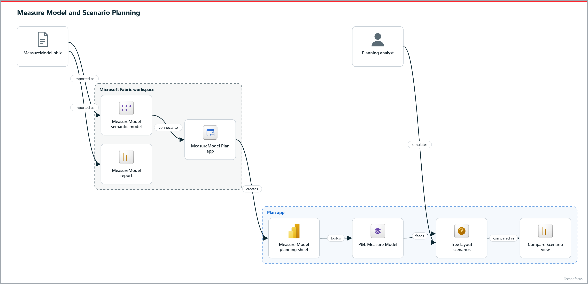

## Prerequisites

- Completion of Exercise 1 (E1), including the environment setup steps in E1 Part 1 and the semantic model connection created there.
- Access to the **MeasureModel.pbix** file, which you import instead of Acme_Beverages.pbix.
- Permissions to create a Plan app named +++MeasureModel+++ and a planning sheet named +++Measure Model+++ in the workspace.

> **Important:** The connection created in E1 is reused here to save time, so you do not need to create a new one. Although it was originally named after the Acme Beverages semantic model, a single connection can point to any semantic model in the workspace. In this step, you select a different semantic model through the same connection.

# Exercise 1: Measure Model and scenarios

In this exercise, you build a Measure Model that organizes native and formula measures into a P&L hierarchy, and then you create and compare two scenarios to see how revenue growth and cost restructuring affect **Net Profit**.

> **Note:** This exercise takes about 30 minutes.

## Task 1: Set up the environment for the Measure Model

In this task, you import the **MeasureModel** semantic model and create a new plan app. This exercise uses a different semantic model and plan app from E1 and E2, so you repeat the environment setup steps from E1 Part 1 with the files and names in this task.

1. In Microsoft Fabric, go to your workspace, for example **Fabricplan-Day1-66670356**.
2. Select **Import** > **Report, Paginated Report or Workbook** > **From this computer**.

   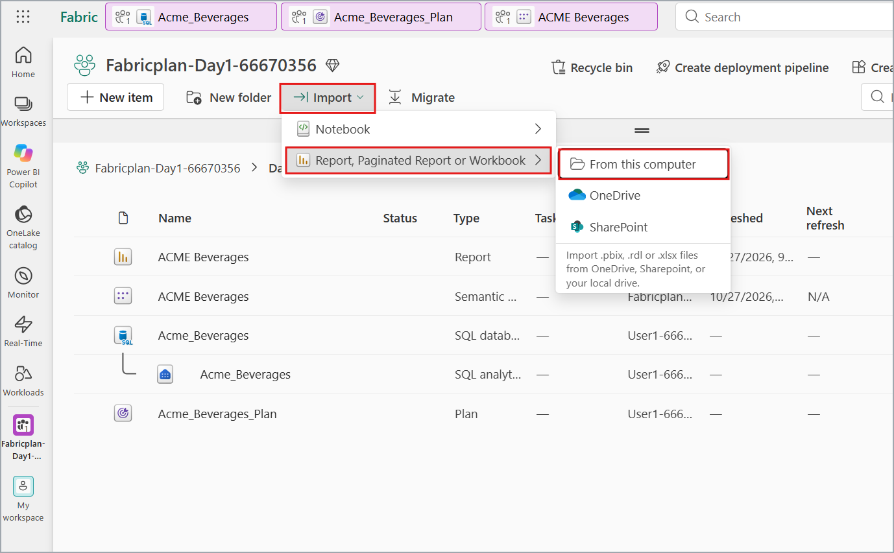

3. In the **Open** dialog box, go to the **Labfiles** folder.
4. Select **MeasureModel**, and then select **Open**:

   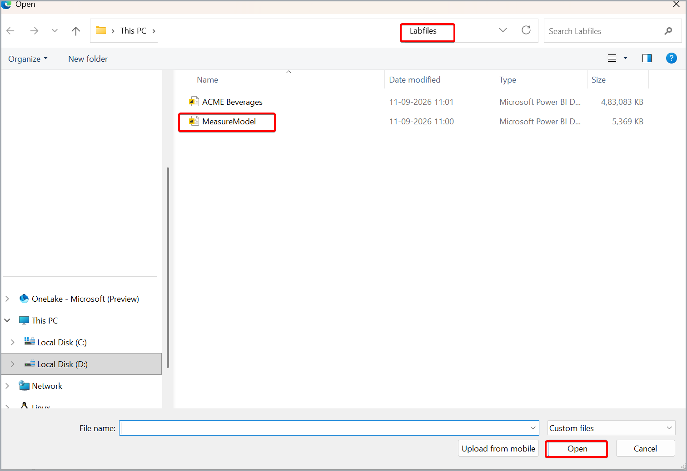

   The **MeasureModel** report and the **MeasureModel** semantic model appear in the workspace.

   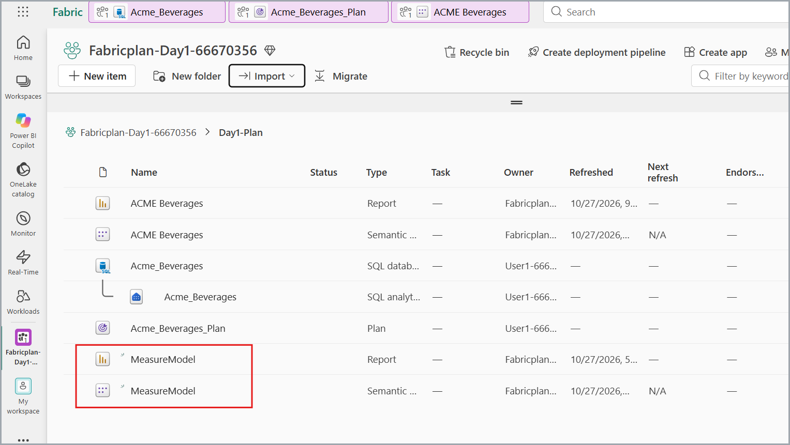

   > **Note:** Import **MeasureModel**, not **ACME Beverages**. This exercise uses a different semantic model from E1 and E2.

5. Select **New item** > **Plan**.

   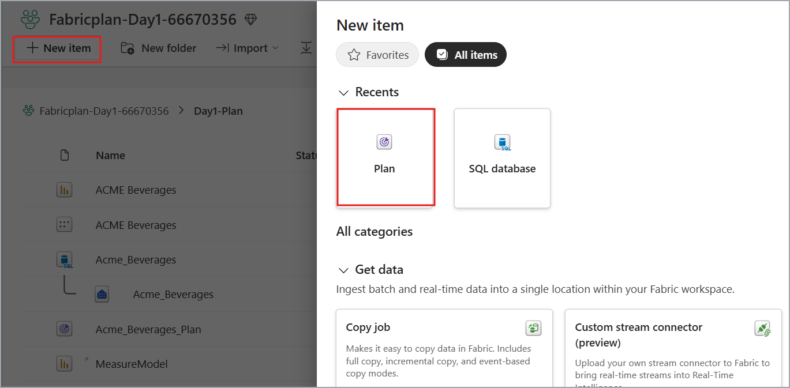

6. Enter +++MeasureModel+++ as the name of the new plan app, and then create the plan app.

   The **MeasureModel** plan app appears in the workspace.

7. In the **New Plan** dialog box, confirm that **Location** is set to **Fabricplan-Day1-66670356** > **Day1-Plan**, and then select **Create**.

   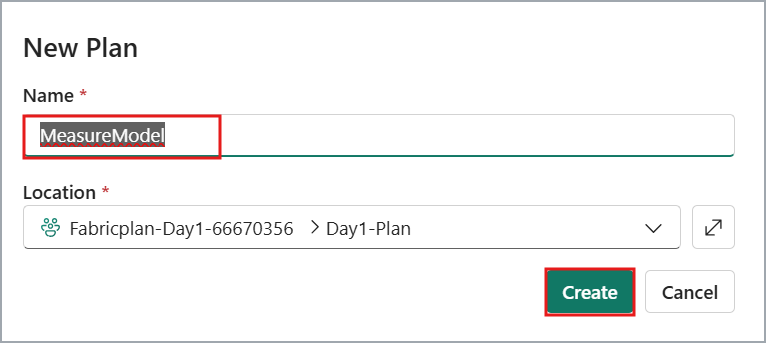

   The **MeasureModel** plan app opens on the **Home** tab.

8. Under **How Would You Like To Get Started?** > **Get data**, select **Semantic Model**.

   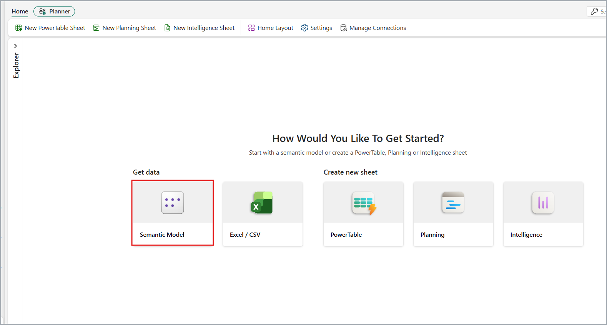

   The **Select Semantic Model Connection** dialog box opens.

9. In the **Select a Connection** list, select the connection that you created in E1. Its name starts with **Acme_Beverages**.

   > **Note:** You reuse the connection from E1 to save time, so you don't need to create a new one. The connection was named after the Acme Beverages semantic model, but one connection can point to any semantic model in the workspace. In this step, you select a different semantic model through the same connection.

10. Under **Select Semantic model From**, confirm that **Semantic Model Item** is selected.
11. In the **Semantic Model** box, enter +++MeasureModel+++, and then select **MeasureModel**.

   

12. Select **Connect**.

   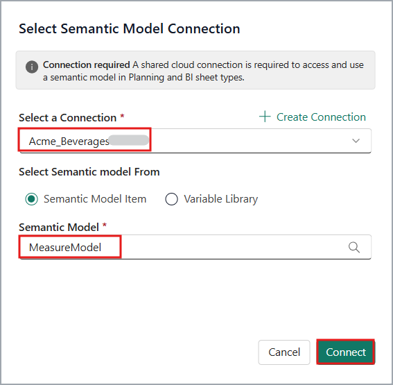

   The **MeasureModel** plan app connects to the **MeasureModel** semantic model.

13. On the **Home** tab, select **New Planning Sheet**.

   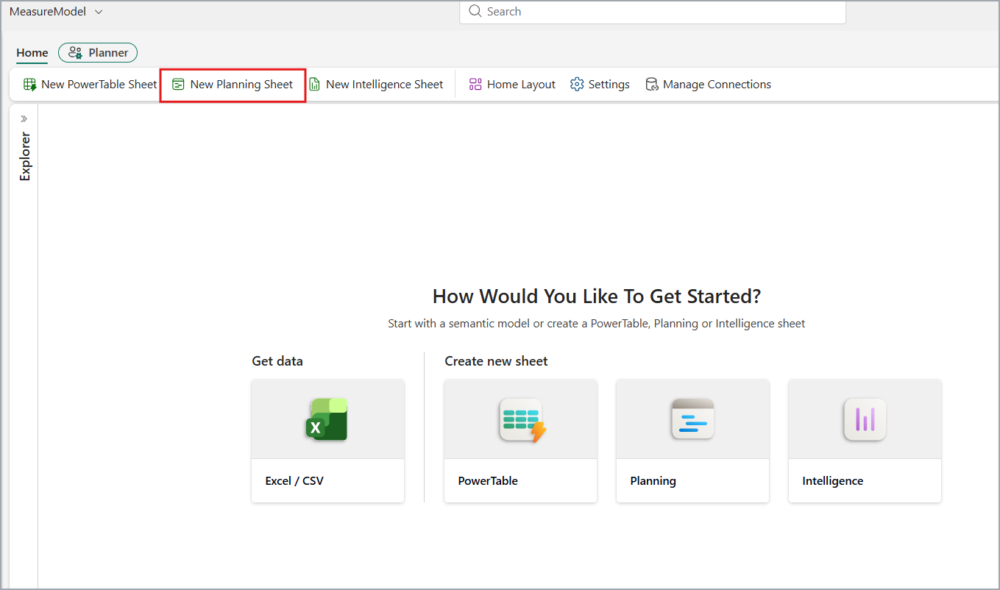

   The **New Planning Sheet** dialog box opens.

14. In the **Name** box, enter +++Measure Model+++, and then select **Create**.

   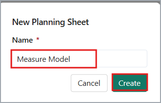

   The **Measure Model** planning sheet opens. The **Fields** and **Data** panes appear on the right side of the sheet.

15. In the **Data** pane, under **Semantic Model** > **Dim Regions**, select the **Region Name** check box.

   **Region Name** appears under **Rows** on the **Fields** pane > **Assign Data** tab.

16. In the **Data** pane, under **Semantic Model**, select the **Country Name** check box.

   **Country Name** appears under **Rows**, below **Region Name**.

17. In the **Data** pane, under **Semantic Model** > **Dim Date**, select the **Date Hierarchy** check box.

   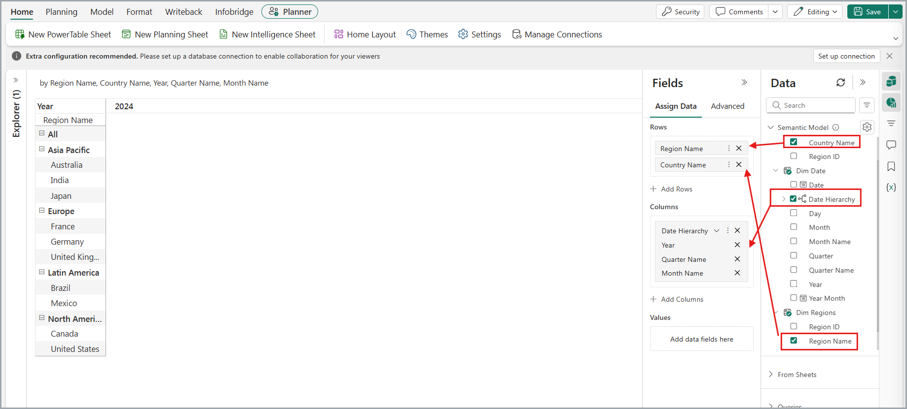

   **Date Hierarchy** appears under **Columns** with the **Year**, **Quarter Name**, and **Month Name** levels. The sheet shows the regions and countries in rows and **2024** in the column header.

   > **Note:** If **Date Hierarchy** appears under **Rows** instead of **Columns**, drag it to the **Columns** well.

18. In the **Data** pane, under **Semantic Model** > **Fact Transactions**, select the check box for each of the following measures:
   - **Admin Expenses**
   - **Avg Selling Price**
   - **Discounts and Returns**
   - **Employee Expenses**
   - **Labor Cost**
   - **Other Direct Exp**
   - **R&D**
   - **Raw Material Cost**
   - **Sales Volume**
   - The measure that starts with **Selling and Marketing Exp**

   The measures appear under **Values** with the **Sum of** prefix, for example **Sum of Admin Expenses**.

   > **Note:** Do not select **Country ID**, **Date**, **Invoice ID**, or **Region ID**. These fields are keys and dates, not measures.

19. On the **Fields** pane > **Assign Data** tab, under **Values**, double-click the **Sum of Admin Expenses** label.

   The label becomes editable.

20. Delete the **Sum of** prefix so that the label reads +++Admin Expenses+++, and then press **Enter**.

21. Repeat steps 19 and 20 for each remaining measure in the **Values** well to remove the **Sum of** prefix.

   Each label under **Values** shows only the measure name, for example **Labor Cost** and **Sales Volume**.

22. Under **Values**, select the three dots (**⋮**) next to **Avg Selling Price**, and then select **Average**.

   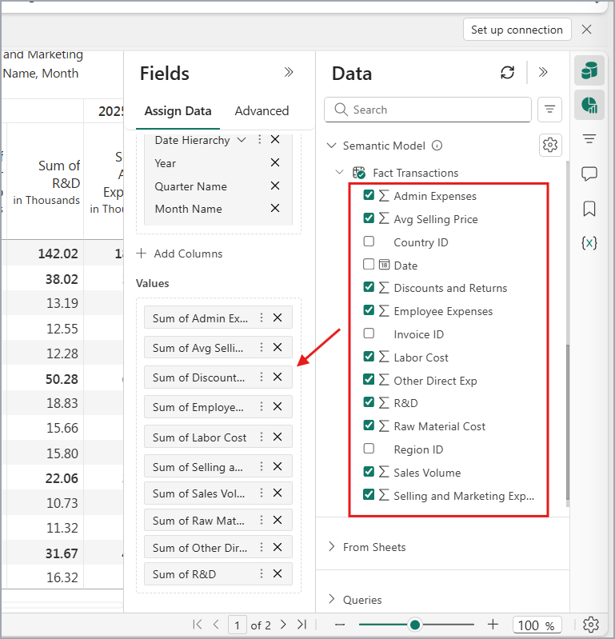

   **Avg Selling Price** now shows the average value instead of the sum. All other measures show sums.

23. On the **Fields** pane > **Assign Data** tab, review the **Values** well and confirm that it lists these ten measures without the **Sum of** prefix:
   - **Admin Expenses**
   - **Avg Selling Price**
   - **Employee Expenses**
   - **Labor Cost**
   - **Selling and Marketing Expenses**
   - **Sales Volume**
   - **Raw Material Cost**
   - **Other Direct Exp**
   - **R&D**
   - **Discounts and Returns**

   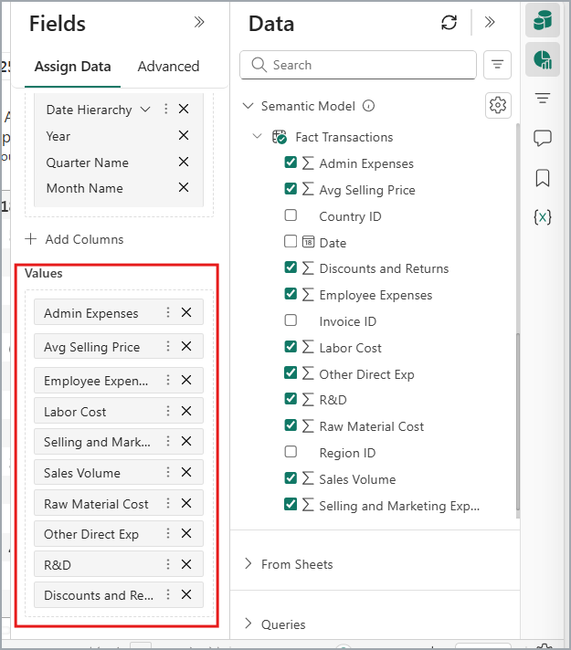

   On the **Data** pane under **Semantic Model** > **Fact Transactions**, the same ten measures have selected check boxes. **Country ID**, **Date**, **Invoice ID**, and **Region ID** stay cleared.

24. Under **Values**, select the three dots (**⋮**) next to **Avg Selling Price** to check its aggregation.

   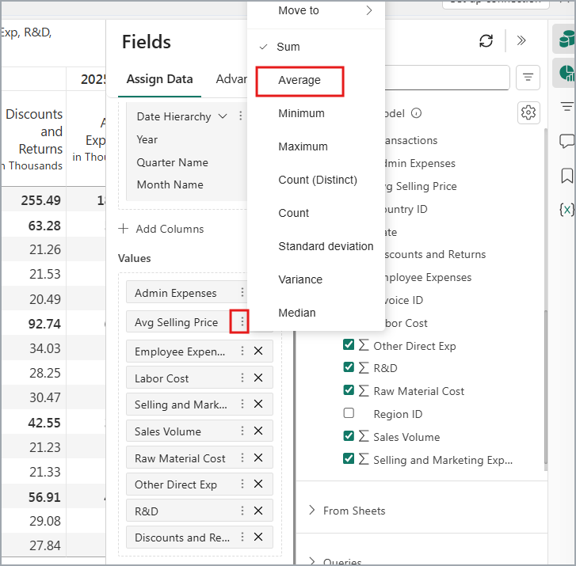

   The menu lists the aggregation options **Sum**, **Average**, **Minimum**, **Maximum**, **Count (Distinct)**, **Count**, **Standard deviation**, **Variance**, and **Median**.

25. If **Average** isn't the selected aggregation, select **Average**.

   **Avg Selling Price** uses the **Average** aggregation. All other measures use **Sum**.

26. Review the table to confirm that the data appears by region and country:
   - Rows - **All**, then **Asia Pacific**, **Europe**, **Latin America**, and **North America**, each expanded to its countries
   - Columns - **Year** **2024** and **2025**, with one column for each measure
   - Measure headers - **in Thousands** under each measure except **Avg Selling Price**

   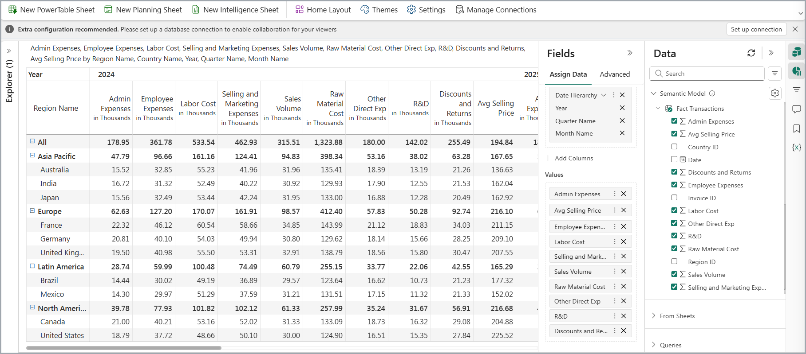

   The **All** row shows totals, for example **Admin Expenses** **178.95** and **Avg Selling Price** **194.84** for **2024**.

27. Compare your **Fields** pane with the final field assignment:
   - Columns - **Date Hierarchy** with **Year**, **Quarter Name**, and **Month Name**
   - Values - the ten measures from step 23

   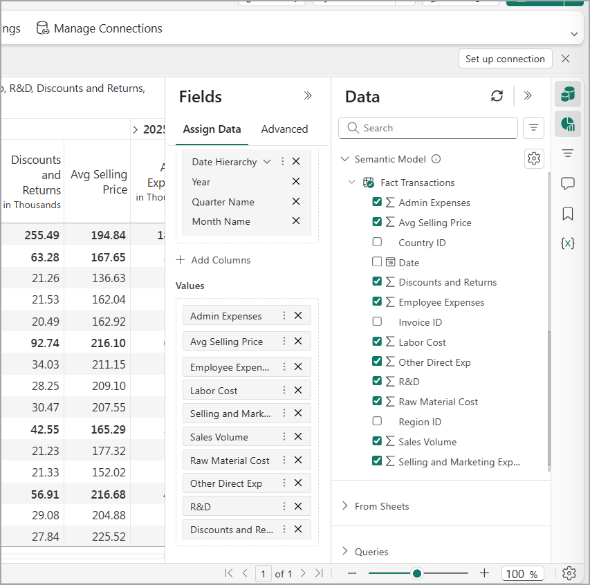

   Your field assignment matches the final configuration. The table is ready for the Measure Model.

# Exercise 2: Create the Measure Model

In this exercise, you build a P&L Measure Model that organizes native measures into a parent-child hierarchy by using formula measures.

## Task 1: Configure the Measure Model

In this task, you open the Measure Model canvas from the report. The canvas is where you turn the flat list of native measures into a structured P&L view.

1. On the ribbon, select **Model** > **Measure Model**.

   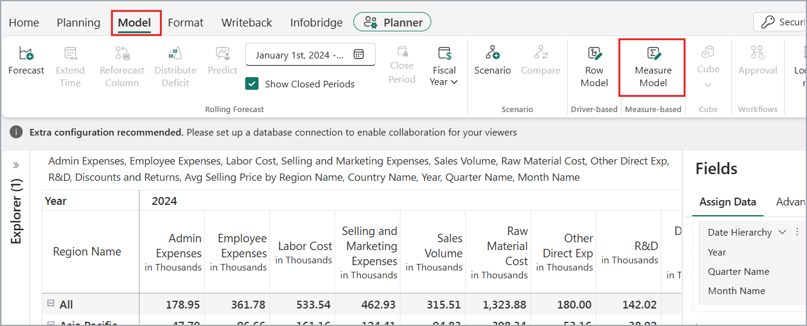

   The **Save changes to proceed** dialog opens with the message **You have unsaved changes. Please save them to continue.**

2. In the **Save changes to proceed** dialog, select **Save and continue**.

   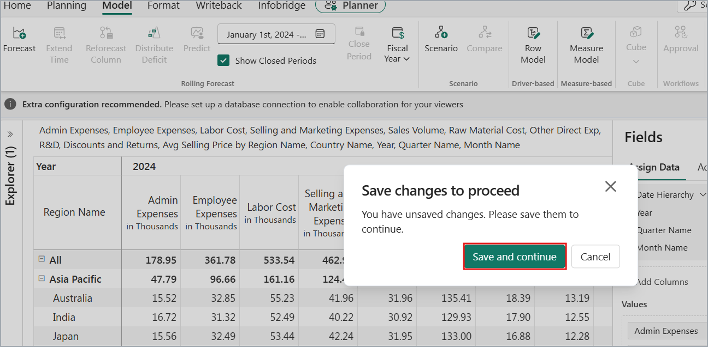

   The report is saved, and the **Measure Model** canvas opens.

3. Select **X** to close the **Report saved successfully!** notification.

   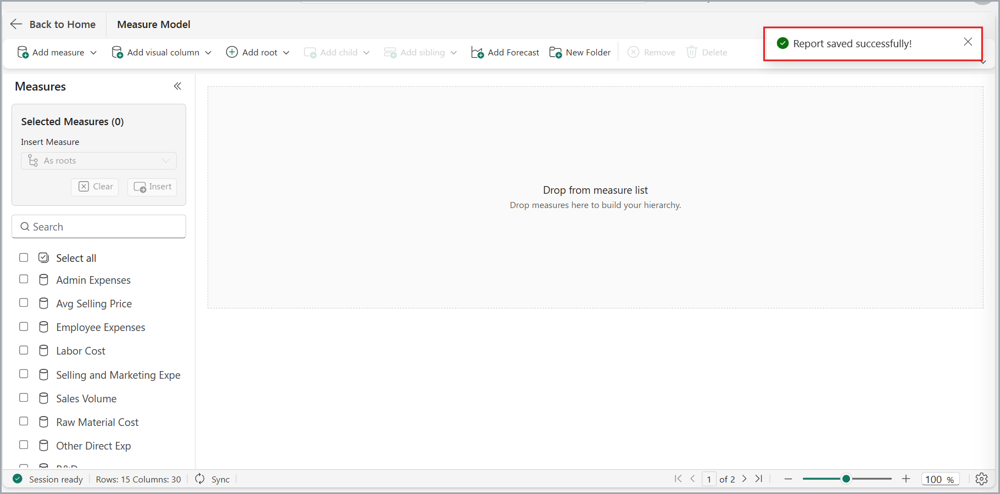

   The **Measure Model** canvas shows the following areas:
   - Toolbar - **Add measure**, **Add Forecast**, **New Folder**, **Remove**, and **Delete**
   - Measures pane - **Selected Measures (0)**, **Insert Measure** set to **As roots**, a **Search** box, and the list of measures
   - Canvas - the **Drop from measure list** area, where you drop measures to build your hierarchy

4. Review the **Measures** pane to confirm that it lists the measures from the report:
   - **Sales Volume**
   - **Avg Selling Price**
   - **Discounts and Returns**
   - **Raw Material Cost**
   - **Labor Cost**
   - **Other Direct Exp**
   - **Admin Expenses**
   - **Employee Expenses**
   - **R&D**
   - **Selling and Marketing Expenses**

   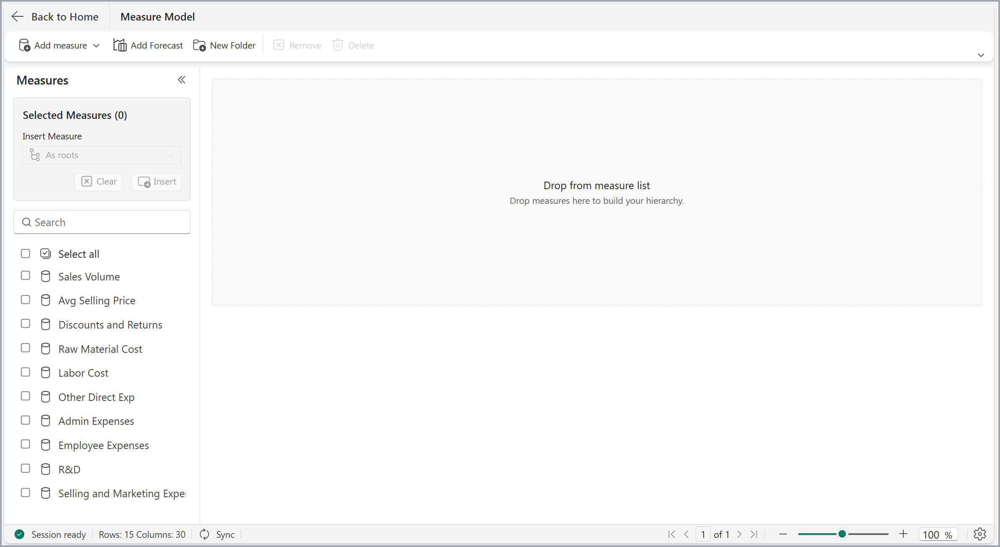

   The **Measure Model** canvas is empty and ready for you to build the P&L hierarchy. The status bar shows **Session ready**.

   > **Note:** The order of measures in the **Measures** pane and the buttons on the toolbar can differ from what you see here. Use the **Search** box to find a measure by name.

5. Build the P&L hierarchy, starting with the **Gross Revenue** formula measure. In the **Measures** pane, drag **Sales Volume** onto the **Drop from measure list** area of the canvas.

   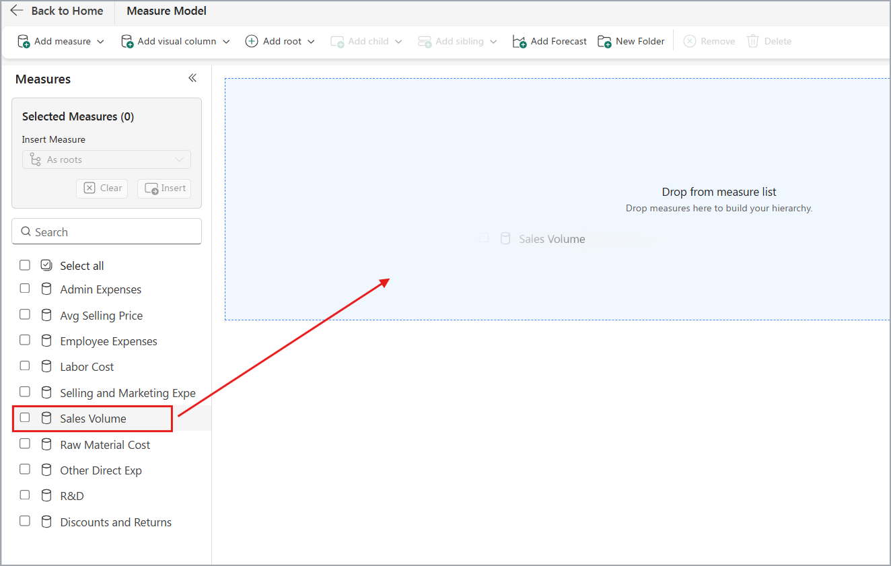

   **Sales Volume** appears on the canvas with **Type** set to **Native**, **Configuration** set to **Default**, and **Aggregation** set to **Sum**.

6. In the **Measures** pane, drag **Avg Selling Price** onto the **Drop from measure list** area below **Sales Volume**.

   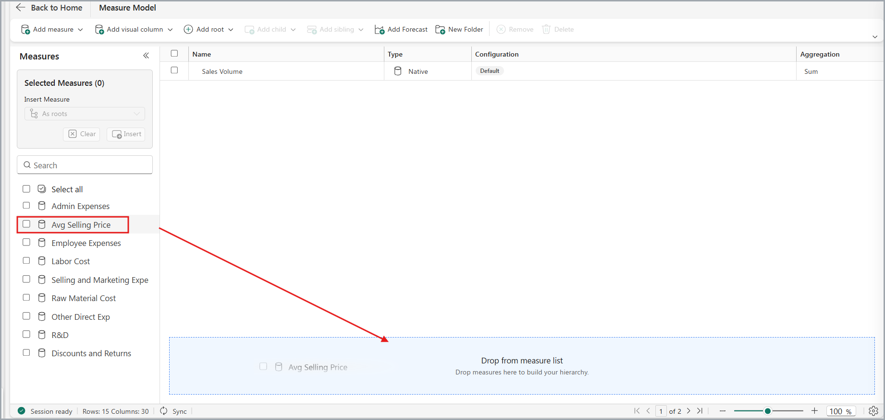

   **Avg Selling Price** appears on the canvas as a second **Native** measure, below **Sales Volume**.

   > **Note:** You can also add measures without dragging. Select the check box next to a measure in the **Measures** pane, and then select **Insert**. The **Insert Measure** setting **As roots** adds the measure at the top level of the hierarchy.

7. On the toolbar, select **Add measure** > **Formula**.

   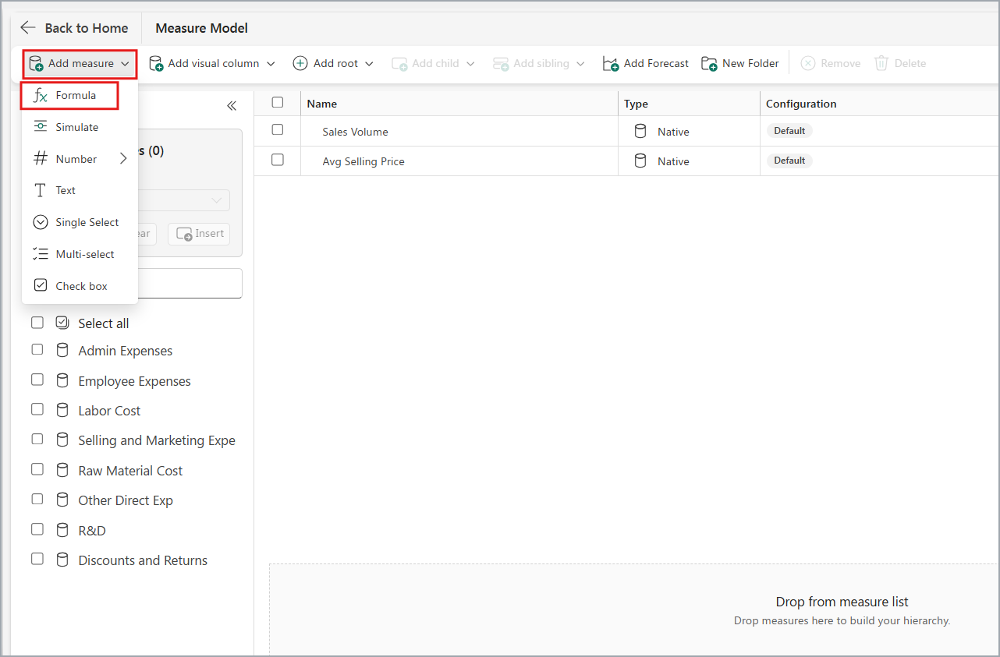

   The **Formula Measure** pane opens.

8. In the **Formula Measure** pane, enter the following details, and then select **Create**:
   - Title - +++Gross Revenue+++
   - Insert as - **Visual Measure**
   - Data type - **Number**
   - Formula - +++[Sales Volume]*[Avg Selling Price]+++
   - Column aggregation type - **Sum**
   - Row aggregation type - **Formula**

   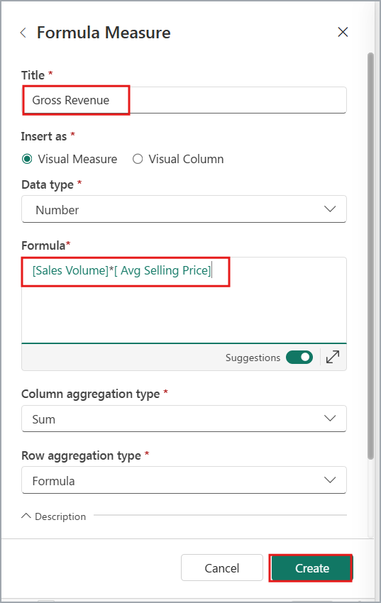

   The **Formula Measure** pane closes, and **Gross Revenue** is added to the **Measure Model** canvas.

   > **Note:** When **Suggestions** is turned on, the **Formula** box lists matching measure names as you enter text. Make sure each measure name in the formula matches the name in the **Measures** pane exactly.

9. Verify that the **Measure created successfully** message appears at the top of the **Formula Measure** pane.

   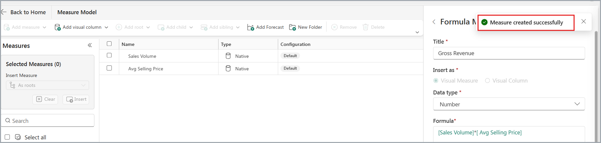

   The message confirms that **Gross Revenue** is saved as a formula measure.

10. In the **Measures** pane, verify that **Gross Revenue** appears at the bottom of the list with the formula (**fx**) icon.

   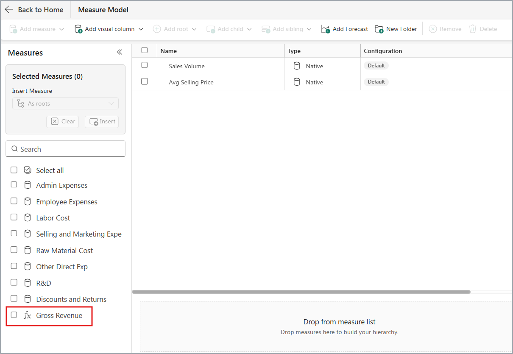

   **Gross Revenue** is now available to add to the hierarchy.

11. Drag **Gross Revenue** from the **Measures** pane to the **Drop from measure list** area on the canvas.

   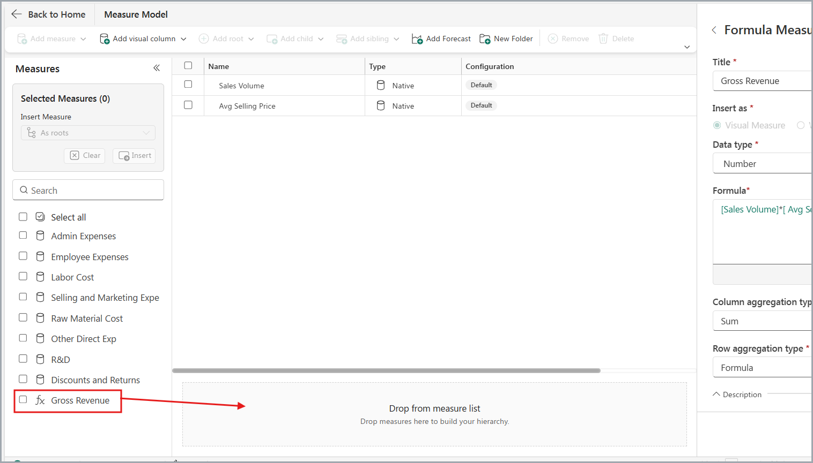

   **Gross Revenue** appears on the canvas with the **Formula** type.

12. Drag **Sales Volume** onto the **Gross Revenue** row.

   **Sales Volume** snaps into place as a child of **Gross Revenue**.

13. Drag **Avg Selling Price** onto the **Gross Revenue** row.

   **Avg Selling Price** snaps into place as a child of **Gross Revenue**.

14. On the canvas, verify that **Gross Revenue** is the parent of **Avg Selling Price** and **Sales Volume**.

   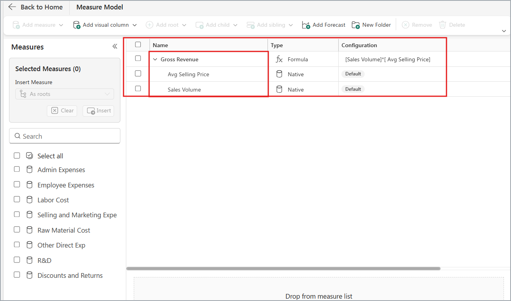

   The **Type** column shows **Formula** for **Gross Revenue** and **Native** for both child measures. The **Configuration** column for **Gross Revenue** shows **[Sales Volume]*[ Avg Selling Price]**.

   > **Note:** When you drop a measure on another measure's row, the dropped measure becomes a child of that measure. If a measure lands at the wrong level, drag it again onto the correct parent row.

> **Note:** If a measure is placed under the wrong parent, select the remove icon next to it on the canvas to unstage it from its current position. This action doesn't delete the measure. After you unstage the measure, drag it again onto the correct parent row.

15. Drag **Discounts and Returns** from the **Measures** pane to the **Drop from measure list** area on the canvas.

   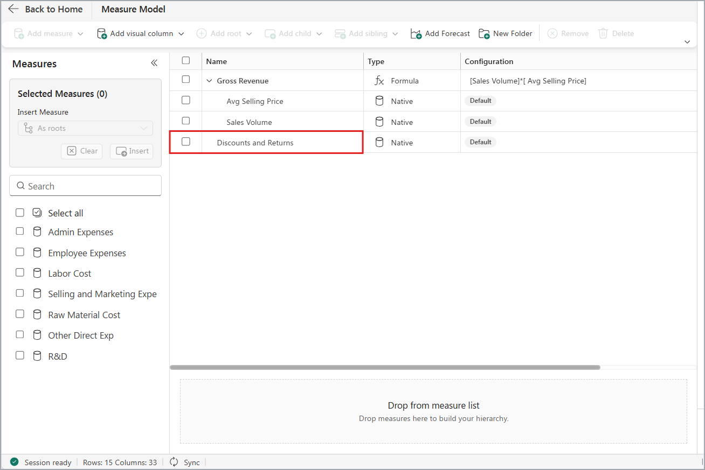

   **Discounts and Returns** appears on the canvas at the root level with the **Native** type.

16. On the toolbar, select **Add measure** > **Formula**.

   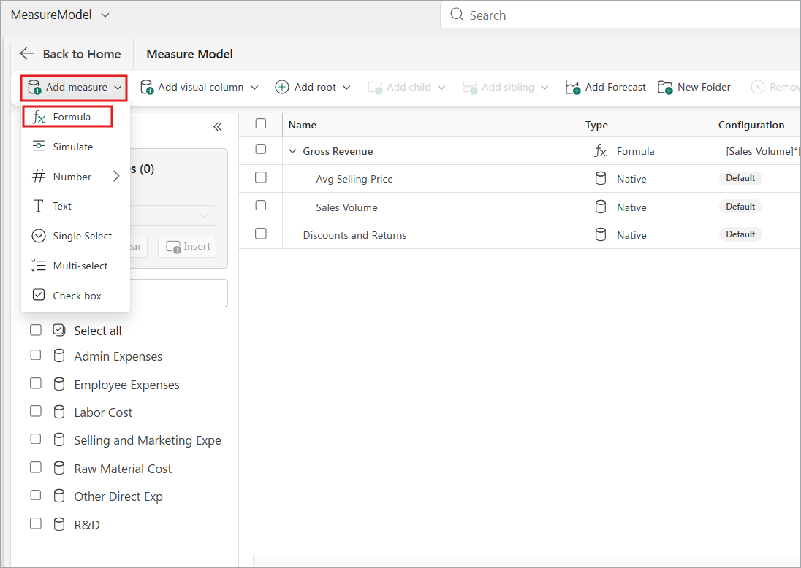

   The **Formula Measure** pane opens.

17. In the **Formula Measure** pane, enter the following details:
   - Title - +++Net Revenue+++
   - Insert as - **Visual Measure**
   - Data type - **Number**
   - Formula - +++[Gross Revenue]-[Discounts and Returns]+++
   - Column aggregation type - **Sum**
   - Row aggregation type - **Formula**

   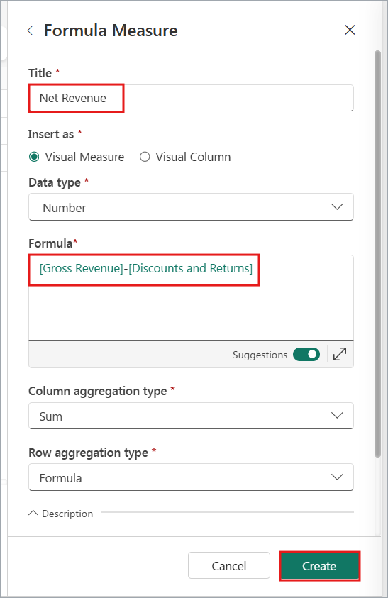

18. Select **Create**.

   The **Measure created successfully** message appears.

19. In the **Measures** pane, verify that **Net Revenue** appears at the bottom of the list with the formula (**fx**) icon.

   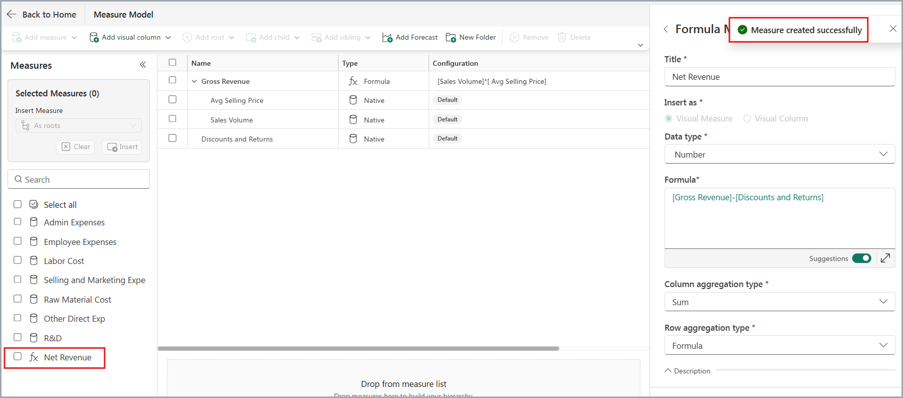

   **Net Revenue** is now available to add to the hierarchy.

20. Drag **Net Revenue** from the **Measures** pane to the **Drop from measure list** area on the canvas.

   **Net Revenue** appears on the canvas at the root level with the **Formula** type.

21. On the canvas, drag **Gross Revenue** onto the **Net Revenue** row.

22. On the canvas, drag **Discounts and Returns** onto the **Net Revenue** row.

   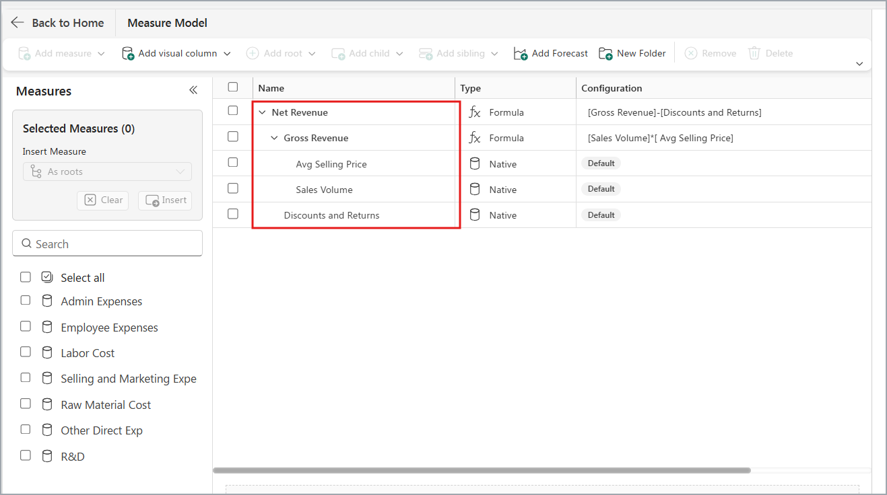

   **Net Revenue** becomes the parent of **Gross Revenue** and **Discounts and Returns**. **Gross Revenue** keeps **Avg Selling Price** and **Sales Volume** as its children.

23. On the toolbar, select **Add measure** > **Formula**.

   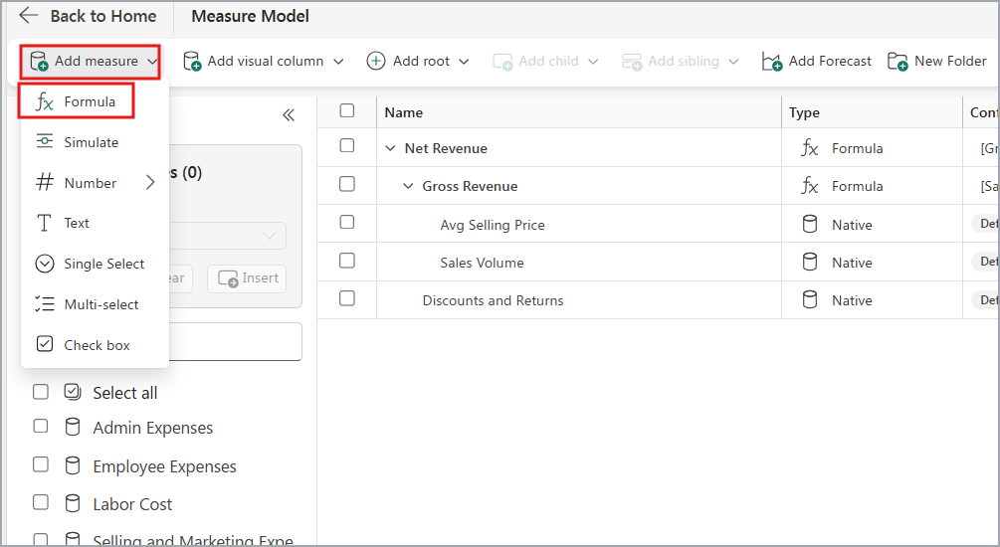

   The **Formula Measure** pane opens.

24. In the **Formula Measure** pane, enter the following details:
   - Title - +++COGS+++
   - Insert as - **Visual Measure**
   - Data type - **Number**
   - Formula - +++[Raw Material Cost]+[Labor Cost]+[Other Direct Exp]+++
   - Column aggregation type - **Sum**
   - Row aggregation type - **Formula**

   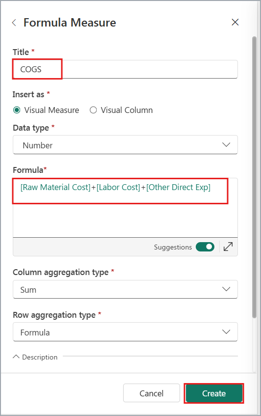

25. Select **Create**.

   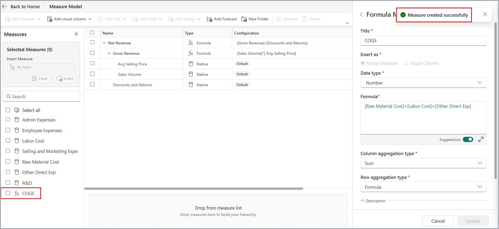

   The **Measure created successfully** message appears. **COGS** appears at the bottom of the **Measures** pane with the formula (**fx**) icon.

26. Drag **COGS** from the **Measures** pane to the **Drop from measure list** area on the canvas.

   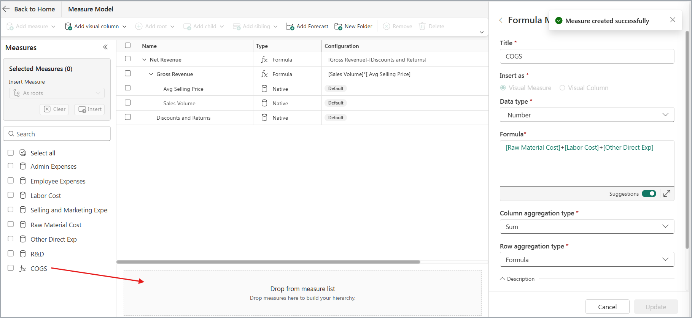

   **COGS** appears on the canvas at the root level with the **Formula** type.

27. In the **Measures** pane, select the checkboxes for **Labor Cost**, **Raw Material Cost**, and **Other Direct Exp**.

   The **Selected Measures** box shows **Selected Measures (3)**.

28. In the **Selected Measures** box, select the **Insert Measure** dropdown, and then select **COGS**.

29. Select **Insert**.

   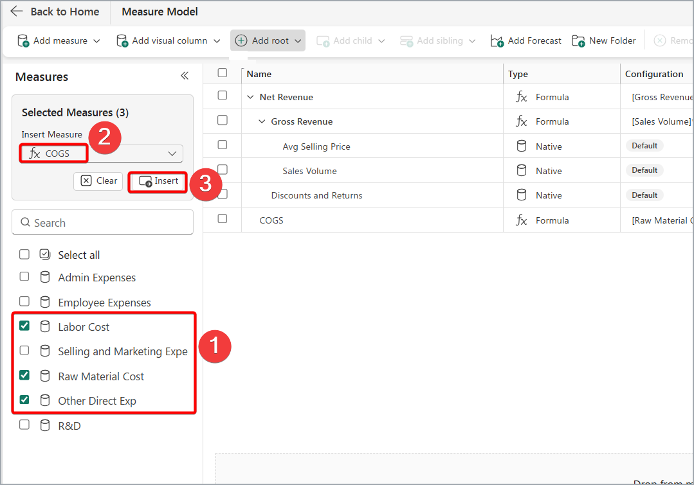

   **COGS** becomes the parent of **Other Direct Exp**, **Raw Material Cost**, and **Labor Cost**. The three measures appear under **COGS** with the **Native** type.

   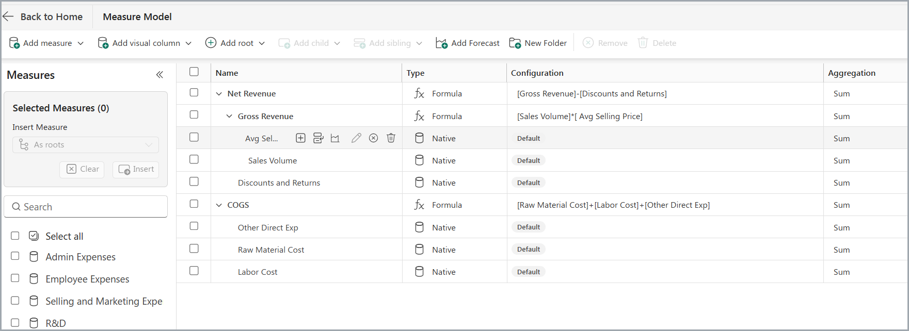

30. On the toolbar, select **Add measure** > **Formula**.

   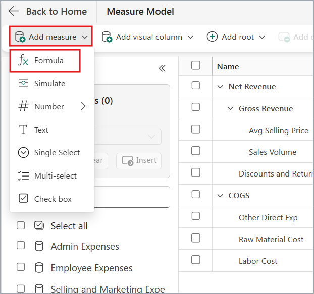

   The **Formula Measure** pane opens.

31. In the **Formula Measure** pane, enter the following details, and keep the default values for the other fields:
   - Title - +++Gross Profit+++
   - Formula - +++[Net Revenue]-[COGS]+++

   > **Note:** Use a standard hyphen (-) as the minus sign in the formula. Measure names in the formula must match the names in the **Measures** pane.

32. Select **Create**.

   The **Measure created successfully** message appears. **Gross Profit** appears in the **Measures** pane with the formula (**fx**) icon.

33. Drag **Gross Profit** from the **Measures** pane to the **Drop from measure list** area on the canvas.

   **Gross Profit** appears on the canvas at the root level with the **Formula** type.

34. On the canvas, drag **Net Revenue** onto the **Gross Profit** row.

35. On the canvas, drag **COGS** onto the **Gross Profit** row.

   **Gross Profit** becomes the parent of **Net Revenue** and **COGS**. **Net Revenue** and **COGS** keep their own child measures.

36. Verify that the **Gross Profit** formula measure uses the following settings:
   - Title - **Gross Profit**
   - Insert as - **Visual Measure**
   - Data type - **Number**
   - Formula - **[Net Revenue]-[COGS]**
   - Column aggregation type - **Sum**

   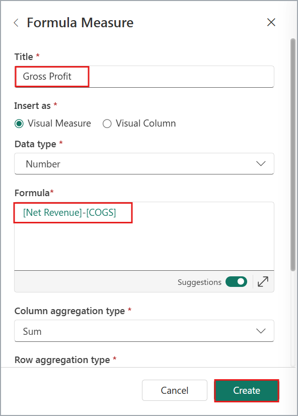

37. Verify that **Gross Profit** appears in the **Measures** pane below **R&D**, with the formula (**fx**) icon.

   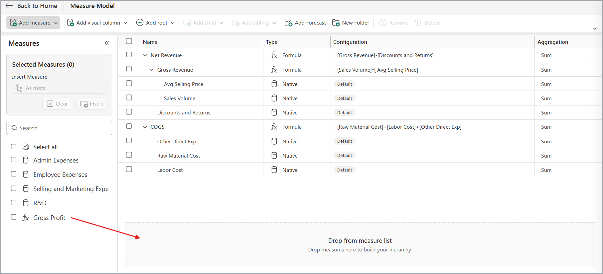

   You drag this measure to the **Drop from measure list** area to add it to the hierarchy.

38. Verify that the canvas shows the following hierarchy:
   - **Gross Profit** at the root level, with the configuration **[Net Revenue]-[COGS]**
   - **Net Revenue** under **Gross Profit**, with **Gross Revenue** and **Discounts and Returns** as children
   - **Gross Revenue** with **Avg Selling Price** and **Sales Volume** as children
   - **COGS** under **Gross Profit**, with **Other Direct Exp**, **Raw Material Cost**, and **Labor Cost** as children

   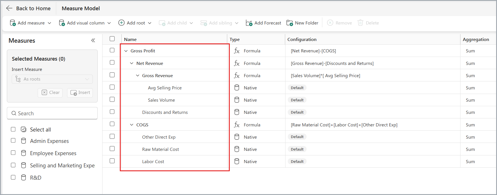

   **Gross Profit** no longer appears in the **Measures** pane because it is now part of the hierarchy.

39. On the toolbar, select **Add measure** > **Formula**.

   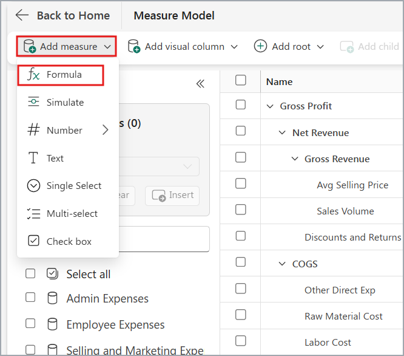

   The **Formula Measure** pane opens.

40. In the **Formula Measure** pane, enter the following details, and keep the default values for the other fields:
   - Title - +++Operating Expenses+++
   - Formula - +++[Admin Expenses]+[Employee Expenses]+[R&D]+[Selling and Marketing Expenses]+++

   > **Note:** The **Measures** pane might truncate the name **Selling and Marketing Expenses**. Enter the full measure name in the formula.

41. Select **Create**.

   The **Measure created successfully** message appears. **Operating Expenses** appears in the **Measures** pane with the formula (**fx**) icon.

42. Drag **Operating Expenses** from the **Measures** pane to the **Drop from measure list** area on the canvas.

   **Operating Expenses** appears on the canvas at the root level with the **Formula** type.

43. Confirm that the **Operating Expenses** formula measure uses the following settings:
   - Insert as - **Visual Measure**
   - Data type - **Number**
   - Column aggregation type - **Sum**

   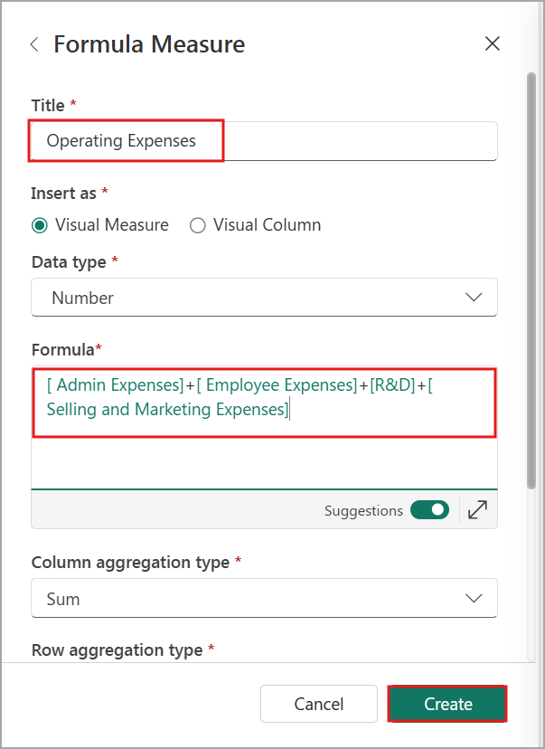

44. On the canvas, confirm that **Operating Expenses** appears below **Labor Cost** at the root level, with the type **Formula** and the aggregation **Sum**.

   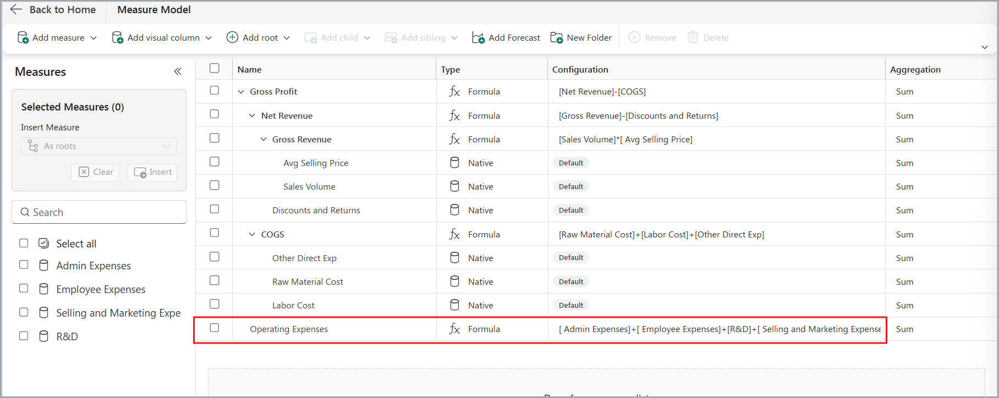

   The **Configuration** column shows the **Operating Expenses** formula. The four expense measures are still in the **Measures** pane.

45. In the **Measures** pane, select the **Select all** check box.

   **Admin Expenses**, **Employee Expenses**, **Selling and Marketing Expenses**, and **R&D** are selected, and **Selected Measures (4)** appears.

46. In the **Insert Measure** list, select **Operating Expenses**.

47. Select **Insert**.

   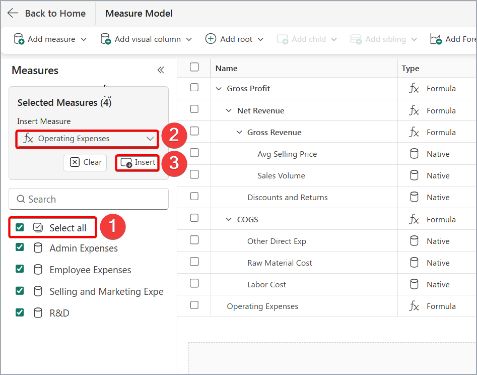

   The four expense measures are inserted under **Operating Expenses**.

48. On the canvas, expand **Operating Expenses** and verify that it is the parent of **Admin Expenses**, **Employee Expenses**, **Selling and Marketing Expenses**, and **R&D**.

   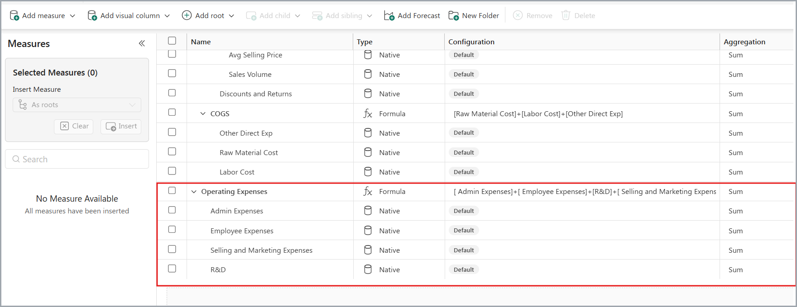

   Each child measure appears with the **Native** type and the **Sum** aggregation. The **Measures** pane shows **No Measure Available** because all measures are inserted.

49. On the **Measure Model** toolbar, select **Add measure** > **Formula**.

   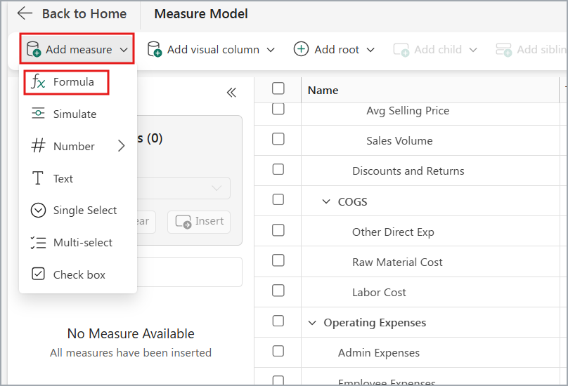

   The **Formula Measure** pane opens.

50. In the **Formula Measure** pane, enter the following details:
   - Title - +++Net Profit+++
   - Insert as - **Visual Measure**
   - Data type - **Number**
   - Formula - +++[Gross Profit]-[Operating Expenses]+++
   - Column aggregation type - **Sum**

51. Select **Create**.

   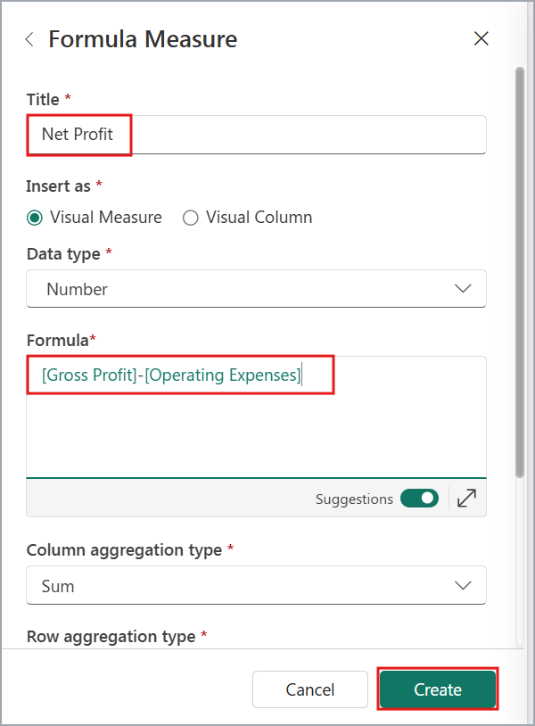

   **Net Profit** appears in the **Measures** pane.

52. In the **Measures** pane, drag **Net Profit** to the **Drop from measure list** area at the bottom of the canvas.

   

   **Net Profit** appears on the canvas at the root level, with the type **Formula**.

53. On the canvas, drag **Gross Profit** onto **Net Profit**.

   **Gross Profit** and its child measures move under **Net Profit**.

54. On the canvas, drag **Operating Expenses** onto **Net Profit**.

   **Operating Expenses** and its child measures move under **Net Profit**.

55. On the canvas, expand **Net Profit** and verify that it is the parent of **Gross Profit** and **Operating Expenses**.

   

   The **Configuration** column for **Net Profit** shows **[Gross Profit]-[Operating Expenses]**, and the aggregation is **Sum**. The P&L Measure Model is now complete, with **Net Profit** at the top of the hierarchy.

## Task 2: View the Measure Model

In this task, you return to the report and display the measures in rows. This shows the P&L hierarchy that you built in place of the flat list of measures.

1. In the Measure Model editor, select **Back to Home**.

   

   The report opens with the **Planning** tab on the ribbon.

2. On the **Planning** tab, select **Layout** > **Measures** > **In Rows**.

   

   The measures move from the columns to the rows of the visual.

3. In the visual, review the measure hierarchy for the years **2024**, **2025**, and **2026**.

   

   The visual shows a structured P&L view. **Net Profit** is at the top, with **Gross Profit**, **Net Revenue**, **Gross Revenue**, and **COGS** and their native measures below it. This view replaces the flat list of measures from the setup step.

# Exercise 3: Create and compare scenarios

In this exercise, you create a revenue growth scenario for Germany and a cost restructuring scenario for the United States, and then compare their impact on **Net Profit** side by side.

## Task 1: Create the Best Case scenario

In this task, you switch the visual to the Tree layout and prepare the Best Case scenario. The Tree layout shows each region and country with the full measure hierarchy, so you can simulate changes at the country level.

1. On the **Planning** tab, select **Layout** > **Tree**.

   

   The P&L model displays in a tree view. It breaks down from the grand total through region and country, with the measure hierarchy at each level.

2. Review the cards in the tree. Each card shows a header KPI, **Admin Expenses**, above the **Net Profit**, **Gross Profit**, and **Net Revenue** measures.

   

3. On the **Tree View** tab, in the **Display** group, select **Display**.

   The **Display Settings** pane opens.

4. In the **Display Settings** pane, under **Header KPI**, set **Show Header KPI** to **Off**.

   

   The **Admin Expenses** header KPI no longer appears on the cards. Each card now shows only the region or country name and the measure hierarchy.

5. Select **X** to close the **Display Settings** pane.

6. On the **Tree View** tab, in the **Scenario** group, select **Create scenario**.

   The **Create Scenario** dialog box opens.

7. In the **Create Scenario** dialog box, enter the following details:
   - Scenario name - +++Best Case+++
   - Include series in scenarios - Confirm that all measures from the semantic model are included, for example **Admin Expenses**, **Avg Selling Price**, **Employee Expenses**, **Labor Cost**, **Selling and Marketing Expenses**, **Sales Volume**, and **Raw Material Cost**.

   

8. Select **Create**.

   The **Best Case** scenario is created. The scenario selector at the bottom of the visual shows **Best Case**.

9. In the tree, under the **Europe** region, select the **Germany** card.

   

   The **Germany** simulation pane opens with the path **All** > **Europe** > **Germany**. Under **Simulation Filters**, **Region Name** is set to **Europe** and **Country Name** is set to **Germany**. The **Measure simulation** section lists the measure hierarchy, starting with **Net Profit**.

10. In the **Germany** simulation pane, under **Measure simulation**, confirm that **Percentage** is selected.

11. Under **Measure simulation**, expand **Gross Revenue**.

    The **Avg Selling Price**, **Sales Volume**, and **Discounts and Returns** input measures appear, each with a slider and a value box.

12. In the **Avg Selling Price** box, enter the following value:

    +++5+++

    The box shows **+5%**.

13. In the **Sales Volume** box, enter the following value:

    +++2+++

    The box shows **+2%**.

14. In the **Discounts and Returns** box, enter the following value:

    +++-5+++

    The box shows **-5%**, and the **Simulations updated successfully** message appears.

    

15. In the tree, verify that the **Germany** card updates in real time.

    The **Germany** card shows **Net Profit** at **739.11k** (**↑20%**), **Gross Profit** at **1.12m** (**↑13%**), and **Net Revenue** at **1.74m** (**↑8%**). The **Europe** and **All** cards also update to show the upward change.

    

16. Select **X** to close the **Germany** simulation pane.

## Task 2: Create the Cost Restructuring scenario

In this task, you create a second scenario named **Cost Restructuring** and change cost inputs for the United States. You compare this cost-focused strategy with the revenue growth strategy in the **Best Case** scenario later in the lab.

1. On the **Tree View** tab, in the **Scenario** group, select **Create scenario**.

   The **Create Scenario** dialog box opens.

2. In the **Create Scenario** dialog box, enter the following details:
   - Scenario name - +++Cost Restructuring+++
   - Include series in scenarios - Confirm that all measures in the model are included, for example **Admin Expenses**, **Avg Selling Price**, **Employee Expenses**, **Labor Cost**, **Selling and Marketing Expenses**, **Sales Volume**, and **Raw Material Cost**.

3. Select **Create**.

   

   The **Cost Restructuring** scenario is created.

4. At the bottom left of the visual, confirm that the scenario selector shows **Cost Restructuring**.

5. In the tree, under the **North America** region, select the **United States** card.

   The **United States** simulation pane opens with the path **All** > **North America** > **United States**.

6. In the **Measure simulation** section, select **Value**.

   The input measures now show absolute values instead of percentages.

7. Scroll down to the **COGS** and **Operating Expenses** sections.

8. Under **COGS**, in the **Raw Material Cost** box, enter the following value:

   +++400000+++

9. Under **COGS**, in the **Labor Cost** box, enter the following value:

   +++125000+++

10. Under **Operating Expenses**, in the **Employee Expenses** box, enter the following value:

    +++120000+++

11. Under **Operating Expenses**, in the **Selling and Marketing Expenses** box, enter the following value:

    +++160000+++

    

    The **United States** card updates. It shows **Net Profit** at **622.89k** (**↓3%**) and **Gross Profit** at **1.01m** (**↓1%**).

12. In the **United States** card, select the down arrow at the bottom right to expand the card.

    The **United States** card expands and shows the full P&L hierarchy.

13. In the **North America** card, select the down arrow at the bottom right to expand the card.

    

    Both cards update in real time. The restructured cost inputs flow through **COGS**, **Operating Expenses**, **Gross Profit**, and **Net Profit**. For example, the **United States** card shows **Raw Material Cost** at **400.00k** (**↑8%**), **Labor Cost** at **125.00k** (**↓16%**), and **Operating Expenses** at **384.65k** (**↑4%**).

## Task 3: Compare the two scenarios

In this task, you compare the **Best Case** scenario with the **Cost Restructuring** scenario. The comparison shows both scenarios side by side at every level of the hierarchy, so you can evaluate a revenue growth approach against a cost restructuring approach.

1. On the ribbon, select the **Tree View** tab.

2. Select the **Quick format** dropdown, and then select **Auto**.

   

   The values in the visual are now formatted cell by cell.

3. In the **Scenario** group, select **Compare scenario**.

   

   The **Scenario Comparison** page opens.

4. In the **Scenarios** group, enter the following details:
   - Compare - **Best Case**
   - With - **Cost Restructuring**

   

   The comparison table shows a **Best Case** column, a **Cost Restructuring** column, and a **Δ Cost Restructuring** variance column for each measure. The table shows these columns for each region and country.

5. Review the **Δ Cost Restructuring** variance columns for the **North America** and **United States** rows.

   The variance columns show the difference between the two scenarios at every level of the hierarchy. For example, for **United States**, **Labor Cost** is **2.71k** in **Best Case** and **2.27k** in **Cost Restructuring**.

6. In the **Close** group, select **Exit Compare**.

   

   The **Scenario Comparison** page closes, and the standard view of the Measure Model opens.

## Summary

In this lab, you:

- Connected the **MeasureModel** semantic model to a new Plan app by following the setup flow in Exercise 1.
- Created a Measure Model planning sheet and assigned all **Fact Transactions** measures to **Values**.
- Configured the Measure Model with six formula measures: **Gross Revenue**, **Net Revenue**, **COGS**, **Gross Profit**, **Operating Expenses**, and **Net Profit**.
- Organized the measures into a parent-child P&L hierarchy.
- Visualized the P&L hierarchy in the **Measures in Rows** layout.
- Created the **Best Case** scenario to simulate revenue growth in **Germany**. **Net Profit** updated in real time across **Germany**, **Europe**, and **All**.
- Created the **Cost Restructuring** scenario to restructure the cost inputs for **United States**. The full P&L cascade updated in real time across **North America** and **All**.
- Compared both scenarios side by side to see the impact of revenue growth and cost restructuring at every level of the hierarchy.

## Summary

In this lab, you connected the MeasureModel semantic model to a new Plan app by following the E1 Part 1 setup flow, and you created a Measure Model planning sheet with all Fact Transactions measures assigned to Values. You configured the Measure Model by creating six formula measures (Gross Revenue, Net Revenue, COGS, Gross Profit, Operating Expenses, and Net Profit) and organizing them into a parent-child P&L hierarchy, which you then viewed in the Measures in Rows layout. You created a Best Case scenario that simulated revenue growth in Germany, with Net Profit updating in real time across Germany, Europe, and All. You also created a Cost Restructuring scenario that restructured United States cost inputs, with the full P&L cascade updating in real time across North America and All. Finally, you compared both scenarios side by side to see the impact of revenue growth versus cost restructuring at every level of the hierarchy.
